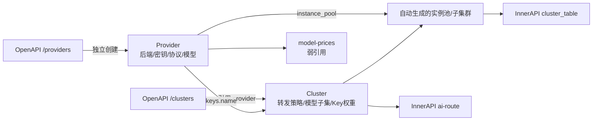
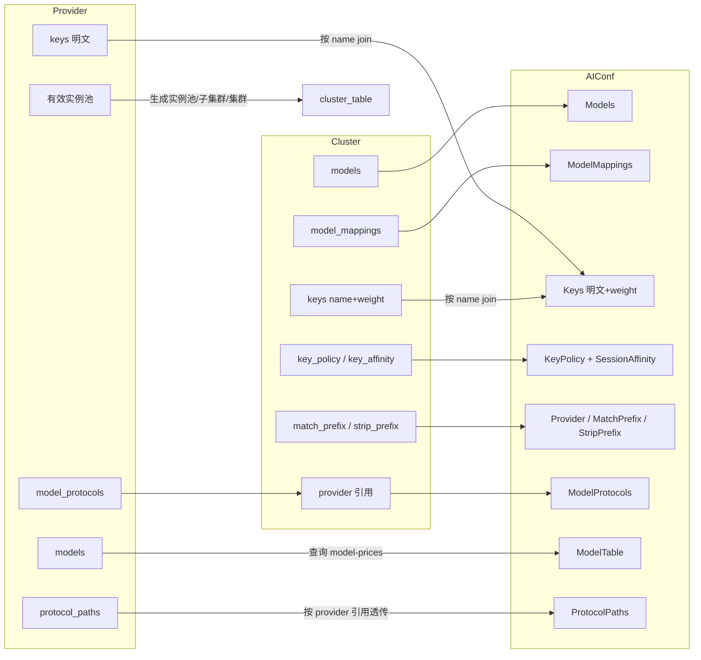

# 第十章 Provider 与 Cluster 设计

## 本章目标

在壬远 AI 网关（Rainway AI Gateway）的控制面（Control Plane）中，模型提供方（Provider）与转发集群（Cluster）曾经是同一个 `/clusters` 资源的两面。本章将解释为什么要把这两个概念拆分开来，以及拆分后各自承担什么职责。阅读完本章，你将能够：

- 理解 Provider 与 Cluster 的数据模型和字段含义。
- 理解二者解耦的设计动机、实现方式和带来的收益。
- 掌握控制面如何根据 Provider + Cluster 生成 BFE 数据面所需的 `AIConf`。
- 了解模型发现、Key 引用与权重、Key Policy、Key Affinity 等关键机制。
- 了解 `protocol_paths` 协议路径改写的语义、校验规则与数据面执行方式。
- 了解 `llm_config.normalize_upstream_error` 上游错误归一化的配置语义与默认值约定。
- 了解 K8s 实例池供给机制与有效实例池契约。
- 能够写出符合规范的实际配置。

## Provider 的设计目标与数据模型

### 设计目标

Provider（提供商）回答的是“下游是谁、能访问哪些模型、如何认证、后端在哪里”这几个问题。它把过去分散在 cluster 里的 provider 相关字段收敛到一个独立资源中，具备以下设计目标：

- **身份与能力声明**：Provider 持有名称、描述、支持的模型列表、模型访问协议（`model_protocols`）、模型发现端点（`model_endpoint`）等元信息。
- **认证信息归集**：Provider 是 API-Key 明文的唯一持有者，cluster 只通过 `name` 引用，不再暴露 key 内容。
- **后端实例归集**：Provider 维护 `instance_pool`（或由 K8s 发现组件供给的实例池），供多个 cluster 复用同一套后端地址。
- **独立生命周期**：Provider 可以独立创建、更新、删除；删除前由控制面检查是否有 cluster 引用。

### 数据模型

一个 Provider 的 JSON 表示如下（字段细节参见 `ai-gateway-api/design-docs/api-define/OpenAPI接口定义/providers.md`）：

```json
{
    "name": "deepseek",
    "description": "DeepSeek 官方 API",
    "model_endpoint": {
        "schema": "https",
        "uri": "/v1/models"
    },
    "models": ["deepseek-chat", "deepseek-coder"],
    "keys": [
        {"name": "key-primary", "key": "sk-aaaaaaaaaaaa"},
        {"name": "key-secondary", "key": "sk-bbbbbbbbbbbb"}
    ],
    "instance_pool": [
        {"addr": "api.deepseek.com", "weight": 100, "port": 443}
    ],
    "model_protocols": ["openai"],
    "time_zone": "Asia/Shanghai",
    "tiers": [
        {
            "name": "peak",
            "time_ranges": [
                {"weekdays": [1,2,3,4,5], "start": "09:00", "end": "12:00"},
                {"weekdays": [1,2,3,4,5], "start": "14:00", "end": "18:00"}
            ]
        }
    ],
    "create_time": 1716883200,
    "update_time": 1716883200
}
```

关键字段说明：

- `name`：Provider 唯一标识，全局唯一。
- `model_endpoint`：模型发现端点，默认 `{schema: "https", uri: "/v1/models"}`。
- `models`：该 provider 支持的模型列表，可以是手动维护，也可以由模型发现接口回填。
- `keys`：API-Key 列表，每项包含 `name` 与 `key`（密钥值）。`name` 用于 cluster 引用。落库时该字段所在列 `providers.api_keys` 为 `MEDIUMTEXT`，整个 key 池序列化为单个 `enc$v1$` 信封密文（不是逐字段加密）；配置 `[Security].MasterKeyFile` 时控制面启动自检该列类型，仍为 JSON 类型则拒绝启动，读路径遇到无法解密的坏值返回 500（见 [第十七章 安全设计](./chapter17-security-design.md)）。下发配置文件中的密钥同样以信封形式传输，仅数据面加载后以明文使用。
- `instance_pool`：后端实例池。实例来源为手工维护（缺省）时，至少包含一个实例，且至少有一个实例的 `weight > 0`；实例来源为 K8s 实例池时该字段不参与校验，详见下文「K8s 实例池供给」。
- `instance_source`：实例供给方式，`instance_pool`（手工维护，缺省）或 `k8s_pool`（K8s 发现组件维护）。
- `k8s_pool_name`：`instance_source=k8s_pool` 时必填，引用的 K8s 实例池名；合法长度 **128** 个字符。
- `k8s_instance_pool`：**当前 API 已不含此字段**。Provider 不存储实例镜像，消费方（cluster 实例快照、导出、报表关联）按 `k8s_pool_name` 实时查询 `k8s_pools` 表；请求体携带该字段按未知字段静默忽略。详见下文「K8s 实例池供给」。
- `model_protocols`：支持的模型访问协议，当前枚举为 `openai`、`anthropic`、`gemini`，至少包含一种。
- `protocol_paths`：可选，协议 → 上游 base path 的声明式映射，用于将标准入口 `/v1/...` 改写为 provider 原生前缀，详见下文「协议路径改写」。
- `time_zone` / `tiers`：用于高峰/闲时价格匹配，初期只支持 `peak` tier。

## Cluster 的设计目标与数据模型

### 设计目标

Cluster（集群）回答的是“流量如何转发、用哪些模型、key 权重如何分配”的问题。Provider 与 Cluster 解耦后，Cluster 专注于转发语义：

- **路由与转发策略**：包括超时、重试、会话保持、被动健康检查等 BFE 集群参数。
- **模型选择**：通过 `llm_config.models` 声明该 cluster 可转发的模型，必须是所属 provider `models` 的子集。
- **Key 权重与策略**：通过 `llm_config.keys` 引用 provider 中的 key，并配置权重；通过 `key_policy` 控制选择策略和重试退避；通过 `key_affinity` 控制会话级 Key 亲和性。
- **前缀处理**：通过 `match_prefix` 与 `strip_prefix` 处理聚合 provider（如 OpenRouter）的模型名前缀。

### 数据模型

一个 Cluster 的 JSON 表示如下（字段细节参见 `ai-gateway-api/design-docs/api-define/OpenAPI接口定义/clusters.md`）：

```json
{
    "name": "my-cluster",
    "description": "示例集群",
    "basic": {
        "protocol": "http",
        "connection": {"max_idle_conn_per_rs": 0, "cancel_on_client_close": false},
        "retries": {"max_retry_in_cluster": 2},
        "buffers": {"req_write_buffer_size": 512},
        "timeouts": {
            "timeout_conn_serv": 50000,
            "timeout_response_header": 50000,
            "timeout_readbody_client": 30000,
            "timeout_read_client_again": 30000,
            "timeout_write_client": 60000
        }
    },
    "sticky_sessions": {"enabled": false, "hash_strategy": "CLIENT_IP_ONLY", "hash_header": ""},
    "passive_health_check": {"interval": 1000, "failnum": 3, "host": "", "uri": "/", "statuscode": 0},
    "llm_config": {
        "models": ["deepseek-chat", "deepseek-coder"],
        "model_mappings": [
            {"source_model": "gpt-4", "target_model": "deepseek-chat"}
        ],
        "keys": [
            {"name": "key-primary", "weight": 70},
            {"name": "key-secondary", "weight": 30}
        ],
        "key_policy": {
            "strategy": "weighted_random",
            "max_retries": 3,
            "retry_backoff_initial": 500,
            "retry_backoff_max": 5000
        },
        "key_affinity": {
            "enabled": true,
            "ttl": 600,
            "redis_prefix": "bfe:ai:key_affinity",
            "penalty_enable": true
        },
        "normalize_upstream_error": {
            "enabled": true,
            "stream_enabled": true,
            "unrecognized_action": "rewrite_generic",
            "max_body_bytes": 65536,
            "redact_secrets": true
        },
        "provider": "deepseek",
        "match_prefix": "deepseek/",
        "strip_prefix": true
    }
}
```

关键字段说明：

- `name`：集群名，全局唯一。
- `basic`：连接、重试、超时、缓冲等基本参数。例如 `connection.max_idle_conn_per_rs` 控制每个 BFE 实例为每个 RS 维持的空闲长连接数；`timeouts` 控制连接后端、读响应头、读请求体等超时；`retries.max_retry_in_cluster` 控制同一集群内的重试次数。
- `sticky_sessions`：会话保持配置。`enabled=false` 时关闭；开启后可根据 `CLIENT_IP_ONLY`、`CLIENT_ID_ONLY` 或 `CLIENT_ID_PREFERED` 策略保持会话；使用 `CLIENT_ID_*` 策略时需要指定 `hash_header`。
- `passive_health_check`：被动健康检查配置。当连续转发失败次数达到 `failnum` 后，BFE 会按 `interval` 周期对下游 RS 发起探活，直到恢复。`host` 为空时默认使用所属 provider 首个实例的 `addr`。
- `llm_config`：AI LLM 服务配置，必须包含 `provider`，且 `models` 必须是所属 provider `models` 的子集。
- `llm_config.keys`：只保留 `name` 与 `weight`，`name` 必须引用 provider 中存在的 key。
- `llm_config.key_policy`：多 Key 选择策略与重试退避，当前 `strategy` 仅支持 `weighted_random`。
- `llm_config.key_affinity`：基于 Redis + `ClientKeyId` 的会话级 Key 亲和性，支持两档惩罚时长配置（见下文「Key Affinity」）。
- `llm_config.price_miss_action`：可选，缺价处置三态（`fallback_chat` / `bill_zero` / `reject`，缺省 `fallback_chat`），详见 [第十三章 模型定价与成本核算设计](./chapter13-model-pricing.md)。
- `llm_config.ensure_reasoning_content`：可选，思考模式推理内容补齐协议列表（仅 `openai` / `anthropic`，空 = 关闭），详见 [第七章 数据面转发设计：BFE](./chapter07-data-plane-design.md)。
- `llm_config.normalize_upstream_error`：可选的上游错误归一化配置，详见下文「上游错误归一化」。

## Provider 与 Cluster 解耦的原因与收益

### 解耦前的痛点

在早期的 `/clusters` 资源中，Provider 与 Cluster 的职责是混合的：

- `/clusters` 既描述下游模型提供商标识、后端实例池、模型端点、API-Key 明文，又描述路由/转发策略、连接超时、健康检查等 BFE 集群参数。
- 同一 provider 被多个 cluster 引用时，`instance_pool`、`keys`、`model_endpoint` 需要重复配置。
- cluster 接口暴露 API-Key 明文，且无法通过引用复用 provider 的 key。
- `model-prices` 的 `provider` 字段语义不清，强引用关系导致配置顺序僵化。
- 新增 provider 类型或协议时，cluster 模型不断膨胀。

### 解耦后的架构

下面这张图展示了 Provider 与 Cluster 解耦后的关系：



在这个架构中：

- Provider 是“能力提供者”，Cluster 是“转发策略”。
- Cluster 通过 `llm_config.provider` 强引用 Provider。
- 控制面在创建 Cluster 时，根据 Provider 的有效实例池（`EffectiveInstancePool()`）自动生成实例池、子集群并绑定到集群。
- `model-prices` 只按名称弱关联 Provider，不阻塞删除。

### 核心收益

| 收益 | 说明 |
|------|------|
| 职责分离 | Provider = “我是谁、我能访问哪些模型、我的后端和密钥是什么”；Cluster = “我如何转发、用哪些模型、key 权重如何分配”。 |
| 独立生命周期 | Provider 可独立创建、更新、删除；Cluster 通过引用获取后端能力。 |
| 数据安全 | Cluster 不再存储 key 明文，只通过 name 引用 Provider 中的 key。 |
| BFE 无感知 | 生成给 BFE 的配置保持原结构；变化仅在控制面内部做“provider → 老配置”的转换。 |
| 弱引用 model-prices | `/model-prices` 的 `provider` 字段不再强制引用 `/providers`，降低配置顺序约束。 |
| 减少重复配置 | 同一 provider 被多个 cluster 引用时，后端实例池和 key 只需维护一份。 |

### 生命周期与引用完整性

Provider 与 Cluster 解耦后，二者各自拥有独立的生命周期，但控制面必须在关键操作点维护引用完整性，避免配置不一致。

**Provider 更新时的反向校验**

当调用 `PATCH /providers/{provider_name}` 修改 `instance_pool`、`keys` 或 `models` 时，控制面会执行以下校验：

- `instance_pool` 变更：会同步刷新所有引用该 provider 的 cluster 所生成的实例池（EPP 子集群除外）。
- `keys` 删除/重命名：会校验没有 cluster 仍引用旧 key name；否则返回 `409 Conflict`。
- `models` 删除：会校验没有 cluster 仍引用已被移除的 model；否则返回 `409 Conflict`。

这些校验通过 `model/icluster_conf/ClusterManager` 向 `ProviderManager.UpdateProvider` 注册 hook 实现，包括 `ProviderInstancePoolSyncer`、`ProviderKeyRefChecker`、`ProviderModelRefChecker`。

**Provider 删除**

删除 provider 前，控制面必须校验该 provider 未被任何 `/clusters` 引用。`/model-prices` 中的同名 provider 不再作为阻塞条件，因为它们之间是弱引用关系。

**Cluster 删除**

删除 cluster 时，系统会先检查该集群是否被 AI 路由规则（global / entity / api-key 级别）引用；若被引用，删除失败并返回 `409 Conflict`。通过引用检查后，系统自动级联清理关联的子集群和实例池。

**更新接口的 name 约束**

无论是 `PATCH /providers/{provider_name}` 还是 `PATCH /clusters/{cluster_name}`，请求体中都不能包含 `name` 字段。名称由 URI 路径参数唯一指定，若请求体携带 `name`，接口返回 `422 Unprocessable Entity`。

## K8s 实例池供给

除了手工维护的 `instance_pool`，Provider 的实例来源还可以是 K8s 实例池：部署在 Kubernetes 环境的控制器 ai-gateway-controller（原名 Service Controller）把带 `ai-gateway-api-name` 标签的 Service/Endpoints 的 Ready 实例经 InnerAPI `k8s_pools` 全量上报到控制面，Provider 通过引用池名获得动态后端列表，实例随 K8s 服务变化自动增减，无需手工维护；池成员经 `cluster_table` 间接到达 BFE。

### 实例来源双模式

`providers` 表以两个字段表达实例来源双模式（库表与响应均无 `k8s_instance_pool` 镜像列）：

| 字段 | 类型 | 说明 |
|------|------|------|
| `instance_source` | `VARCHAR(32)`，默认 `instance_pool` | 实例供给方式：`instance_pool` 表示实例列表由人手工维护；`k8s_pool` 表示实例由 K8s 发现组件供给 |
| `k8s_pool_name` | `VARCHAR(255)`，可空 | `instance_source=k8s_pool` 时必填，引用的 K8s 实例池名 |

`k8s_pool_name` 的命名规范为 **1-128** 个字符，仅允许字母、数字与 `_`、`-`、`.`，且不得以 `.`、`-`、`_` 开头或结尾。引用无需预先存在：池不存在等价于零实例，等待发现组件首次同步后实例自动出现。

### 有效实例池契约

有效实例池不在 Provider 上存储镜像，而是由 `InstancePoolResolver` 在消费时按 `k8s_pool_name` 实时查询 `k8s_pools` 表解析（`model/iprovider/provider.go` 的 `EffectiveInstancePool()` 为下游统一入口）：

```text
EffectiveInstancePool(p) = p.instance_source == "k8s_pool" ? 实时查询 k8s_pools[p.k8s_pool_name] : p.instance_pool
```

- cluster 实例快照、实例池同步、变更判等、导出与报表关联全部经由该契约读取有效池，不直接触碰 `instance_pool` 原始字段；池名为空或池不存在返回空列表，读取失败 fail-close（返回空）。
- 实时解析保证创建顺序无关：无论 provider 创建于池 `PUT` 之前还是之后，都能解析到当前池实例。
- 合法空池只出现在 `k8s_pool` 模式：有效池为空时，K8s 模式 cluster 的派生池为空占位（不承载实例），引用该 provider 的 cluster 以空条目下发，BFE 加载接受，该 cluster 的请求返回 500（`BK_NO_BACKEND`，message `no available backend for this request`），须配合告警使用；`cluster_table` 中缺失的子集群同样按空 backend 处理。`instance_pool` 模式下的非空校验（至少一个实例、(addr, port) 去重、至少一个 `weight > 0`）保持不变。

### k8s_pools 表与维护端点

`k8s_pools` 表登记所有 K8s 实例池（`name` 唯一、`instances` JSON、`created_at` / `updated_at`），其写入方唯一为 K8s 发现组件，经 InnerAPI（鉴权 `FeatureK8sPool`）维护：

| 端点 | 说明 |
|------|------|
| `PUT /inner-api/v1/k8s_pools/{name}/instances` | 全量替换实例列表，请求体为裸 JSON 数组；实例 `addr` 必填、`port` 取值 1-65535、`weight` 取值 [0,100] 缺省 100，(addr, port) 组合池内唯一；空数组合法，等价于零实例 |
| `GET /inner-api/v1/k8s_pools` | 池列表，含 `instance_count` / `last_sync_time` |
| `GET /inner-api/v1/k8s_pools/{name}` | 单池查询，池不存在返回 404 |
| `DELETE /inner-api/v1/k8s_pools/{name}` | 删池；被 Provider 引用的池“保留池记录 + 清空实例”（详情查询返回 200、`instance_count=0`），无引用时物理删除 |

写入路径不做扇出：`PUT` / `DELETE` 只维护 `k8s_pools` 表本身（`model/ik8s_pool/k8s_pool.go` 的 `K8sPoolManager.ReplaceInstances` / `DeletePool`），不写 providers / clusters / pools 派生数据；实例在消费时按 `k8s_pool_name` 实时解析（见上节「有效实例池契约」）。

### 只读查询

控制面对 K8s 实例池提供**只读 OpenAPI**（鉴权 `FeatureK8sPool` + `ActionRead`，不开放写接口、不分页）：

| 端点 | 说明 |
|------|------|
| `GET /open-api/v1/k8s_pools` | 池列表：`list[]`（`name` / `instance_count` / `last_sync_time`），无池返回 `[]` 而非 404 |
| `GET /open-api/v1/k8s_pools/{name}` | 池详情：`name` + `instances[]`（`addr` / `port` / `weight` / `disable` 只读）+ `instance_count` + `last_sync_time`；池不存在 404、空池 200 |

Dashboard 据此把 provider 页的池名输入呈现为下拉选择，并在编辑/详情页实时展示实例表。

## AIConf 的生成

BFE 数据面消费的配置结构与重构前保持一致。控制面通过 `model/icluster_conf/exporter.go` 将 Provider 与 Cluster 的数据合并，生成最终的 `AIConf`。下面这张图展示了生成过程：



各字段的生成来源如下：

| BFE 配置项 | 来源（新模型） |
|------------|----------------|
| 实例池 / 子集群 / 集群 | Cluster + Provider 有效实例池（`EffectiveInstancePool()`） |
| `AIConf.Models` | `cluster.llm_config.models` |
| `AIConf.ModelMappings` | `cluster.llm_config.model_mappings` |
| `AIConf.Keys` | `provider.keys`（key 明文） + `cluster.llm_config.keys`（weight）按 name join |
| `AIConf.KeyPolicy` | `cluster.llm_config.key_policy` + `cluster.llm_config.key_affinity` |
| `AIConf.Provider` | `cluster.llm_config.provider` |
| `AIConf.MatchPrefix` / `StripPrefix` | `cluster.llm_config.match_prefix` / `strip_prefix` |
| `AIConf.ModelProtocols` | `provider.model_protocols` 按 cluster 的 provider 引用透传 |
| `AIConf.ProtocolPaths` | `provider.protocol_paths` 按 cluster 的 provider 引用透传 |
| `AIConf.NormalizeUpstreamError` | `cluster.llm_config.normalize_upstream_error` |
| `AIConf.ModelTable` | 由 provider 查询 `model-prices` 自动填充 |

### ModelTable 的自动填充

`ModelTable` 不在 OpenAPI `/clusters` 端点中展示，仅通过 InnerAPI 根据 `provider` 自动填充后下发给 BFE。控制面会依据 cluster 引用的 provider 名称，到 `model-prices` 中查询对应的 (model, mode) 价格记录，填充为 BFE 可识别的模型价格表。

### MatchPrefix 与 StripPrefix

这两个字段主要用于聚合 provider 场景，例如 OpenRouter 会把模型名统一加上 `openrouter/` 前缀：

- `match_prefix`：用于路由匹配，例如 `openrouter/`。
- `strip_prefix`：为 `true` 时，转发给下游前会从请求 `model` 字段中去掉该前缀；为 `false` 时仅用于路由标识，不裁剪。

当 `strip_prefix=true` 时，`match_prefix` 必填且非空，且必须以 `/` 结尾。

### ModelProtocols

`ModelProtocols` 来自 Provider 的 `model_protocols`，控制面按 cluster 的 `provider` 引用透传到 `AIConf`。BFE 据此判断请求协议风格（如 OpenAI 兼容格式或 Anthropic Messages API）。

数据面在启动加载与热加载时都会校验每个 cluster 的 `AIConf.ModelProtocols`：`bfe_server/bfe_confdata_load.go` 中的 `validateClusterModelProtocols` 调用 `bfe_model_protocol.ValidateProtocols`，要求列表中的每个协议都已在 `bfe_model_protocol` 协议适配层注册表中注册（内置 `openai`、`anthropic`、`gemini`）；只要出现未知协议名，启动加载或热加载就会失败，并指明是哪个集群配置非法。空列表视为合法，按默认 `["openai"]` 处理。协议适配层的设计详见[第七章 数据面转发设计：BFE](./chapter07-data-plane-design.md)。

### 协议路径改写（protocol_paths）

不同 provider（以及同一 provider 的不同协议）的上游路径前缀各不相同：百炼 OpenAI 兼容挂在 `/compatible-mode/v1`、Anthropic 兼容挂在 `/apps/anthropic`，Kimi Code 会员是 `/coding/v1` 与 `/coding`，火山方舟按量是 `/api/v3` 与 `/api/compatible`。BFE 数据面对上游路径默认纯透传，若不加处理，客户端必须按 provider 原生路径发起请求，同一套客户端 SDK 配置（统一打标准入口 `/v1/...`）无法复用到多家 provider。

为此，Provider 提供可选字段 `protocol_paths`：协议 → 上游 base path 的声明式映射。语义约定：`protocol_paths[protocol]` = 该协议官方 SDK `base_url` 的 path 部分——`openai` 含 `/v1` 尾（`/compatible-mode/v1`、`/api/v3`、`/coding/v1`）；`anthropic` 不含 `/v1`（`/apps/anthropic`、`/coding`、`/anthropic`，Anthropic SDK 会自拼 `/v1/messages`）。配置值可直接照抄 provider 官方文档的 base_url 一栏。

BFE 在转发时按检测到的请求协议改写上游路径，两个协议分支的判定规则不同。anthropic 分支仍只认标准入口：`/v1/messages` → `{anthropic 值}/v1/messages`。openai 分支先剥离可选的 `/v1` 版本前缀（`/v1/chat/completions` 与 `/chat/completions` 等价），再查 `bfe_basic` 的共享 OpenAI 端点表（`bfe_basic/openai_endpoint.go` 的 `openAIEndpointModes`）：命中端点表的路径改写为 `{openai 值} + 剥离后路径`，如 `/v1/chat/completions` 与 `/chat/completions` 都改写为 `/compatible-mode/v1/chat/completions`；未命中端点表的自定义路径原样透传。未配置 `protocol_paths` 或对应协议无条目时原样透传；`/v10/xxx` 这类伪标准入口在任何分支下都不改写。改写只改出站请求的 URL path：不改请求/响应体、不改 host/scheme；gemini 协议也不进入 `protocol_paths`（其原生路径本身就是标准路径，透传已可用）。

控制面校验规则：key 必须是 `model_protocols` 已声明的 `openai` 或 `anthropic`；value 必须 `/` 开头、不以 `/` 结尾、不含 `..`/`?`/`#`、长度不超过 128。导出方面，`provider.protocol_paths` 按 cluster 的 provider 引用恒透传至 `AIConf.ProtocolPaths`（与 `ModelProtocols` 同模式，cluster 不单独持有路径配置，保持单一事实来源）；BFE 加载期另做 key 白名单与 value 格式校验兜底，非法配置拒绝加载。

常见 provider 的参考值：

| provider | protocol_paths |
|----------|----------------|
| 百炼 DashScope | `{"openai": "/compatible-mode/v1", "anthropic": "/apps/anthropic"}` |
| Kimi 开放平台（api.moonshot.cn） | `{"openai": "/v1", "anthropic": "/anthropic"}` |
| Kimi Code 会员（api.kimi.com） | `{"openai": "/coding/v1", "anthropic": "/coding"}` |
| DeepSeek | `{"openai": "/v1", "anthropic": "/anthropic"}` |
| 火山方舟·按量 | `{"openai": "/api/v3", "anthropic": "/api/compatible"}` |
| 火山方舟·Coding Plan | `{"openai": "/api/coding/v3", "anthropic": "/api/coding"}` |

两点注意：path 在部分 provider 上挂计费语义（火山 `/api/v3` 按量 vs `/api/coding` 订阅），订阅 Key 误配按量前缀会错扣费，配置时需核对 Key 类型与 path 的对应关系；模型发现端点（`model_endpoint`）不随 `protocol_paths` 自动生成，例如百炼 Anthropic 协议的模型发现需手工配置 `/apps/anthropic/v1/models`。

改写执行细节与 fallback 重算语义见[第七章 数据面转发设计：BFE](./chapter07-data-plane-design.md)。

## 上游错误归一化（normalize_upstream_error）

不同 provider 的错误响应格式千差万别（状态码、错误码、错误体的字段名各不相同），直接透传会让客户端难以统一处理失败。为此，Cluster 的 `llm_config` 提供可选的 `normalize_upstream_error` 对象，开启后由 BFE 按 `openai` / `anthropic` / `gemini` 协议适配器把上游错误统一映射为网关内部的 `UPSTREAM_*` 错误目录，再以下游请求的协议风格重写响应。

### 数据面行为

BFE 侧的对应配置项为 `AIConf.NormalizeUpstreamError`（`Enabled` / `StreamEnabled` / `UnrecognizedAction` / `MaxBodyBytes` / `RedactSecrets`），主要行为包括：

- 非流式响应按 `enabled` 开关归一；SSE 流按 `stream_enabled` 开关归一，流内错误帧会被重写（访问日志中的 `ai_stream_error_rewritten` 记录该行为），流被异常截断时记录 `ai_stream_truncated`；
- 归一后的网关响应打 `X-Bfe-Gw-Error` 标记头，客户端可据此识别响应来自网关归一而非上游原文；
- 归一过程对凭据做脱敏，覆盖 raw / base64 / URL / JSON 转义等常见形态，避免上游错误体把 API-Key 明文带回给客户端；
- `unrecognized_action` 控制无法识别的错误体的处置：`passthrough` 原样透传，`rewrite_generic` 重写成通用错误格式。

访问日志包含以下字段（bfe-access-pb 定义于 pb 字段 810-815，要求 bfe-access-pb ≥ v0.3.12）：`ai_upstream_status`、`ai_upstream_err_code`、`ai_err_normalized`、`ai_err_normalize_miss`、`ai_stream_error_rewritten`、`ai_stream_truncated`。

### 控制面配置

`normalize_upstream_error` 复用 `clusters.llm_config` JSON 列存储，不需要独立 DDL。全部字段均为可选指针，缺省等价于 BFE 关闭归一化（保持历史透传行为）：

| 字段 | 类型 | 说明 |
|------|------|------|
| `enabled` | `*bool` | 非流式响应归一开关，默认 `false`。 |
| `stream_enabled` | `*bool` | SSE 流归一开关，默认 `false`。 |
| `unrecognized_action` | `*string` | 无法识别的错误体的处置，枚举 `passthrough` / `rewrite_generic`。 |
| `max_body_bytes` | `*int64` | 错误体读取上限；`≤0` 或未设置时使用 BFE 默认 65536。 |
| `redact_secrets` | `*bool` | 凭据脱敏开关；`nil` 使用 BFE 默认 `true`，显式 `false` 关闭脱敏。 |

导出方面，InnerAPI `server_data_conf` 把 `cluster.llm_config.normalize_upstream_error` 映射为 BFE `AIConf.NormalizeUpstreamError`；默认值不下发，由 BFE `Effective()` 在加载期合成，避免下发冗余配置。控制面的校验规则与 BFE `AIConfCheck` 逐条对齐（如 `unrecognized_action` 枚举、数值范围），非法配置在保存时以 422 拒绝。

配置示例：

```json
"normalize_upstream_error": {
    "enabled": true,
    "stream_enabled": true,
    "unrecognized_action": "rewrite_generic",
    "max_body_bytes": 65536,
    "redact_secrets": true
}
```

## 模型发现机制

模型发现（Model Discovery）是 Provider 的一个辅助能力，用于自动探测第三方 AI 提供商支持的模型列表，减少手工维护成本。

### 触发方式

通过 OpenAPI 端点 `POST /providers/tools/discover-models` 触发。该接口为无状态工具接口，不直接读写 Provider 资源，返回模型名列表后，调用方需要再调用 `PATCH /providers/{provider_name}` 将结果回填到 Provider 的 `models` 字段。

### 输入参数

| 参数 | 说明 |
|------|------|
| `model_protocol` | 模型访问协议，必填，枚举 `openai`、`anthropic`、`gemini` |
| `schema` | 请求协议，必填，`http` 或 `https` |
| `addr` | 目标实例地址 |
| `port` | 目标实例端口 |
| `uri` | 模型列表接口 URI，默认 `/v1/models` |
| `apikey` | 调用模型列表接口的 API Key |

### 执行流程

1. 若 `uri` 为空，默认使用 `/v1/models`；构造请求 URL：`{schema}://{addr}:{port}{uri}`。
2. 若 `apikey` 非空，根据 `model_protocol` 生成认证头：
   - `openai`：`Authorization: Bearer {apikey}`
   - `anthropic`：`x-api-key: {apikey}`
3. 携带认证头调用第三方模型列表接口。
4. 根据 `model_protocol` 选择对应的响应解析器，提取模型名列表。
5. 返回模型名列表。

模型发现失败后不会影响已有 cluster 的正常运行，管理员仍可手动维护 `models`。

## Key 引用与权重、Key Policy、Key Affinity

### Key 引用与权重

解耦后，Cluster 不再持有 API-Key 明文，而是通过 `llm_config.keys` 引用 Provider 中的 key：

```json
"keys": [
    {"name": "key-primary", "weight": 70},
    {"name": "key-secondary", "weight": 30}
]
```

规则：

- `name` 必须对应 provider `keys` 中存在的 name。
- 同一 `keys` 数组内 `name` 唯一。
- `weight` 取值范围 `[0,100]`，`0` 表示该 Key 不接收流量（等效于禁用）。
- 所有 Key 的 `weight` 之和必须等于 `100`。

### Key Policy

`key_policy` 控制多 Key 时的选择策略和重试退避：

```json
"key_policy": {
    "strategy": "weighted_random",
    "max_retries": 3,
    "retry_backoff_initial": 500,
    "retry_backoff_max": 5000
}
```

字段说明：

- `strategy`：Key 选择策略，当前仅支持 `weighted_random`。BFE 会根据 `weight` 做加权随机选择。
- `max_retries`：该 cluster 在当前请求内的总额外重试次数，不是单个 Key 的重试次数。当某个 Key 因网络异常或后端限流失败时，BFE 可以在重试次数上限内切换到另一个 Key。
- `retry_backoff_initial` / `retry_backoff_max`：初始退避时间和最大退避时间，单位毫秒。实际退避时间通常按指数退避计算，但不超过 `retry_backoff_max`，且必须满足 `retry_backoff_max >= retry_backoff_initial`。

Key Policy 与 Key Affinity 配合使用：Affinity 保证同一客户端优先使用同一个 Key，而 Policy 在 Key 失败时提供重试与切换能力。

### Key Affinity

`key_affinity` 提供基于 Redis + `ClientKeyId` 的会话级 Key 亲和性，确保同一客户端在一段时间内持续使用同一个 Key，便于配额管理和故障隔离。

```json
"key_affinity": {
    "enabled": true,
    "ttl": 600,
    "redis_prefix": "bfe:ai:key_affinity",
    "penalty_enable": true,
    "penalty_ttl_429": 60,
    "penalty_ttl_auth": 300
}
```

字段说明：

- `enabled`：是否开启会话级 Key 亲和性。
- `ttl`：绑定空闲超时时间，单位秒；命中绑定后 BFE 会刷新 TTL，持续请求则绑定保持。
- `redis_prefix`：Redis key 前缀。
- `penalty_enable`：是否开启 Key 惩罚；为 `true` 时，近期返回 429/401/402/403 的 Key 会被跳过。
- `penalty_ttl_429`：429 档惩罚时长（秒），默认 60，合法区间 [10, 600]。
- `penalty_ttl_auth`：401/402/403 档惩罚时长（秒），默认 **300**，合法区间 [60, 1800]。`0`/负数/越界返回 422 且不落库；缩短配置不追改已存在的 Redis 惩罚键。

`key_affinity` 为**整体替换**语义：只提交片段会按默认值补齐并重置其余子字段，改单个字段须先 GET 再提交完整 `llm_config`。控制面永不把 `0` 传给数据面（Redis `expire=0` 意味着永不过期），`key_affinity` 为 nil 的存量集群同样导出 60/300。

Key Affinity 最终会映射到 `AIConf` 的 `SessionAffinity*` 相关字段下发给 BFE。

## 配置示例

### 配置顺序

推荐按以下顺序配置：

```
/providers → /model-prices → /clusters → 路由规则
```

其中 `/model-prices` 与 `/providers` 之间为弱引用关系，实际配置时无需等待 `/providers` 数据就绪即可写入 `/model-prices`。

### 创建 Provider

```bash
curl -X POST "http://api-server:8183/api/v1/providers" \
  -H "Content-Type: application/json" \
  -d '{
    "name": "deepseek",
    "description": "DeepSeek 官方 API",
    "model_endpoint": {"schema": "https", "uri": "/v1/models"},
    "models": ["deepseek-chat", "deepseek-coder"],
    "keys": [
        {"name": "key-primary", "key": "sk-aaaaaaaaaaaa"},
        {"name": "key-secondary", "key": "sk-bbbbbbbbbbbb"}
    ],
    "instance_pool": [
        {"addr": "api.deepseek.com", "weight": 100, "port": 443}
    ],
    "model_protocols": ["openai"]
}'
```

### 创建 Cluster

```bash
curl -X POST "http://api-server:8183/api/v1/clusters" \
  -H "Content-Type: application/json" \
  -d '{
    "name": "my-cluster",
    "description": "示例集群",
    "llm_config": {
        "models": ["deepseek-chat", "deepseek-coder"],
        "model_mappings": [
            {"source_model": "gpt-4", "target_model": "deepseek-chat"}
        ],
        "keys": [
            {"name": "key-primary", "weight": 70},
            {"name": "key-secondary", "weight": 30}
        ],
        "key_policy": {
            "strategy": "weighted_random",
            "max_retries": 3,
            "retry_backoff_initial": 500,
            "retry_backoff_max": 5000
        },
        "key_affinity": {
            "enabled": true,
            "ttl": 600,
            "redis_prefix": "bfe:ai:key_affinity",
            "penalty_enable": true
        },
        "normalize_upstream_error": {
            "enabled": true,
            "stream_enabled": true,
            "unrecognized_action": "rewrite_generic",
            "max_body_bytes": 65536,
            "redact_secrets": true
        },
        "provider": "deepseek",
        "match_prefix": "deepseek/",
        "strip_prefix": true
    }
}'
```

### 触发模型发现

```bash
curl -X POST "http://api-server:8183/api/v1/providers/tools/discover-models" \
  -H "Content-Type: application/json" \
  -d '{
    "model_protocol": "openai",
    "schema": "https",
    "addr": "api.deepseek.com",
    "port": 443,
    "uri": "/v1/models",
    "apikey": "sk-aaaaaaaaaaaa"
}'
```

返回示例：

```json
{
    "ErrNum": 200,
    "ErrMsg": "success",
    "Data": {
        "models": ["deepseek-chat", "deepseek-coder", "deepseek-reasoner"]
    }
}
```

## 本章小结

本章详细介绍了壬远 AI 网关中 Provider 与 Cluster 的设计。

- **Provider** 负责描述下游模型提供方的身份、模型列表、API-Key 明文、后端实例池和模型访问协议，是“能力提供者”。
- **Cluster** 负责描述转发策略，包括模型子集、Key 引用与权重、Key Policy、Key Affinity、超时/重试/健康检查等，是“转发策略”。
- **解耦收益**：职责更清晰、配置更少重复、Cluster 不再暴露 key 明文、BFE 无感知、model-prices 与 provider 之间可弱引用。
- **AIConf 生成**：控制面将 Provider 与 Cluster 的数据按 name join，生成 BFE 所需的实例池、子集群、`AIConf.Keys`、`AIConf.ModelTable`、`AIConf.ModelProtocols` 等字段。
- **模型发现**：通过 `/providers/tools/discover-models` 探测第三方模型列表，再回填到 Provider。
- **K8s 实例池供给**：`instance_source` 双模式（手工 `instance_pool` / K8s 发现组件维护的 `k8s_pool`），`EffectiveInstancePool()` 是下游唯一消费口；K8s 池由发现组件经 InnerAPI 独占写入，写入不扇出，实例在消费时按 `k8s_pool_name` 实时解析。
- **Key 机制**：Cluster 通过 `name` 引用 Provider 的 key 并设置权重；`key_policy` 控制选择策略与重试退避；`key_affinity` 提供基于 Redis 的会话级 Key 亲和性。
- **上游错误归一化**：`llm_config.normalize_upstream_error` 将上游错误按协议适配器统一映射为 `UPSTREAM_*` 错误目录，字段全部可选、缺省保持历史透传行为；导出映射为 `AIConf.NormalizeUpstreamError`，默认值由 BFE 加载期合成。

理解 Provider 与 Cluster 的边界，是正确配置壬远 AI 网关、实现多模型提供商灵活调度的基础。

## 参考文档

- `ai-gateway-api/design-docs/sys-design/details/provider与cluster概念分离.md`
- `ai-gateway-api/design-docs/api-define/OpenAPI接口定义/providers.md`
- `ai-gateway-api/design-docs/api-define/OpenAPI接口定义/clusters.md`
- `ai-gateway-api/design-docs/api-define/InnerAPI接口定义/cluster-table.md`
- `ai-gateway-api/design-docs/api-define/InnerAPI接口定义/ai-route.md`
- `ai-gateway-api/design-docs/api-define/InnerAPI接口定义/k8s-pools.md`
- [第六章 控制面核心设计：AI Gateway API](./chapter06-control-plane-design.md)
- [第二十章 Provider 配置](../operation/chapter20-provider-and-model-config.md)
- [第二十一章 Cluster 配置](../operation/chapter21-cluster-and-route-config.md)
- [第三十一章 mod_ai_route 实现](../implementation/chapter31-mod-ai-route.md)
