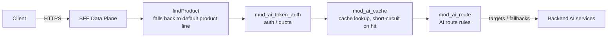
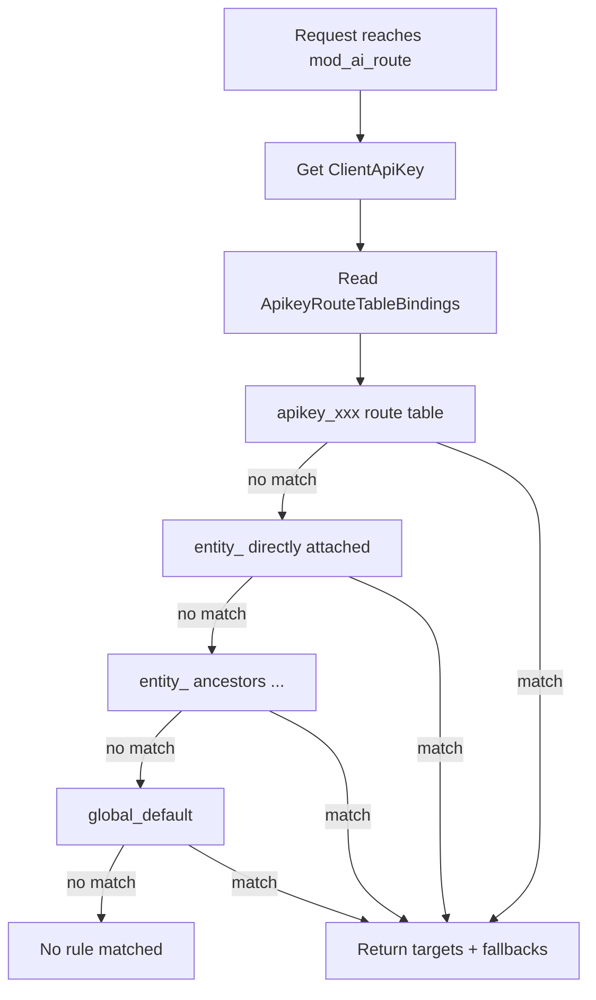

# Chapter 11: AI Route Rule Design

## Chapter Goals

In an AI gateway scenario, the forwarding target of a request is determined entirely by AI route rules. This chapter will help readers:

- Understand where AI route rules sit in the request processing pipeline;
- Understand the three-level organization of AI route tables: Global / Entity / API-Key;
- Master the data model, validation rules, and lifecycle consistency of the `route_rules` table;
- Learn how AI route rules are exported to BFE, including binding order and file format;
- Master the semantics of the `req_ai_intent_in` intent condition primitive and a complete example of route rules consuming intent;
- Master the syntax, weekday numbering convention, and time zone semantics of the time condition primitive `time_weekday_in`;
- Master the design and configuration of Fallback and the default route.

## Where AI Route Rules Sit in the Request Processing Pipeline

In AI gateway mode, BFE handles requests through a dedicated `ServeHTTPForAI()` path. This path still calls `findProduct()`, but unlike traditional BFE, which matches a product by hostname, the AI gateway scenario configures a default product line in the host table (`defaultProduct`, corresponding to the Control Plane's `AIRouteInnerProductName`). Therefore, `findProduct()` falls back to that default product, which is used only to load the module configuration context of that product line; **traditional product-level BFE route rules are not used to select the target Cluster**. The final model and cluster a request is forwarded to is determined entirely by the `mod_ai_route` module based on AI route rules.

AI route rules are executed at the `HandleFoundProduct` stage, after `mod_ai_token_auth` authentication and `mod_ai_cache` cache lookup, and before `mod_ai_rate_limit` rate limiting. Each rule contains:

- A match condition `Cond`;
- One or more `targets` (cluster + model + weight);
- Optional `fallbacks` (a list of fallback targets).



The diagram above shows the request pipeline in AI gateway mode: product identification falls back to the default product line, which serves only the middleware and configuration context; after authentication the cache is looked up first — a hit short-circuits and returns, and only on a miss do AI route rules run to determine the forwarding target.

## Three-Level AI Route Tables: Global / Entity / API-Key

An AI route table is a collection of AI route rules. The `route_rules` table distinguishes levels via `type` and `owner`.

### Global Route Table

- Unique record: `type=global, owner=global`.
- OpenAPI endpoints: `GET /global-route-rules`, `PUT /global-route-rules`.
- During system initialization, `stateful/container/rdb/components.go:Init()` calls `RouteRulesManager.EnsureGlobalRouteRules` to automatically create a default record (`enabled=false`, `rules=[]`), ensuring that administrators see the Global Route Table the first time they open the route management page.
- If the record already exists it will not be overwritten; when it does not exist, `PUT` creates it automatically.
- The Global Route Table is the last-resort fallback for all requests. It is typically configured with a `default_t()` rule as the default route.

### Entity Route Table

- Record identifier: `type=entity, owner=<entity_id>`.
- Entity route tables are not maintained through a dedicated endpoint; instead, they are written together as an embedded object when an Entity is created or updated, corresponding to the `entities.route_rules_id` foreign key.
- When creating an Entity, if `route_rules` is not provided, the system writes `enabled=false`, `rules=[]` by default.

### API-Key Route Table

- Record identifier: `type=apikey, owner=<apikey_id>`.
- Similar to Entity, API-Key route tables are written as embedded objects when an API-Key is created or updated, corresponding to `api_keys.route_rules_id`.
- When not provided, `enabled=false`, `rules=[]` is likewise written by default.

### Listing Route Tables

`GET /route-tables` paginates the metadata of all route tables. It returns only `type`, `owner`, and `enabled`, not the `rules` details:

```json
{
    "id": 1,
    "type": "global",
    "owner": "global",
    "enabled": true
}
```

### Binding Priority

For each API-Key, the lookup order seen by BFE is:

1. `apikey_<key>` (API-Key level)
2. `entity_<entity_name>` (the directly attached Entity)
3. `entity_<parent_name>` ... (all ancestor Entities traversed upward along `parent_id`)
4. `global_default` (Global level)

BFE matches in this list order: typically the API-Key level rules hit first, then the rules of each Entity level in turn, and finally the Global fallback rule.

This top-down priority design aligns with organizational management habits: API-Key level rules are the finest-grained and can satisfy special needs of individual applications or users; Entity level rules connect the upper and lower levels, suiting unified scheduling at the department or project level; and Global level rules serve as the default policy for the entire system, preventing any request from being rejected outright simply because no rule matched it.



The diagram above shows the three-level lookup flow of AI route tables: the next level is only consulted when all rules at the current level fail to match; any level that matches returns the result immediately.

## Design and Management of the route_rules Table

### Table Structure

```sql
CREATE TABLE route_rules (
    id BIGINT AUTO_INCREMENT PRIMARY KEY,
    type VARCHAR(64) NOT NULL COMMENT 'global / entity / apikey',
    owner VARCHAR(255) NOT NULL COMMENT 'global for global, entity_id for Entity, apikey_id for API-Key',
    enabled TINYINT(1) NOT NULL DEFAULT 1,
    rules JSON NOT NULL COMMENT 'rule array',
    created_at DATETIME NOT NULL DEFAULT CURRENT_TIMESTAMP,
    updated_at DATETIME NOT NULL DEFAULT CURRENT_TIMESTAMP ON UPDATE CURRENT_TIMESTAMP,
    UNIQUE KEY uk_route_rules_type_owner (type, owner)
);
```

Field descriptions:

- `type`: route table type; one of `global`, `entity`, `apikey`.
- `owner`: owner identifier. Fixed to `global` for Global; `entity_id` for Entity; `apikey_id` for API-Key.
- `enabled`: whether the route table is enabled. Disabled route tables are not exported to BFE and are not added to the binding list.
- `rules`: the rule JSON array.

### Rule JSON Structure

The JSON structure of a single AI route rule is as follows:

```json
{
    "name": "rule-1",
    "cond": "req_body_json_in(\"model\", \"gpt-4\", false)",
    "targets": [
        {"cluster_name": "cluster-openai", "model": "gpt-4", "weight": 80},
        {"cluster_name": "cluster-azure", "model": "gpt-4", "weight": 20}
    ],
    "fallbacks": [
        {"cluster_name": "cluster-fallback", "model": "gpt-3.5-turbo"}
    ]
}
```

Field descriptions:

- `name`: rule name, unique within the same route table.
- `cond`: BFE condition expression; the rule is used when this matches.
- `targets`: list of forwarding targets, containing `cluster_name`, `model`, `weight`. An empty `model` means pass-through of the original model; the sum of all `weight` values within the same rule must equal 100. The `model` specified by a rule is a target model override: at forwarding time it replaces the original model in the request body and goes through prefix stripping and the cluster's `ModelMapping` to produce the final target model sent upstream. The target model override and the API-Key model allowlist are both validated against this post-forwarding target model — the route rule first redirects the model, then the allowlist validates the redirected model — and the two compose (e.g., an allowlist that only permits `gpt-4` can be combined with a rule redirecting requests to `gpt-4o`; redirecting to a model outside the allowlist fails the check with a 400).
- `fallbacks`: list of fallback targets, optional; tried in order.

### Go Model

The corresponding Go struct definitions on the Control Plane are located in `ai-gateway-api/model/shared/types.go`:

```go
type AiRouteRuleParam struct {
    Name      *string                `json:"name"`
    Cond      *string                `json:"cond"`
    Targets   []*AiRouteTargetParam  `json:"targets"`
    Fallbacks []*AiRouteFallbackParam `json:"fallbacks,omitempty"`
}

type AiRouteTargetParam struct {
    ClusterName *string `json:"cluster_name"`
    Model       *string `json:"model"`
    Weight      *int    `json:"weight"`
}

type AiRouteFallbackParam struct {
    ClusterName *string `json:"cluster_name"`
    Model       *string `json:"model"`
}
```

### Management Methods

- **Global Route Table**: managed independently via `GET /global-route-rules` and `PUT /global-route-rules`.
- **Entity / API-Key route tables**: managed as embedded objects via the create/update endpoints of Entities or API-Keys; no dedicated endpoints are exposed.
- **Route table metadata**: paginated via `GET /route-tables`.

## Route Rule Validation and Lifecycle Consistency

### Validation Rules

When creating or updating route rules, `RouteRulesManager.validateRouteRules` performs unified validation:

1. The rule name is required and must not be duplicated within the same route table;
2. `cond` is required and must not be empty;
3. `targets` must not be empty;
4. Every target must have a `weight`;
5. The sum of all target `weight` values within the same rule must equal 100;
6. A Fallback's `cluster_name` must not be empty.

The OpenAPI layer additionally requires:

- `cond` must be a valid BFE condition expression;
- `cluster_name` must be an existing cluster;
- if `model` is not empty, it must be a model already configured in that cluster's `llm_config.models`;
- within the same `targets` array, the `(cluster_name, model)` combination must not be duplicated.

> Note: at save time, `validate.ConditionExpression` performs BFE expression syntax validation on `cond` (internally calling `condition.Build`); expressions with syntax errors cannot be written to the database. The Dashboard or `RouteRuleManager.ExpressionVerify` provides the same pre-validation capability.

### Deletion Protection

AI route rules not only constrain their own writes but also protect the referenced clusters in reverse:

- **Cluster deletion protection**: when a cluster is deleted, `RouteRulesManager.ClusterDeleteChecker` (`ai-gateway-api/model/route_rules/route_rules.go`) scans the `route_rules` table across the Global, Entity, and API-Key levels; if any rule's `targets` or `fallbacks` reference the cluster, the deletion is rejected with `409 Conflict`, and the error message names the referencing rule. The cluster can only be deleted after the related route rules are removed or modified.
- **Cluster model update protection**: when a cluster's model list is updated, `ClusterModelUpdateChecker` checks whether any removed model is still referenced by a rule's `targets` or `fallbacks` (matched by `cluster_name` + `model`); if so, it likewise returns `409 Conflict`, preventing rules from pointing to models that no longer exist in the cluster.

Both checkers are registered as delete/update hooks of the ClusterManager in `stateful/container/rdb/components.go` and run inside the transaction, keeping the reference check atomic with the delete/update operation.

### Lifecycle Consistency

AI route rules keep their lifecycle consistent with that of API-Keys / Entities:

- **Create**: when creating an API-Key or Entity with `route_rules` provided, a `route_rules` record is created in sync, and the generated `id` is written back to `api_keys.route_rules_id` or `entities.route_rules_id`.
- **Update**: when updating with `route_rules` provided, an existing `route_rules_id` is updated; if none exists, a new record is created and written into the foreign key.
- **Delete**: deleting an API-Key or Entity cascades to delete its associated `route_rules` record.
- **Switching Entities**: when an API-Key switches from one Entity to another, the API-Key's own `route_rules_id` remains unchanged, and at export time it is automatically bound to the new Entity's route table.
- **Entity name change**: the exported Key `entity_<name>` changes, and BFE must reload.

| Scenario | Behavior |
|---|---|
| Route table `enabled=false` | Not exported to BFE, and not added to the binding list |
| API-Key has no Entity attached | Bound only to its own route table + the Global Route Table |
| Neither API-Key nor Entity has a route table configured | Bound only to the Global Route Table (if enabled) |
| Global Route Table disabled | No global fallback; requests may end up with no rule to match |
| Referenced Cluster deleted | Cluster deletion fails validation; references must be removed or rules deleted first |

### Collection Constraints for AI Cache Rules

AI cache rules are read and written as a whole set via `/open-api/v1/ai-cache-rules`. They share the BFE condition-expression syntax with route rules but have independent constraints:

- **`cond` is unique within the set**: the submitted `rules[].cond` values must be pairwise distinct, compared byte for byte. A duplicate makes the interface return 422 `duplicate ai cache rule cond`. This constraint is a precondition for export — duplicate `cond` values leave BFE unable to decide which rule a given request should match, so the entire `ai_cache.data` file is rejected rather than the duplicate entry being skipped.
- **Whole-set replacement semantics**: the write interface replaces the existing set with the submitted `rules` array as a whole; there is no per-entry create/update/delete. The rule elements in the response therefore contain no `created_at` / `updated_at` — those columns are reset by a whole-set replacement and cannot serve as the rules' own lifecycle evidence. To trace when a rule was modified, rely on the change records in the operation log (`/open-api/v1/operation-logs`).

## Semantic Routing and Intent Conditions

Beyond conventional request-feature primitives (such as `req_host_in`, `req_body_json_in`), the `cond` of AI route rules also supports the intent condition primitive `req_ai_intent_in`, enabling semantic routing based on the semantic content of requests. The primitive is defined as `PrimitiveAiIntentIn` in `bfe/bfe_basic/condition/primitive.go`, with the signature:

```
req_ai_intent_in(String question_name, String value_list [, Float min_confidence])
```

Parameter semantics:

- `question_name`: the intent question name, corresponding to a question configured in `intent_questions.data`;
- `value_list`: the list of candidate answers, with multiple answers separated by `|` (following the BFE `*_in` primitive convention);
- `min_confidence`: an optional confidence floor. When omitted, the question-level `MinConfidence` is used (default 0.6); an explicit 0 means no confidence check — any answer matches.

Example:

```
req_ai_intent_in("task_type", "test_writing|doc_writing", 0.9)
```

This means: the condition matches when the classification result of the intent question `task_type` is `test_writing` or `doc_writing` with a confidence no lower than 0.9.

### Lazy Resolution Timing

Intent classification is provided by `mod_ai_intent` using a lazy-resolution design: the module `Init()` only injects the resolver and confidence threshold into `bfe_basic` (`bfe_basic.SetAiIntentResolver`), registering no request callbacks; the classification call to the decision service (System One protocol `POST /v1/systemone`, timeout default 300ms) is not triggered until rule evaluation first references `req_ai_intent_in` (typically during route rule evaluation in `mod_ai_route`). Requests whose route rules contain no intent conditions carry zero overhead. Classification results are cached in an in-process LRU cache and reused across multiple condition evaluations.

This brings two semantic constraints:

- When the decision service is unavailable, the confidence is below the threshold, or the question is not configured, `req_ai_intent_in` never matches (fail-safe semantics), and traffic naturally falls through to subsequent rules; referencing a nonexistent question name likewise never hits;
- the cache lookup of `mod_ai_cache` runs before routing, so hit requests short-circuit and return directly — route rules (together with intent lazy resolution) never execute. Therefore, when a cache rule file's `cond` references `req_ai_intent_in`, load time only logs a WARN without rejecting it (see `bfe/bfe_modules/mod_ai_cache/cache_rule_load.go`), and the intent condition semantics only take effect on the miss path.

Clients can also declare intent directly via the explicit intent header `X-AI-Intent: <question>=<option>` (multiple questions separated by semicolons), which takes priority over model classification and produces no decision service call on this path.

### Complete Example of Route Rules Consuming Intent

The Control Plane maintains the following route table per API-Key (Entity / API-Key levels likewise):

```json
{
    "enabled": true,
    "rules": [
        {
            "name": "writing-tasks-to-deepseek",
            "cond": "req_ai_intent_in(\"task_type\", \"test_writing|doc_writing\", 0.9)",
            "targets": [
                {"cluster_name": "cluster_deepseek_a", "model": "deepseek-v4-pro", "weight": 100}
            ],
            "fallbacks": [
                {"cluster_name": "cluster_deepseek_c", "model": "deepseek-v3.2"}
            ]
        },
        {
            "name": "default-route",
            "cond": "default_t()",
            "targets": [
                {"cluster_name": "cluster_global", "model": "", "weight": 100}
            ],
            "fallbacks": []
        }
    ]
}
```

The effect of this configuration: writing requests (intent classification confidence ≥ 0.9) are routed to `cluster_deepseek_a`, and all other requests take the `default-route` global fallback. When the decision service fails or classification confidence is insufficient, `req_ai_intent_in` does not match, and writing requests automatically fall back to the default route — semantic routing never causes a request to fail.

The data model of the intent question set (`intent_questions.data`) and the decision service protocol are detailed in the mod_ai_intent section of [Chapter 7: Data Plane Forwarding Design](./chapter07-data-plane-design.md); the implementation timing is detailed in [Chapter 31: Implementing the AI Route Module](../implementation/chapter31-mod-ai-route.md).

## The Time Condition Primitive time_weekday_in

Beyond request-feature and intent primitives, the `cond` of AI route rules also supports the system-time condition primitive `time_weekday_in`, enabling time-of-week scheduling such as splitting weekday and weekend traffic across different clusters. The primitive is implemented as `WeekdayMatcher` in `bfe/bfe_basic/condition`, with the signature:

```
time_weekday_in(String weekday_list [, String zone])
```

Parameter semantics:

- `weekday_list`: a `|`-separated enumeration of weekday numbers, validated at configuration load time; range syntax is not supported (`"1-5"` is an error); elements may repeat and may carry whitespace on either side.
- `zone`: a military time zone letter (see `bfe_util.TimeZoneMap`; `"H"` means UTC+8), optional; when omitted, evaluation uses UTC (`"Z"`). For deployments in China, `"H"` must be passed explicitly — at Monday 00:00 Beijing time, the UTC time is still Sunday, so omitting `zone` would misclassify a weekday as the weekend.

The weekday numbering follows the Go `time.Weekday` convention: `0` is Sunday and `6` is Saturday, consistent with the `TimeRange.Weekdays` field of cluster pricing.

Examples:

```
time_weekday_in("0|6", "H")        // weekends (Beijing time)
time_weekday_in("1|2|3|4|5", "H")  // weekdays (Beijing time)
```

Semantics: the condition matches when the weekday of the current time belongs to the given set. The time is taken from the process clock; when the request carries the `X-Bfe-Debug-Time` debug header, the time specified by that header is used instead.

In implementation, `WeekdayMatcher` compiles `weekday_list` into a `uint8` bitmask and resolves `zone` into a `time.Location` at configuration load time, performing only a bitmask test at runtime. The primitive is registered in `funcProtos` and `optionalLastArgProtos` (the latter provides the optional `zone` argument). By naming convention, new system-time primitives use the `time_` prefix, while the historical primitives `bfe_time_range` and `bfe_periodic_time_range` keep their `bfe_` prefix unchanged.

On the Control Plane side, after the bfe dependency is upgraded, every entry point that saves or validates condition expressions — route rules, AI cache rules, AI context rules, traffic mirroring rules, and `PATCH /expression/verify` — accepts this primitive; illegal values (such as `"7"` or an invalid `zone`) are still rejected by the compile-time validation with a 422.

## Conditional Expression Engine expr

BFE provides a condition engine based on expr-lang/expr (the `bfe_expr` package) on top of the legacy primitives; the legacy primitives are function-wrapped through a compatibility layer (covering all 53 existing primitives), and `condition.Build` dispatches according to `ConditionEngineMode` in `bfe.conf [Server]`:

| Mode | Semantics |
|------|-----------|
| `LegacyFirst` (default) | Legacy engine first, falling back to expr when a legacy primitive fails to compile; byte-for-byte identical to legacy-primitive behavior |
| `ExprCompatible` | expr and legacy primitives may be mixed; compile failures are rejected |
| `ExprOnly` | Pure expr; legacy primitive names are treated as unknown functions |

The mode accepts the numeric aliases `0/1/2` and any letter case; **invalid values fail startup**; the mode is process-wide — hot reload does not apply, and changing it requires a restart. Under expr modes, the `cond` field of route rules and all the validation entry points above go through the same compilation pipeline.

expr mode can express logic that is hard to compose with legacy primitives (arithmetic, boolean combinations, variable functions) and can read Redis through dynamic data sources (`RedisEnv` with `Get` / `GetInt` / `HGetAll`; misses and errors return zero values without failing; default conn 100ms / read 300ms / write 300ms). Mind the intentional differences between the engines: string escapes follow Go rules (a regex `\.` must be written `\\.` / backquoted / `[.]` in expr); the legacy `res_code_in` primitive compares strings while the modern `ResCode()` compares integers; and the hash empty-input bucket semantics differ. Expression errors are treated as `false` plus a warning and never fail the request.

On the action-parameter side, shared actions of `mod_redirect` / `mod_header` support the `=expr` prefix (see [Chapter 7 Data Plane Forwarding Design: BFE](./chapter07-data-plane-design.md)). The Control Plane save path is unchanged — `validate.ConditionExpression` still calls `condition.Build`, and the same validation constrains both engines.

## Binding Order and File Format Exported to BFE

### Export Structure

The Control Plane exports AI route rules via InnerAPI as `ai_route.json` (ultimately landing as BFE's `ai_route.data`). The exported Go structure is:

```go
type AiRouteDataExport struct {
    Version                  string                    `json:"Version"`
    RouteRules               map[string]*RouteTableExport `json:"RouteRules"`
    ApikeyRouteTableBindings map[string][]string       `json:"ApikeyRouteTableBindings"`
}
```

### Route Table Naming

| Type | Export Key | Owner Field | `route_rules.type` Value |
|---|---|---|---|
| API-Key | `apikey_<api_key_value>` | The API-Key's key value | `apikey` |
| Entity | `entity_<entity_name>` | The Entity's name | `entity` |
| Global | `global_default` | `global` | `global` |

### Binding Order

For each API-Key, the binding list is appended in the following order:

1. `apikey_<key>` (API-Key level)
2. `entity_<entity_name>` (the directly attached Entity)
3. `entity_<parent_name>` ... (all ancestor Entities traversed upward along `parent_id`)
4. `global_default` (Global level)

The core logic can be simplified to:

```go
for _, apiKey := range apiKeys {
    var bindingList []string

    // 1. API-Key level
    if apiKey.RouteRulesID != nil && enabled {
        bindingList = append(bindingList, fmt.Sprintf("apikey_%s", *apiKey.Key))
    }

    // 2. Entity level (traverse the hierarchy bottom-up)
    currentEntityID := apiKey.EntityID
    for currentEntityID != nil && *currentEntityID != "" {
        entity := entityMap[*currentEntityID]
        if entity.RouteRulesID != nil && *entity.RouteRulesID != "" {
            bindingList = append(bindingList, fmt.Sprintf("entity_%s", *entity.Name))
        }
        currentEntityID = entity.ParentID
    }

    // 3. Global level
    if globalRouteRules != nil && enabled {
        bindingList = append(bindingList, "global_default")
    }

    bindings[*apiKey.Key] = bindingList
}
```

### File Format

`ai_route.data` is the rule configuration file of BFE's `mod_ai_route` module. Field descriptions are in `bfe/docs/zh_cn/configuration/mod_ai_route/ai_route.data.md`:

- `Version`: configuration file version, usually in timestamp format;
- `route_rules`: the set of route tables, keyed by route table name;
- `route_rules[k].type`: route table type; one of `apikey`, `entity`, `global`;
- `route_rules[k].owner`: route table owner;
- `route_rules[k].rules`: list of rules, matched in order;
- `ApikeyRouteTableBindings`: bindings from API-Keys to lists of route table names, matched in order.

## Fallback and the Default Route

### Fallback Mechanism

Fallback provides degradation when all `targets` of a rule are unavailable. Typical errors that trigger Fallback include:

- Connection failure;
- Timeout;
- Backend returns 5xx.

Scenarios that do not trigger Fallback include:

- Client-side 4xx;
- Authentication failure;
- Rate limit rejection.

When Fallback is triggered, BFE constructs new targets in the order of the `fallbacks` list, calling `clusterInvoke()` again for each; it stops at the first success, and if all fail, returns the error response of the last fallback.

Two points to note when designing Fallback: first, the Fallback list itself does not perform weighted selection but is tried strictly linearly in array order; second, the `model` in a Fallback can likewise be empty, meaning pass-through of the original model. Operators usually put lower-cost or higher-capacity clusters in Fallback, so they can take over traffic quickly when the primary targets fail.

### Default Route

The Global Route Table is usually configured with a `default_t()` rule as the default route, ensuring that any request that does not match a finer-grained rule still has somewhere to go. For example:

```json
{
    "name": "global-default",
    "cond": "default_t()",
    "targets": [
        {"cluster_name": "cluster_global", "model": "", "weight": 100}
    ],
    "fallbacks": []
}
```

If the Global Route Table is disabled or has no default rule configured, and the API-Key and Entity route tables all fail to match, a request may have no rule to match and ultimately returns 404. Therefore, it is strongly recommended to enable the Global fallback route in production.

## Route Rule Configuration Examples

### Global Route Table Example

```json
{
    "enabled": true,
    "rules": [
        {
            "name": "global-default",
            "cond": "default_t()",
            "targets": [
                {"cluster_name": "cluster_global", "model": "", "weight": 100}
            ],
            "fallbacks": []
        }
    ]
}
```

### Entity Route Table Example

```json
{
    "enabled": true,
    "rules": [
        {
            "name": "dept-ai-default",
            "cond": "req_host_in(\"ai.dept.example.com\")",
            "targets": [
                {"cluster_name": "cluster_dept_ai", "model": "", "weight": 100}
            ],
            "fallbacks": []
        }
    ]
}
```

### API-Key Route Table Example

```json
{
    "enabled": true,
    "rules": [
        {
            "name": "user-a-deepseek",
            "cond": "req_body_json_in(\"model\", \"deepseek-v4-pro\", false)",
            "targets": [
                {"cluster_name": "cluster_deepseek_a", "model": "deepseek-v4-pro", "weight": 70},
                {"cluster_name": "cluster_deepseek_b", "model": "deepseek-v4-pro", "weight": 30}
            ],
            "fallbacks": [
                {"cluster_name": "cluster_deepseek_c", "model": "deepseek-v3.2"}
            ]
        }
    ]
}
```

### Exported `ai_route.data` Example

```json
{
    "Version": "20260720150000",
    "route_rules": {
        "apikey_ak_user_a": {
            "type": "apikey",
            "owner": "ak_user_a",
            "rules": [
                {
                    "name": "user-a-deepseek",
                    "Cond": "req_body_json_in(\"model\", \"deepseek-v4-pro\", false)",
                    "targets": [
                        {"ClusterName": "cluster_deepseek_a", "Model": "deepseek-v4-pro", "Weight": 70},
                        {"ClusterName": "cluster_deepseek_b", "Model": "deepseek-v4-pro", "Weight": 30}
                    ],
                    "fallbacks": [
                        {"ClusterName": "cluster_deepseek_c", "Model": "deepseek-v3.2"}
                    ]
                }
            ]
        },
        "entity_dept_ai": {
            "type": "entity",
            "owner": "dept_ai",
            "rules": [
                {
                    "name": "dept_ai-default",
                    "Cond": "default_t()",
                    "targets": [
                        {"ClusterName": "cluster_dept_ai", "Model": "", "Weight": 100}
                    ],
                    "fallbacks": []
                }
            ]
        },
        "global_default": {
            "type": "global",
            "owner": "global",
            "rules": [
                {
                    "name": "global-default",
                    "Cond": "default_t()",
                    "targets": [
                        {"ClusterName": "cluster_global", "Model": "", "Weight": 100}
                    ],
                    "fallbacks": []
                }
            ]
        }
    },
    "ApikeyRouteTableBindings": {
        "ak_user_a": [
            "apikey_ak_user_a",
            "entity_dept_ai",
            "global_default"
        ]
    }
}
```

> Note: the route configuration InnerAPI exports to BFE keeps capitalized field names such as `Cond`, `ClusterName`, `Model`, and `Weight`. These are field names mandated by the BFE Data Plane and constitute the exception described in `00-common.md`.

## Chapter Summary

This chapter introduced the AI route rule design of the Rainway AI Gateway:

- In AI gateway mode, the forwarding target of a request is determined entirely by AI route rules; traditional product-level BFE route rules do not participate in Cluster selection;
- AI route tables are divided into three levels — Global, Entity, and API-Key — with the binding order API-Key → Entity (bottom-up) → Global;
- The `route_rules` table distinguishes levels via `type` and `owner`, and rules are stored as a JSON array;
- The Control Plane validates rule names, conditions, weights, and Fallbacks at save time, and keeps the lifecycle consistent with that of API-Keys / Entities;
- The `req_ai_intent_in` primitive supports semantic routing by intent classification results; intent lazy resolution is provided by `mod_ai_intent`, and when the decision service is unavailable it fails safe and falls through to subsequent rules;
- The `time_weekday_in` primitive supports time-of-week scheduling by weekday (Go `time.Weekday` numbering); when `zone` is omitted it evaluates in UTC, so deployments in China should pass `"H"` explicitly;
- AI route rules are exported via InnerAPI as `ai_route.json` and land in BFE as `ai_route.data`; `ApikeyRouteTableBindings` determines the lookup order;
- Fallback provides ordered degradation when targets are unavailable, and the Global default route serves as the last-resort fallback; together they improve routing reliability.

## References

- `ai-gateway-api/design-docs/sys-design/details/路由规则管理.md`
- `ai-gateway-api/design-docs/api-define/OpenAPI接口定义/global-route-rules.md`
- `ai-gateway-api/design-docs/api-define/OpenAPI接口定义/route-tables.md`
- `ai-gateway-api/design-docs/api-define/OpenAPI接口定义/00-common.md`
- `bfe/docs/zh_cn/configuration/mod_ai_route/ai_route.data.md`
- `bfe/docs/zh_cn/sys_design/mod_ai_route.md`
- `bfe/docs/zh_cn/sys_design/mod_ai_intent.md`
- `ai-gateway-api/model/shared/types.go`
- `ai-gateway-api/model/route_rules/route_rules.go`
- `ai-gateway-api/model/imods/ai_route_exporter.go`
- `bfe/bfe_modules/mod_ai_route/mod_ai_route.go`
- `bfe/bfe_basic/condition/primitive.go` (`PrimitiveAiIntentIn`)
- `bfe/bfe_basic/condition/` (`WeekdayMatcher`, `time_weekday_in`)
