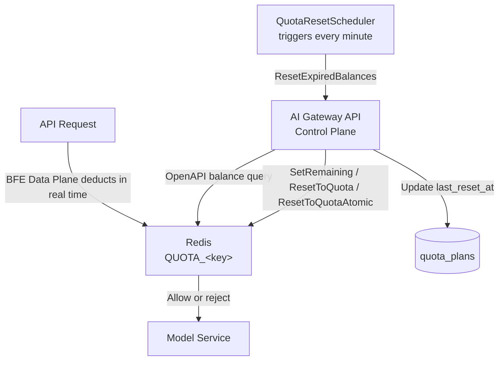
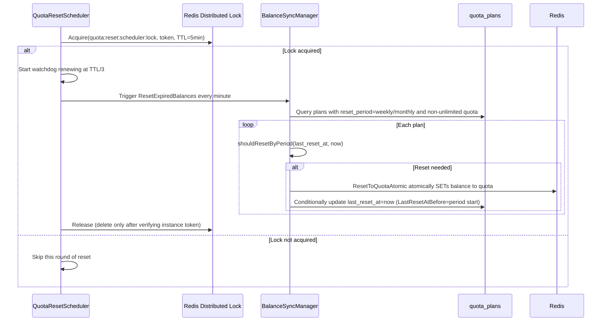
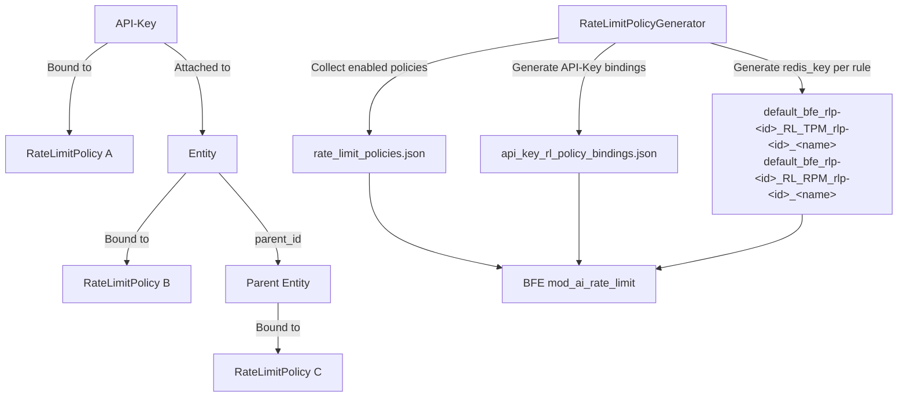
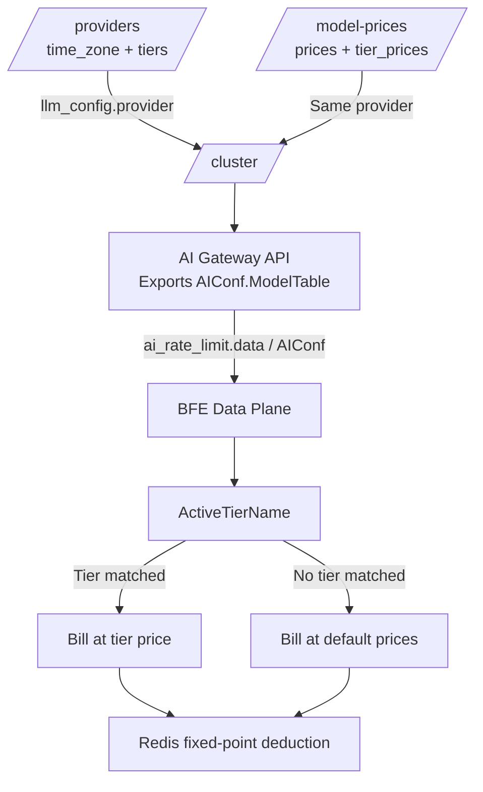

# Chapter 12: Quota and Rate Limit Design

## Chapter Goals

By the end of this chapter, the reader will understand:

- How Rainway AI Gateway uses `QuotaPlan` to allocate quotas in two units, Token or RMB, to API-Keys and Entities;
- Why Redis serves as the single source of truth for quota balances, and how the management plane queries real-time balances by reading Redis directly;
- The reset logic for calendar weeks and calendar months, and the role of `last_reset_at` in reset boundary determination;
- How periodic reset is mutually exclusive across instances via a Redis distributed lock, and how atomic SET plus conditional updates keep the reset idempotent;
- The consistent semantics of `quota=0` (a plan with no balance) on both the Control Plane and the Data Plane;
- The TPM, RPM, and concurrency limit model of `RateLimitPolicy`, how policies merge upward along the Entity hierarchy, and how they are exported to BFE;
- The `batch_limits` rate limit section and the reserve-settle-release postpaid quota model for batch and asynchronous tasks;
- How RMB quotas combine Provider time-of-day templates with Model tiered prices to enable peak/off-peak differentiated billing;
- Typical quota and rate limit configuration examples.

---

## Why Quotas and Rate Limits Are Needed

After an enterprise unifies access to large-model services, it typically faces two kinds of resource-control risks:

1. **Budget overrun**: a business team or a single API-Key consumes a large amount of Tokens or generates high costs in a short period, blowing through the overall budget;
2. **Traffic overrun**: sudden request surges overwhelm the backend model services, raising latency and error rates, and even triggering upstream rate limiting.

Quota answers the question "how much can be used in total," while rate limit answers "how much can be used per unit of time." The two complement each other: quotas keep the overall budget under control, while rate limits keep instantaneous traffic smooth. Rainway AI Gateway binds both quota plans and rate limit policies to API-Keys or Entities, allowing administrators to control resource usage at fine granularity by application, by team, and by model.

---

## The QuotaPlan Model: Two Units, total_token and RMB

`QuotaPlan` (quota plan) is the most fundamental quota abstraction in Rainway AI Gateway. It can bill by total Token volume or by RMB amount, corresponding to `unit = total_token` and `unit = RMB` respectively.

### Table Structure

Quota plans are persisted in the `quota_plans` table. The core fields are as follows (see `ai-gateway-api/design-docs/sys-design/details/配额余额同步机制.md` for the full definition):

```sql
CREATE TABLE `quota_plans` (
  `id` BIGINT NOT NULL AUTO_INCREMENT,
  `unlimited` TINYINT(1) DEFAULT 1,
  `pass_when_no_enough_quota` TINYINT(1) DEFAULT 0,
  `quota` DECIMAL(18,8) DEFAULT 0,
  `unit` VARCHAR(32) DEFAULT 'total_token',
  `reset_period` VARCHAR(16) DEFAULT 'never',
  `last_reset_at` DATETIME DEFAULT NULL,
  `created_at` DATETIME NOT NULL DEFAULT CURRENT_TIMESTAMP,
  `updated_at` DATETIME NOT NULL DEFAULT CURRENT_TIMESTAMP ON UPDATE CURRENT_TIMESTAMP,
  PRIMARY KEY (`id`),
  INDEX `idx_unlimited` (`unlimited`)
) ENGINE=InnoDB DEFAULT CHARSET=utf8mb4 COMMENT='quota plan table';
```

| Field | Description |
|------|------|
| `unlimited` | Whether the quota is unlimited. When `true`, no quota check is performed, and the balance is displayed as the sentinel value `100000000`. |
| `pass_when_no_enough_quota` | Whether to still allow requests when the quota is insufficient; commonly used in canary or test scenarios. |
| `quota` | Total quota. An integer when `total_token`; up to 8 decimal places when `RMB`. |
| `unit` | Quota unit; either `total_token` or `RMB`. |
| `reset_period` | Reset period; one of `never`, `weekly`, `monthly`. |
| `last_reset_at` | Time of the last reset; periodic reset uses this to determine whether a calendar week/month boundary has been crossed. |

### The Semantics of quota=0: A Plan with No Balance

Both `total_token` and `RMB` allow `quota = 0`, meaning "a plan with no balance": the configuration itself is valid, but requests bound to the plan are rejected because the balance is exhausted. This is fundamentally different from a negative value: a negative quota is an invalid configuration and fails at configuration load time, whereas `0` is a meaningful business value (for example, temporarily freezing a plan without unbinding it from its API-Keys / Entities). The handling on each side works as follows:

- **Control Plane**: when the quota changes, `QuotaPlanManager.adjustQuota` (`ai-gateway-api/model/quota/quota_plan_manager.go`) computes `remaining = max(0, newQuota - used)` and writes the difference to Redis. When the quota is updated to 0, `remaining` is zeroed out and the Redis balance is synced to 0.
- **Data Plane BFE**:
  - At configuration load time, `quotaPlanCheck` in `token_rule_load.go` rejects only configurations with `Quota < 0`; `quota=0` loads as a valid configuration, and each no-balance plan takes effect independently without affecting other plans under the same Product.
  - At request time, `QuotaPlan.HasBalance` (`bfe/bfe_modules/mod_ai_token_auth/token.go`) judges the balance: if the Redis balance key exists, it is evaluated by value; if the key is missing (`redis_client.IsKeyNotFound`), it is treated as a balance of 0 and likewise reported as "no balance", so requests hitting the plan receive 429 QuotaExhausted instead of an internal error.

### Applicable Scenarios for the Two Units

- **`total_token`**: suitable for models billed by Token (e.g., OpenAI, Anthropic). Administrators can directly cap the total input + output Tokens available per month.
- **`RMB`**: suitable for scenarios where different models at different prices need to be converted into a unified cost. The system converts consumed Tokens into RMB in real time based on the model's unit price, and deducts from the balance.

### RMB Quota Precision

To avoid floating-point errors, ai-gateway-api and BFE uniformly store RMB amounts inside Redis as fixed-point integers by multiplying by `1e8`; externally, values are uniformly displayed with 4 decimal places. For example, `0.0000015` yuan is represented internally as `150`, and during serialization `strconv.FormatFloat(v, 'f', -1, 64)` forces decimal notation to avoid readability problems or intermediate-layer truncation caused by scientific notation.

---

## Redis as the Single Source of Truth for Balances

Quota consumption happens on the request path (the BFE Data Plane deducts in real time), which demands high concurrency and low latency; meanwhile, the management plane (AI Gateway API) needs to expose `used` / `remaining` to OpenAPI and wants the data to be real-time and consistent. Therefore, the current architecture makes Redis the single source of truth for quota balances:

- Redis stores the current remaining quota, which the request path reads and writes directly;
- OpenAPI balance queries read Redis directly;
- `last_reset_at` is stored only in the `quota_plans` table; periodic reset touches only this one table;
- On manual or periodic reset, Redis and `quota_plans.last_reset_at` are updated together.



In this architecture, the `QuotaCache` interface (defined in `ai-gateway-api/model/quotacache/quotacache.go`, implemented in `ai-gateway-api/model/quotacache/redis.go`) encapsulates all Redis operations, including `GetRemaining`, `BatchGetRemaining`, `SetRemaining`, `ResetToQuota`, `ResetToQuotaAtomic`, and `DeleteKeys`.

### Redis Key Rules

Redis Keys are generated by `AIUsedQuotaKey` (`ai-gateway-api/stateful/config_redis.go`):

```go
func AIUsedQuotaKey(key string) string {
    return fmt.Sprintf("QUOTA_%s", key)
}
```

| Object Type | Redis Key Example | Description |
|----------|----------------|------|
| API-Key | `QUOTA_AI_ak-2v8x9k3m7p` | Suffixed with the API-Key's actual `key` value |
| Entity | `QUOTA_entity-1` | Suffixed with `entity_id` |
| Value Semantics | Current remaining quota | An integer for `total_token`; a fixed-point integer in 1e-8 yuan for `RMB` |

The Key no longer appends the `KeyCreateAt` timestamp; its lifecycle matches that of the API-Key / Entity, avoiding Key bloat. When an API-Key or Entity is deleted, `DeleteKeys` is called to actively clean up the corresponding Redis Keys.

### Atomic Deduction and Zeroing Strategy

The system uses two different Redis write strategies for different scenarios.

**Incremental adjustment (manual reset / initial balance write)**: `SetRemaining` and `ResetToQuota` use atomic `IncrBy(delta)` instead of `SET`:

- Under concurrency, `SET` would overwrite the counts just deducted by other requests, causing quota overdraft;
- `IncrBy(delta)` adjusts incrementally based on the current value and can be serialized with other deduction operations;
- When the Key does not exist, a single `IncrBy(quotaTotal)` completes initialization.

**Atomic SET (periodic reset)**: periodic reset uses `ResetToQuotaAtomic`, which executes `redis.call('set', KEYS[1], ARGV[1])` via a Lua script to set the balance directly to the total quota. `IncrBy(delta)` must first read the current value and then compute the difference before writing; there is a time window between the read and the write: if a request completes a deduction in between, the delta computed from the stale value makes the final result deviate from the total quota. Atomic SET does not depend on the current value — the final result is always exactly the total quota and depends only on the ordering between the SET and concurrent deductions — eliminating the read-modify-write race. Combined with the distributed lock (see below), which converges global resets onto a single instance, the contention window between the SET and request-path deductions is also minimal.

### Overage Model: Negative Balances Allowed

Each deduction is a full `DECRBY` with no `math.min(current, amount)` truncation, so the balance may go negative and overages are recorded faithfully:

- The Data Plane performs no deduction truncation, so the balance can fall below 0; `HasBalance` still treats a negative balance as "no balance" at request time (429 QuotaExhausted, unchanged behavior), with a `QuotaOverage` counter + WARN for overage alerting;
- Control Plane presentation: `used = quota − remaining` reflects overage faithfully (**it may exceed `quota`**), while `Balance.Remaining` is still displayed as 0 when the Redis balance is negative; the adjustment paths (`adjustQuota` and two others) do not clamp at zero, so "adjusting quota while in overage" preserves the overage (negative `remaining` is kept and authentication keeps rejecting);
- Dashboard caps the usage percentage at 100% and makes the overage state recognizable;
- No data migration: the Redis single-key model is unchanged; note that **existing keys pinned at 0 before the upgrade cannot recover their historical overage**.

---

## Calendar Week/Month Reset and Expired Reset

### Periodic Reset Policy

`QuotaPlan.reset_period` supports three values:

- `never`: no automatic reset;
- `weekly`: calendar week, reset every Monday at 00:00:00;
- `monthly`: calendar month, reset on the 1st of each month at 00:00:00.

`QuotaResetScheduler` (`ai-gateway-api/model/quota/scheduler.go`) runs `ResetExpiredBalances` once per minute and only processes plans that need resetting.

### Reset Boundary Determination

`BalanceSyncManager` (`ai-gateway-api/model/quota/balance_sync.go`) obtains the current time through an injected `Clock` interface, then calls `shouldResetByPeriod` to determine whether a period boundary has been crossed:

```go
func (m *BalanceSyncManager) shouldResetByPeriod(
    lastResetAt *time.Time,
    resetPeriod string,
    now time.Time,
) bool {
    if lastResetAt == nil {
        return true
    }
    switch resetPeriod {
    case "weekly":
        return getWeekStart(now).After(getWeekStart(*lastResetAt))
    case "monthly":
        return getMonthStart(now).After(getMonthStart(*lastResetAt))
    }
    return false
}
```

`getWeekStart` and `getMonthStart` normalize a time to 00:00:00 on Monday or on the 1st of the month (local timezone). Because the determination is based on comparing week/month start points, the scheduler is self-healing: even if it misses a certain moment for some reason, as long as the current period's start point is later than the period start point at the last reset, the reset will be triggered.

### Reset Execution Flow



### Manual Reset API

In addition to periodic reset, the system provides manual reset APIs:

- `POST /api-keys/{id}/quota-plan/reset`
- `POST /entities/{id}/quota-plan/reset`

Manual reset calls `QuotaPlanManager.ResetBalance(..., updateLastResetAt=false)`, i.e., it only resets the Redis balance without updating `last_reset_at`, so as not to interfere with the periodic scheduler's calendar week/month determination. If a new `quota` is passed, `quota_plans.quota` is updated as well.

### Manually Triggering Periodic Reset (Inner API)

In addition to per-object resets, the Control Plane provides the Inner API `POST /inner-api/v1/quota/trigger-reset` (`ai-gateway-api/endpoints/innerapi_v1/quota_reset/quota_reset.go`), which manually triggers one round of the exact same periodic reset flow as the scheduled task: it is likewise protected by the distributed lock and executes `ResetExpiredBalances`, but it does not affect the next execution time of the scheduled task. The API synchronously returns `{"status":"ok"}` and is intended for internal operations.

### Multi-Instance Deployment and the Distributed Lock

`QuotaResetScheduler` starts independently in every AI Gateway API instance, and in a multi-instance deployment all instances attempt to run the reset. The scheduler uses a Redis distributed lock to ensure that only one instance actually executes `ResetExpiredBalances()` at a time:

- **Acquire**: each round first acquires a lock via `quotacache.DistributedLock` (`ai-gateway-api/model/quotacache/lock.go`), with the lock key `quota:reset:scheduler:lock` and a TTL of 5 minutes; if acquisition fails (held by another instance), the round is skipped and retried in the next round.
- **Token and release**: each instance generates a unique `instanceToken` (UUID) at startup, which is written as the lock value; releasing the lock uses a Lua script that verifies `GET == token` before `DEL`, preventing the lock from being deleted by another instance after the holder crashes, and preventing an old holder from deleting a new holder's lock after expiration.
- **Watchdog renewal**: while holding the lock, a watchdog goroutine renews it with `EXPIRE` at TTL/3 intervals (about 100 seconds), preventing the lock from expiring early if the reset takes longer than the TTL and another instance grabs it mid-reset.
- **Idempotency backstop**: even if the lock fails and a duplicate reset occurs within the same period, the atomic SET is inherently idempotent; in addition, `last_reset_at` is updated conditionally (the `QuotaPlanFilter` has a `LastResetAtBefore = period start` field, `ai-gateway-api/model/quota/quota_plan.go`), so a second update within the same period matches zero rows and does not advance the reset watermark.
- **Claim first, reset second**: the scheduler performs a conditional claim update first (`last_reset_at IS NULL OR last_reset_at < period start`, `TQuotaPlanClaimPeriodReset`) and runs this round's Redis atomic reset only when rows were affected, so a period is reset at most once across all instances; `weekly` / `monthly` plans initialize `last_reset_at` to the creation time (`never` keeps NULL), so SQL three-valued logic (`NULL < x` is never true) cannot put legacy NULL rows into a per-minute reset loop where the claim affects zero rows while still reporting success.

---

## RateLimitPolicy: TPM, RPM, and Concurrency Limits

### Policy Model

`RateLimitPolicy` (rate limit policy) controls the rate at which an API-Key or Entity accesses backend AI models, and supports three types of limits:

- **TPM** (Tokens Per Minute): the maximum Token consumption per minute;
- **RPM** (Requests Per Minute): the maximum number of requests per minute;
- **Concurrency** (Max Concurrency): the maximum number of requests processed simultaneously.

Policies are persisted in the `rate_limit_policies` table (see `ai-gateway-api/design-docs/sys-design/details/限流策略与导出.md` for the full definition):

```sql
CREATE TABLE rate_limit_policies (
    id BIGINT AUTO_INCREMENT PRIMARY KEY,
    name VARCHAR(255) NOT NULL,
    description VARCHAR(255) DEFAULT NULL,
    product_name VARCHAR(255) NOT NULL,
    enabled TINYINT(1) NOT NULL DEFAULT 1,
    max_concurrency INT DEFAULT NULL,
    tpm_configs JSON DEFAULT NULL,
    rpm_configs JSON DEFAULT NULL,
    batch_limits JSON DEFAULT NULL,
    create_time DATETIME NOT NULL DEFAULT CURRENT_TIMESTAMP,
    update_time DATETIME NOT NULL DEFAULT CURRENT_TIMESTAMP ON UPDATE CURRENT_TIMESTAMP
);
```

### TPM and RPM Rule Structure

TPM and RPM rules are stored as JSON arrays in the `tpm_configs` and `rpm_configs` fields:

```json
{
  "tpm_configs": [
    {
      "name": "tpm_gpt4",
      "model": "gpt-4",
      "window_minutes": 1,
      "max_tokens": 100000,
      "step_minutes": 1
    }
  ],
  "rpm_configs": [
    {
      "name": "rpm_gpt4",
      "model": "gpt-4",
      "window_minutes": 1,
      "max_requests": 1000,
      "burst": 1
    }
  ]
}
```

`model` supports a specific model name or the wildcard `*`; when no specific model matches, the default limit is used. `name` is unique within a policy and serves as the identifier for rule export and the Redis Key.

### Validation Rules

`RateLimitPolicyManager` performs strict validation on creation/update:

- `name` must be unique within `product_name`;
- `max_concurrency` must be ≥ 0;
- each rule's `name` is required, non-empty, 1–128 characters, restricted to the character set `[a-zA-Z0-9_-]`;
- `name` must be unique within a policy; renaming a rule is equivalent to deleting the old rule and adding a new one (see "Redis Key Stability" below);
- `model` cannot be empty, and `limit` must be ≥ 0;
- for a policy with `enabled=true`, `rules` must configure at least one of `tpm`, `rpm`, `max_concurrency`, and `batch_limits`; when all four are absent the request returns 422 with a message naming the dimensions to configure;
- the `limit` of each `tpm` / `rpm` rule, `max_concurrency`, and every numeric field of `batch_limits` must be ≥ 0; 0 is a legal value, and `max_concurrency=0` or a field set to 0 inside `batch_limits` does not enable that dimension on the Data Plane.

### batch_limits: Rate Limit Section for Batch Tasks

To support batch and asynchronous tasks (the `/v1/files` and `/v1/batches` endpoint families, see [Chapter 32: Token Authentication and Quota Module Implementation: mod_ai_token_auth](../implementation/chapter32-mod-ai-token-auth.md)), the policy `rules` carry an optional `batch_limits` section. The section belongs to the shared `RateLimitPolicy` type and appears both on the `/rate-limit-policies` resource and in the inline `rate_limit_policy.rules` of API-Keys and Entities:

```json
{
  "batch_limits": {
    "max_create_rpm": 60,
    "max_active_batches": 10,
    "max_file_bytes": 104857600,
    "max_file_lines": 1000000
  }
}
```

| Field | Description |
|------|------|
| `max_create_rpm` | Maximum number of batches that may be created per minute (create-operation RPM) |
| `max_active_batches` | Maximum number of batches in the active (non-terminal) state per API-Key |
| `max_file_bytes` | Hard ceiling on uploaded file size in bytes |
| `max_file_lines` | Hard ceiling on uploaded file line count |

Omitting `batch_limits` or setting it to `null` means the policy does not participate in batch rate limiting. During export, the Control Plane writes this section into the `rules.batch` section of BFE's `ai_rate_limit.data`; on the BFE side, `mod_ai_rate_limit` checks the create RPM, active batch count, and file byte/line hard ceilings according to the operation type (classified by `bfe_basic.ClassifyBatchOp` into create / upload, etc.): exceeding the create RPM or the active batch count returns 429, while exceeding a file ceiling returns 413 `BATCH_FILE_TOO_LARGE`. The file byte/line ceilings are also merged with the global hard ceilings in `mod_ai_batch.data` by taking the minimum as the effective value; even an API-Key bound to no rate limit policy is still subject to the global hard ceilings (implementation details in [Chapter 33: Rate Limit Module Implementation: mod_ai_rate_limit](../implementation/chapter33-mod-ai-rate-limit.md)).

`batch_limits` is configured through the same entry points as TPM/RPM/concurrency: the standalone policy resource (`POST/PUT /rate-limit-policies`) and the inline `rate_limit_policy` of API-Keys / Entities use the same `RateLimitPolicy` structure and the same `validate.RateLimitPolicy` validation (`endpoints/openapi_v1/api_key/checker.go`, `endpoints/openapi_v1/entity/validator.go`), and an inline policy is persisted to a `rate_limit_policies` row as well. Each dimension is counted per API-Key (`max_active_batches` compares against that `ClientKeyId`'s active batch count) and merges up the Entity hierarchy: the API-Key policy and every ancestor Entity policy all participate, with the same dimension combined by AND (equivalent to taking the minimum), and the file byte/line ceilings then take the minimum with the `mod_ai_batch.data` global hard ceilings. The console currently offers no form for this section; configure it through the OpenAPI.

---

## Hierarchical Merge and Export

### Reference Relationships

Both API-Keys and Entities reference rate limit policies via the `rate_limit_policy_id` field:

| Dimension | Quota Plan | Rate Limit Policy |
|------|----------|----------|
| Table | `quota_plans` | `rate_limit_policies` |
| Reference field | `quota_plan_id` | `rate_limit_policy_id` |
| Hierarchical merge | Collect QuotaPlans from all levels | Collect Policy IDs from all levels |
| Exported Redis Key | `QUOTA_xxx` | `default_bfe_rlp-<id>_RL_TPM_rlp-<id>_<name>` / `default_bfe_rlp-<id>_RL_RPM_rlp-<id>_<name>` |
| Balance sync | Yes | No |

### Entity Hierarchical Merge Upward

During export, `RateLimitPolicyGenerator` (`ai-gateway-api/model/rate_limit_policy/rate_limit_policy_manager.go`) recursively collects the policy IDs bound to each API-Key's own Entity and all parent Entities:

```go
func (m *RateLimitPolicyManager) fetchEntityRateLimitPolicyIDs(ctx context.Context, entity *EntityParam) ([]int64, error) {
    policyIDs := make([]int64, 0)
    if entity.RateLimitPolicyID != nil {
        policyIDs = append(policyIDs, *entity.RateLimitPolicyID)
    }
    if entity.ParentID != nil && *entity.ParentID != "" {
        parent, err := m.entityStorager.FetchEntity(ctx, &EntityFilter{EntityID: entity.ParentID})
        if parent != nil {
            parentPolicyIDs, _ := m.fetchEntityRateLimitPolicyIDs(ctx, parent)
            policyIDs = append(policyIDs, parentPolicyIDs...)
        }
    }
    return policyIDs, nil
}
```

### Export Files

The export result is written to two files:

- `rate_limit_policies.json`: all rate limit policies in enabled state;
- `api_key_rl_policy_bindings.json`: the bindings from API-Keys to policies.

Exported policy names use the uniform format `rlp-<policy_id>` to avoid naming conflicts and to make indexing easy on the BFE side. Only policies with `enabled=true` are exported and generate bindings.

### Redis Key Stability

The Control Plane generates a Redis Key for each rule during export, and the rule name is part of the Key (`BuildBFERateLimitRedisKey` in `model/shared/rate_limit_redis_key.go`):

```go
// model/shared/rate_limit_redis_key.go
func BuildBFERateLimitRedisKey(policyID int64, ruleType string, name string) string {
    return fmt.Sprintf("default_bfe_rlp-%d_%s_rlp-%d_%s", policyID, ruleType, policyID, name)
}
```

TPM / RPM rules pass `ruleType` as `RL_TPM` / `RL_RPM` respectively and `name` as the rule name, producing keys such as `default_bfe_rlp-1_RL_TPM_rlp-1_tpm_1min`. On the BFE side, the full `redis_key` delivered in the configuration is used as-is.

Because the rule name is encoded in the Key, renaming a rule is equivalent to deleting the old rule and adding a new one: `DiffRateLimitRedisKeys` compares the old and new policies by name, cleans up the keys of removed rules, and the new rule starts counting from zero under its new Key. Modifying other fields of a rule, such as `model`, does not change the Key and does not reset the counter.



### Expected Behavior on the BFE Side

After receiving the configuration, BFE:

1. Uses `api_key_rl_policy_bindings.json` to find the policy list for an API-Key;
2. When a request arrives, matches rules in `rules.tpm` / `rules.rpm` by the target model after forwarding, preferring exact model names and falling back to the `*` default limit when no match is found;
3. After a rule matches, builds the Redis counter key from the rule's `redis_key` and performs the rate limit check;
4. Also checks `max_concurrency`;
5. Returns 429 Too Many Requests when any limit is exceeded.

## Upstream Key Exhaustion: 429 NO_AVAILABLE_KEY

A 429 from rate limiting means "the caller is over limit", whereas `NO_AVAILABLE_KEY` means "the gateway has no usable upstream credential". Both are 429 but with different attribution:

- When every candidate Key in the cluster is in its penalty window (the 429-tier and 401/402/403-tier penalty durations are configurable per cluster via `key_affinity.penalty_ttl_429` / `penalty_ttl_auth`, defaulting to 60s / **300s**; penalties are written only when session-affinity penalty is enabled), Key selection returns an empty candidate set and the forwarding loop synthesizes 429 `NO_AVAILABLE_KEY` (type `rate_limit_error`, message `no available upstream api key for this cluster`), carrying `Retry-After` and `error.details.retry_after_seconds`, both fixed at 60s;
- The Key penalty filter skips `Weight=0` Keys: they never participate in selection and are not counted as candidates;
- An empty candidate set acts as a circuit breaker for that cluster: the current attempt stops rotating Keys and falls back per the fallback rules; Keys become available again automatically when the TTL expires, with no manual intervention.

This error consumes no QuotaPlan balance and is not counted against RateLimitPolicy limits. When troubleshooting, check the upstream Provider's credential validity and the cluster's Key pool size rather than adjusting rate-limit policies.

---

## RMB Quota Tiered Pricing by Time of Day

### Background

As model providers such as DeepSeek adopt "peak / off-peak" time-of-day pricing, BFE's RMB quota deduction needs the ability to match different prices based on when a request occurs. Rainway AI Gateway places time-of-day templates under `/providers` and tiered prices under `/model-prices`, achieving separation of Provider and price management.

### Core Concepts

| Concept | Description |
|------|------|
| **Tier** | A price level divided by time dimension, e.g., `peak`. |
| **TimeRange** | A time-of-day definition, containing `weekdays` (0 = Sunday), `start` / `end` (HH:MM, left-closed right-open). |
| **Provider time-of-day template** | The `time_zone` and `tiers` defined on `/providers`, shared by all models under the same provider. |
| **Model tier price** | The `tier_prices` defined on `/model-prices`, describing a model's price under a given tier. |

### Configuration Ownership and Delivery Chain



When multiple clusters reference the same provider, each receives an identical copy of the `ModelTable` data; after a provider's time-of-day rules change, all clusters referencing it take effect automatically on the next configuration export.

### BFE ModelTable Structure

The exported `AIConf.ModelTable` has the following structure (defined in the relevant configuration loading code on the BFE side):

```go
type ModelTable struct {
    Currency string      // Fixed "RMB"
    TimeZone string      // Default "Asia/Shanghai"
    Tiers    []PriceTier // Time-of-day definitions
    Models   []ModelPrice
}

type PriceTier struct {
    Name       string
    TimeRanges []TimeRange
}

type ModelPrice struct {
    Provider   string
    Model      string
    Prices     PriceMap     // Default prices
    TierPrices TierPriceMap // tier name -> price table
}
```

### Runtime Tier Matching

At load time, BFE parses `TimeZone` and validates `Tiers`; at runtime it uses `ActiveTierName` to match the tier based on when the request occurs:

```go
func (table *ModelTable) ActiveTierName(now time.Time) string {
    if table == nil || len(table.Tiers) == 0 {
        return ""
    }
    t := now.In(table.tz)
    wd := int(t.Weekday())
    hour, min := t.Hour(), t.Minute()
    cur := hour*60 + min

    for i := range table.Tiers {
        tier := &table.Tiers[i]
        for _, tr := range tier.TimeRanges {
            if len(tr.Weekdays) > 0 && !containsInt(tr.Weekdays, wd) {
                continue
            }
            start := parseHHMM(tr.Start)
            end := parseHHMM(tr.End)
            if start <= cur && cur < end {
                return tier.Name
            }
        }
    }
    return ""
}
```

When a tier is matched and that tier has the corresponding price key configured, the tier price is used; otherwise it falls back to the default `Prices`. Time ranges are left-closed and right-open; ranges crossing midnight must be split into two segments.

### Backward Compatibility

- When `/providers` omits `time_zone` / `tiers`, `ModelTable.TimeZone` / `Tiers` are empty and behavior is identical to fixed pricing;
- When `/model-prices` omits `tier_prices`, billing uses the default `Prices`;
- When a tier is matched but a price key is not configured for that tier, billing automatically falls back to the corresponding key in the default `Prices`;
- `TokenUsage.UsedCost`, the Lua deduction logic, and the Redis fixed-point storage all require no changes.

---

## Postpaid Quota for Batch Tasks: Reserve-Settle-Release

Billing for batch and asynchronous tasks (the OpenAI Batch API, `/v1/files` + `/v1/batches`) differs fundamentally from ordinary requests: the final Token usage is unknown when a batch is created, the result file is downloaded by the customer on demand after the asynchronous task completes, and the fee cannot be settled at request end. The system therefore introduces a three-state reserve-settle-release reconciliation model:

1. **Reserve**: `POST /v1/batches` performs a quota pre-check and reserves quota at creation time (on the Data Plane, `mod_ai_batch` establishes batch-level key affinity on a first-come-first-served basis via Redis `SETNX`, so subsequent operations of the same batch are routed to the same Data Plane instance);
2. **Settle**: when the result file is downloaded, the actual fee is settled at the batch price for the model;
3. **Release**: when a batch is cancelled or reaches a terminal state, the reserved quota is released.

Idempotency is guaranteed by two Redis markers, `BATCH_RESERVE_BATCH:<batch_id>` (reservation bookkeeping) and `BATCH_SETTLED` (settlement deduplication SETNX lock): duplicate settlement, duplicate release, and 404-then-retry paths all converge to the same terminal state. The settled amount is computed at base prices: `settle_units = usage_in × input_cost_per_token + usage_out × output_cost_per_token` (batch prices and discounts are defined in [Chapter 13: Model Pricing and Cost Accounting Design](./chapter13-model-pricing.md); tiered time-of-day prices are not integrated into batch settlement in this phase).

### Control Plane Data and Reconciliation

The Control Plane carries batch task data in two tables:

- `batch_files`: uploaded file entities (including direction, line count, byte count, and other metadata);
- `batch_tasks`: batch task entities, carrying the OpenAI batch state machine (`validating` / `in_progress` / `completed` / `failed` / `cancelled`, etc.) plus the reserve-settle-release three-state reconciliation status.

Redis key contract (`ai-gateway-api/model/ibatch/redis_keys.go`):

| Redis Key | Description |
|-----------|------|
| `BATCH_FILE:<cluster>:<file_id>` | File entity (fields such as dir) |
| `BATCH_TASK:<batch_id>` (hash) | Task entity and status |
| `BATCH_RESERVE_BATCH:<batch_id>` | Reservation bookkeeping; released on cancel/terminal state |
| `BATCH_SETTLED:<batch_id>` | Settlement deduplication marker (SETNX lock) |

Reconciliation is performed by a Control Plane batch reconcile job: mutual exclusion across multiple AI Gateway API instances is coordinated via a MySQL named lock, and a Redis `SCAN` iterates the task keys to sync task entities, advance states, and perform backstop settlement (for example, settlement residue caused by a crashed Data Plane instance). The job is disabled by default and is enabled by setting `[BatchJob] Enable=true` in the configuration (`BatchJobConfig` in `ai-gateway-api/stateful/config.go`).

For Data Plane implementation details of the `mod_ai_batch` module (upload line/byte counting, large-file streaming forwarding, key affinity, settlement at batch prices), see [Chapter 32: Token Authentication and Quota Module Implementation: mod_ai_token_auth](../implementation/chapter32-mod-ai-token-auth.md); for the `batch_limits` implementation, see [Chapter 33: Rate Limit Module Implementation: mod_ai_rate_limit](../implementation/chapter33-mod-ai-rate-limit.md).

---

## Quota and Rate Limit Configuration Examples

### QuotaPlan Example

Below is a quota plan with monthly reset and a total of 100 million Tokens:

```json
{
  "quota_plan": {
    "unlimited": false,
    "pass_when_no_enough_quota": false,
    "quota": 100000000,
    "unit": "total_token",
    "reset_period": "monthly",
    "balance": {
      "used": 50000000,
      "remaining": 50000000
    }
  }
}
```

Below is a quota plan billed in RMB with a monthly budget of 5000 yuan:

```json
{
  "quota_plan": {
    "unlimited": false,
    "pass_when_no_enough_quota": false,
    "quota": 5000.00,
    "unit": "RMB",
    "reset_period": "monthly",
    "balance": {
      "used": 1234.56,
      "remaining": 3765.44
    }
  }
}
```

### RateLimitPolicy Example

Below is a policy that limits TPM/RPM for the gpt-4 model and sets the maximum concurrency to 50:

```json
{
  "rate_limit_policy": {
    "enabled": true,
    "rules": {
      "tpm": [
        {
          "name": "tpm_gpt4",
          "model": "gpt-4",
          "window_minutes": 1,
          "max_tokens": 100000,
          "step_minutes": 1
        },
        {
          "name": "tpm_default",
          "model": "*",
          "window_minutes": 1,
          "max_tokens": 500000,
          "step_minutes": 1
        }
      ],
      "rpm": [
        {
          "name": "rpm_gpt4",
          "model": "gpt-4",
          "window_minutes": 1,
          "max_requests": 1000,
          "burst": 1
        },
        {
          "name": "rpm_default",
          "model": "*",
          "window_minutes": 1,
          "max_requests": 5000,
          "burst": 1
        }
      ],
      "max_concurrency": 50,
      "batch_limits": {
        "max_create_rpm": 60,
        "max_active_batches": 10,
        "max_file_bytes": 104857600,
        "max_file_lines": 1000000
      }
    }
  }
}
```

### RMB Tiered Pricing Example

Provider time-of-day template:

```json
{
  "name": "deepseek",
  "time_zone": "Asia/Shanghai",
  "tiers": [
    {
      "name": "peak",
      "time_ranges": [
        { "weekdays": [1, 2, 3, 4, 5], "start": "09:00", "end": "12:00" },
        { "weekdays": [1, 2, 3, 4, 5], "start": "14:00", "end": "18:00" }
      ]
    }
  ]
}
```

Model price:

```json
{
  "provider": "deepseek",
  "model": "deepseek-v4-pro",
  "mode": "chat",
  "prices": {
    "input_cost_per_token": 0.000001,
    "output_cost_per_token": 0.000002,
    "cache_read_input_token_cost": 0.0000005
  },
  "tier_prices": {
    "peak": {
      "input_cost_per_token": 0.000002,
      "output_cost_per_token": 0.000004,
      "cache_read_input_token_cost": 0.000001
    }
  }
}
```

---

## Chapter Summary

- `QuotaPlan` supports two quota units, `total_token` and `RMB`, suitable for Token-based and cost-based billing respectively. RMB quotas are stored inside Redis as fixed-point integers in 1e-8 yuan and uniformly displayed externally with 4 decimal places.
- Redis is the single source of truth for quota balances, and OpenAPI queries read Redis directly; manual resets and initial writes use atomic `IncrBy(delta)`, while periodic resets switch to a Lua atomic SET (`ResetToQuotaAtomic`) under distributed-lock protection, eliminating the read-modify-write race.
- Periodic reset supports `weekly` (every Monday) and `monthly` (the 1st of each month), triggered every minute by `QuotaResetScheduler`, with the period boundary determined based on `last_reset_at`; manual resets do not update `last_reset_at`, avoiding interference with periodic scheduling; `last_reset_at` is updated conditionally as an idempotency backstop against duplicate resets within the same period.
- In multi-instance deployments, periodic reset is guaranteed to run on only one instance by a Redis distributed lock (key `quota:reset:scheduler:lock`, TTL 5 minutes, watchdog renewal at TTL/3, release guarded by the instance token); `POST /inner-api/v1/quota/trigger-reset` can manually trigger one round of equally protected periodic reset.
- `quota=0` means a plan with no balance: the Control Plane computes and syncs the balance normally, while the Data Plane treats it as a valid configuration — requests hitting it receive 429 QuotaExhausted, and a missing Redis balance key is treated as exhausted rather than a 500.
- `RateLimitPolicy` provides three types of limits — TPM, RPM, and concurrency — and rules support exact model names or the `*` default match; during export, policies merge upward along the Entity hierarchy, producing `rate_limit_policies.json` and `api_key_rl_policy_bindings.json`.
- The Control Plane generates a Redis Key from the rule name for each TPM/RPM rule (e.g. `default_bfe_rlp-<id>_RL_TPM_rlp-<id>_<name>`): renaming a rule is equivalent to deleting the old rule and adding a new one (counter reset to zero), while modifying other fields such as `model` does not reset the counter.
- `rate_limit_policies` has a nullable `batch_limits` section (create RPM, active batch count, file byte/line hard ceilings); omitting it means no batch rate limiting. After export it produces the `rules.batch` section of BFE's `ai_rate_limit.data`; the file ceilings are merged with the global hard ceilings in `mod_ai_batch.data` by taking the minimum, and API-Keys bound to no policy are still constrained by the global hard ceilings.
- Batch tasks use a reserve-settle-release three-state postpaid quota model: reserve at create time after a pre-check, settle at batch prices when the result file is downloaded, and release on cancel/terminal state; the Control Plane carries them in the `batch_files` / `batch_tasks` tables and the `BATCH_FILE` / `BATCH_TASK` / `BATCH_RESERVE_BATCH` / `BATCH_SETTLED` Redis key contract, and the reconcile job — enabled by `[BatchJob] Enable=true` — coordinates multiple instances via a MySQL named lock.
- RMB quotas support tiered pricing by time of day: the Provider maintains `time_zone` and `tiers`, the Model maintains `tier_prices`, and after export BFE matches the tier based on the request time and selects the corresponding price, falling back to the default price when no tier matches.

---

## References

- `ai-gateway-api/design-docs/sys-design/details/配额余额同步机制.md`
- `ai-gateway-api/design-docs/sys-design/details/限流策略与导出.md`
- `ai-gateway-api/design-docs/sys-design/details/RMB配额分时段定价.md`
- `ai-gateway-api/design-docs/api-define/OpenAPI接口定义/api-keys.md`
- `bfe/docs/zh_cn/sys_design/ai_rate_limit_redis_key.md`
- `ai-gateway-api/model/quotacache/quotacache.go`
- `ai-gateway-api/model/quotacache/redis.go`
- `ai-gateway-api/model/quotacache/lock.go`
- `ai-gateway-api/model/quota/balance_sync.go`
- `ai-gateway-api/model/quota/scheduler.go`
- `ai-gateway-api/endpoints/innerapi_v1/quota_reset/quota_reset.go`
- `ai-gateway-api/model/quota/quota_plan.go`
- `bfe/bfe_modules/mod_ai_token_auth/token_rule_load.go`
- `bfe/bfe_modules/mod_ai_token_auth/token.go`
- `ai-gateway-api/model/rate_limit_policy/rate_limit_policy.go`
- `ai-gateway-api/model/rate_limit_policy/rate_limit_policy_manager.go`
- `bfe/bfe_modules/mod_ai_rate_limit/data_load.go`
- `bfe/bfe_modules/mod_ai_rate_limit/policy_limiter.go`
- `bfe/bfe_modules/mod_ai_rate_limit/batch_check.go`
- `ai-gateway-api/model/ibatch/redis_keys.go`
- `ai-gateway-api/stateful/config.go`
- `ai-gateway-api/design-docs/api-define/OpenAPI接口定义/batches.md`
