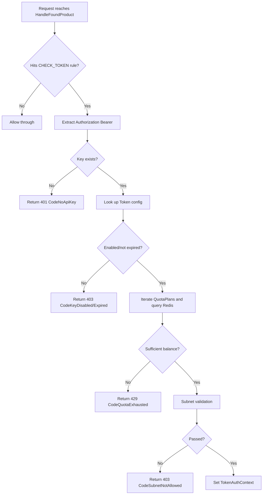
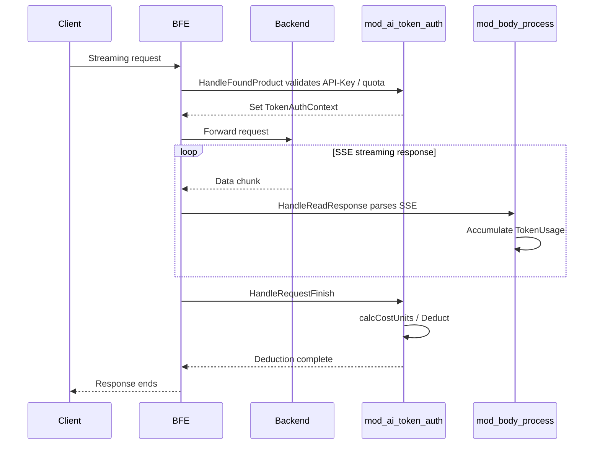

# Chapter 32: Token Authentication and Quota Module Implementation: mod_ai_token_auth

## Chapter Goals

Through this chapter, readers will understand the complete implementation of the `mod_ai_token_auth` module in the Rainway AI Gateway Data Plane:

- Where the module sits in the BFE request processing chain and when it is registered;
- How to validate the API-Key carried by a request and return a structured error response on failure;
- How to bind an API-Key to `QuotaPlan`s and query real-time balances via Redis;
- How to deduct quota at request end based on actual Token usage or RMB cost;
- The reliability semantics of deduction idempotency, no billing on client abort, and `/count_tokens` skipping billing;
- How RMB quota achieves differentiated billing by combining Provider time-period templates with time-period model prices;
- The fallback billing rules: entry-driven billing for image/video and falling back to the chat price when a mode has no price entry;
- Billing observability: access log fields such as `ai_usage_source` / `ai_zero_cost_reason` / `ai_price_miss` and the usage-presence recognition semantics;
- Batch and asynchronous task support (phase 1): endpoint detection, key affinity, and reserve-settle-release billing in `mod_ai_batch`;
- How `mod_ai_token_auth` cooperates with `mod_body_process` in streaming and non-streaming responses.

## Responsibilities of mod_ai_token_auth

`mod_ai_token_auth` (the AI Token authentication module) is the core module in the Data Plane BFE responsible for API-Key authentication and quota deduction. An API-Key represents a business party's access credential to a specific large-model service, and is associated with several `QuotaPlan`s that determine how many resources the credential can consume within a period.

The module's core responsibilities include:

1. **API-Key extraction and validation**: extract the Key from the request's `Authorization: Bearer <api-key>` header, and check its existence, enabled state, expiration time, source IP subnets, etc. When validation fails, a structured error response is constructed and returned to the client immediately, preventing invalid requests from reaching the backend.
2. **Quota balance pre-check**: before a request enters the backend, query the remaining quota of each `QuotaPlan` in Redis, and reject the request when the balance is insufficient or the plan has expired. This step runs only after the request is successfully authenticated; requests that do not hit an authentication rule do not trigger a quota check.
3. **Target model validation**: if the Token configures `Models` or `BlockModels`, the allowlist/blocklist is checked against the final target model at the forwarding stage (see "Target Model Validation (Forwarding Stage)" below); a mismatch returns 400 `CodeModelNotAllowed`.
4. **Deduction at request end**: after the response completes, deduct the `total_token` quota based on the `usage` field in the response body or the Token count estimated from content length; for the `RMB` quota, first convert the cost at the model unit price, then deduct. Requests aborted by the client without a final usage are not billed, `/count_tokens`-style endpoints skip billing, and the `deducted` flag makes deduction idempotent. Deduction failures are caught and recorded as Warn logs, and do not affect the response delivery.
5. **Structured error information**: record the rejection reason and the hit quota plan in `AiBasicInfo.AiAuthInfo`, facilitating access-log and monitoring analysis. These fields are also output by access-log modules such as `mod_access`, providing complete context for troubleshooting.

## Position of the Module in the BFE Module Chain

BFE modules are registered in a fixed order in `bfe_modules/bfe_modules.go`. `mod_ai_token_auth` sits after `mod_unified_waf` and before `mod_ai_route`:

```go
// bfe/bfe_modules/bfe_modules.go
var moduleList = []bfe_module.BfeModule{
    // ... preceding modules ...

    // mod_ai_token_auth
    mod_ai_token_auth.NewModuleAITokenAuth(),

    // mod_ai_route
    // Requirement: after mod_ai_token_auth (needs ClientApiKey)
    mod_ai_route.NewModuleAiRoute(),

    // mod_body_process
    mod_body_process.NewModuleBodyProcess(),

    //depends on token calc
    mod_ai_rate_limit.NewModuleAiRateLimit(),

    // ... subsequent modules ...
}
```

The reason `mod_ai_token_auth` is placed before `mod_ai_route` is that the routing module needs to select dedicated routing rules based on the authenticated API-Key; while `mod_ai_rate_limit` sits after `mod_body_process` because the rate-limit module relies on the Token usage parsed by `mod_body_process` for TPM calculation.

`HandleRequestFinish` is the last callback point in the BFE request lifecycle, at which point all response data (including streaming accumulated Token usage and RMB cost) is ready, so placing quota deduction here ensures it happens exactly once with an accurate amount. If deduction were moved earlier to `HandleReadResponse`, the streaming response would not have ended yet, leading to under-deduction or duplicate deduction.

`mod_ai_token_auth` registers four callbacks during initialization:

- `HandleFoundProduct`: `tokenFoundProductHandler`, completes API-Key validation and the quota pre-check;
- `HandleAfterAITargetModel`: `targetModelCheckFilter`, performs the model allowlist/blocklist check against the final target model after it is resolved and before forwarding, fired per cluster attempt;
- `HandleReadResponse`: `tokenReadResponseHandler`, parses Token usage from the response body in non-streaming scenarios;
- `HandleRequestFinish`: `tokenRequestFinishHandler`, performs the final quota deduction after all response processing completes.

At `HandleAfterAITargetModel`, `mod_ai_token_auth` is registered before `mod_ai_rate_limit`, so the model allowlist check always precedes rate limiting.

```mermaid
flowchart LR
    A[Request enters] --> B[mod_unified_waf]
    B --> C[mod_ai_token_auth<br/>HandleFoundProduct]
    C --> D[mod_ai_route]
    D --> E[Target model resolution<br/>doSingleAIForward]
    E --> F[mod_ai_token_auth<br/>HandleAfterAITargetModel<br/>target model check]
    F --> G[mod_ai_rate_limit<br/>HandleAfterAITargetModel]
    G --> H[Backend model service]
    H --> I[mod_body_process<br/>HandleReadResponse]
    I --> J[mod_ai_token_auth<br/>HandleReadResponse]
    J --> K[mod_ai_token_auth<br/>HandleRequestFinish]
    K --> L[Return to client]
```



## API-Key Validation Flow

The API-Key in the request header must follow this format:

```http
Authorization: Bearer <api-key>
```

`tokenFoundProductHandler` is the module's entry point; its processing logic is located in `bfe/bfe_modules/mod_ai_token_auth/mod_ai_token_auth.go`:

```go
func (m *ModuleAITokenAuth) tokenFoundProductHandler(req *bfe_basic.Request) (int, *bfe_http.Response) {
    meta := req.GetAiBasicInfo()
    if meta == nil {
        return bfe_module.BfeHandlerGoOn, nil
    }

    matched := m.matchTokenRule(req)
    if !matched {
        return bfe_module.BfeHandlerGoOn, nil
    }

    m.state.ReqAuth.Inc(1)
    tok, err := m.ValidateUserTokenByReq(req)
    if err != nil {
        m.state.ReqAuthFail.Inc(1)
        resp := err.CreateErrorResponse(req)
        return bfe_module.BfeHandlerResponse, resp
    }

    promptToken := 0
    if meta.IsAllowEstimateToken() {
        promptToken = int(GetPromptToken(req))
    }
    SetTokenAuthContext(req, tok, int64(promptToken), tok.Tags)

    return bfe_module.BfeHandlerGoOn, nil
}
```

`matchTokenRule` matches rules from the rule table by product; only rules that hit the `CHECK_TOKEN` action trigger subsequent authentication. This design lets administrators flexibly enable or disable authentication per product — for example, allowing internal test products through while enforcing authentication on online products.

The actual validation logic is in `ValidateUserTokenByReq` in `bfe/bfe_modules/mod_ai_token_auth/token_rule_table.go`, executed in the following order:

1. **Extract the API-Key**: call `bfe_basic.GetApiKey(req)`; if empty, return `CodeNoApiKey`.
2. **Look up the Token**: search by `product + key` in the rule table `TokenRuleTable`; if not found, return `CodeInvalidApiKey`. Before a validation failure occurs, the module writes `KeyId` and `ApikeyTags` into `AiBasicInfo` as early as possible, so that even if the request is later rejected, the access log can be correlated to the specific Key and attributed to an Entity.
3. **State validation**: check `Enabled` and `ExpiredTime`; a disabled or expired Key returns `CodeKeyDisabled` or `CodeKeyExpired` respectively.
4. **Quota pre-check**: iterate over `token.QuotaPlans`, skipping `Unlimited` and `PassNoQuota` plans; for finite plans, call `plan.HasBalance` to query Redis — insufficient balance returns `CodeQuotaExhausted`, and an expired plan returns `CodeQuotaExpired`. Multiple quota plans are checked in sequence, and the request is allowed only if all of them pass.
5. **IP subnet validation**: if `Subnet` is configured, check whether `ClientAddr` or `RemoteAddr` is within the allowed subnets; if not, return `CodeSubnetNotAllowed`. Subnets support CIDR notation, and multiple can be configured.

Note in particular that all rejection paths above — the quota pre-check rejection (429 `QUOTA_EXHAUSTED`) and `KEY_DISABLED` / `KEY_EXPIRED` / `QUOTA_EXPIRED` / `SUBNET_NOT_ALLOWED` — preserve the API-Key's tags and write them into the access log field `ai_apikeytags` (pb field 702) along with `ClientKeyId`: rejected rows can also be attributed to Entities for cost and usage accounting, not just allowed requests.

The model allowlist/blocklist is not part of the authentication-stage list above; it is checked against the final target model at the forwarding stage, detailed in the next section.



After validation succeeds, `SetTokenAuthContext` writes information such as `KeyId`, `ApikeyTags`, and the estimated `PromptTokens` into `AiBasicInfo` for use by subsequent modules. For image/video generation modes, it also pre-reads the `n` field of the request body (`GetImageCountFromReq` / `GetVideoCountFromReq`) at the authentication stage to populate `ImageCount` / `VideoCount` as a fallback; when `n` is missing or `<= 0`, it takes 1, preventing under-billing when the response carries no usage:

```go
if aiBasicInfo.Mode == bfe_basic.ModeImageGeneration {
    tusage.ImageCount = GetImageCountFromReq(req)
}
if aiBasicInfo.Mode == bfe_basic.ModeVideoGeneration {
    tusage.VideoCount = GetVideoCountFromReq(req)
}
```

## Target Model Validation (Forwarding Stage)

The Token's `Models` (allowlist) and `BlockModels` (blocklist) are validated at the forwarding stage, not by reading the `model` field of the request body during authentication. The entry point is `targetModelCheckFilter`, registered by `mod_ai_token_auth` at the `HandleAfterAITargetModel` callback point (`bfe/bfe_modules/mod_ai_token_auth/model_check.go`): every cluster attempt in `ServeHTTPForAI()` fires this callback inside `doSingleAIForward`, before `clusterInvoke` is invoked. By that time `AiBasicInfo.TargetModel` has already been resolved by `computeTargetModel` — applying, in order, the route target/fallback target model override, the cluster's `StripPrefix`/`MatchPrefix` prefix stripping, and the cluster's `ModelMapping` — so the object being validated is exactly the final model name sent upstream. The logic of `ValidateTargetModel`:

```go
func (m *ModuleAITokenAuth) ValidateTargetModel(req *bfe_basic.Request, targetModel string) *bfe_basic.AiError {
    ctx := GetTokenAuthContext(req)
    if ctx == nil || ctx.Token == nil {
        return nil // no auth rule matched or unauthenticated: no check
    }
    tok := ctx.Token
    if len(tok.Models) == 0 && len(tok.BlockModels) == 0 {
        return nil // no allowlist/blocklist configured: pass
    }
    model := strings.TrimSpace(targetModel)
    if model == "" {
        // an allowlist/blocklist is configured but the target model is
        // undetermined: reject as "model not found"
        return ... // CodeInvalidRequest, HTTP 400
    }
    // check the blocklist first, then the allowlist (non-empty allowlist requires a hit)
    // a mismatch returns CodeModelNotAllowed, HTTP 400
}
```

On rejection, `targetModelCheckFilter` returns `BfeHandlerFinish` with a locally constructed 400 error response; that attempt is not sent upstream and triggers neither API-Key rotation nor cluster fallback. The result is recorded via `SetAiAuthInfo` into `AiBasicInfo.AiAuthInfo.RejectReason`, so access logs can correlate the rejection reason.

Firing per attempt means cluster-level fallback re-validates the target model resolved for each attempt: when the primary target is rejected by the allowlist, the request carries the `RejectReason` into the backup cluster attempt, and if a later attempt succeeds, `ServeHTTPForAI()` clears the stale `RejectReason` (and `RejectQuotaPlans`) when breaking out of the forwarding loop, so the access log of a successful request does not carry an old rejection reason. Consequently the route target model override and the API-Key model allowlist compose in a "redirect first, validate second" manner: the allowlist constrains the post-forwarding target model, not the raw model in the client request body.

For native Gemini paths (of the form `/v1beta/models/<model>:<action>`, in contrast to `:publishers/.../models/<model>:generateContent`), the model name is taken from the URL path (`ExtractModelFromPath` in `bfe_model_protocol/gemini`); it enters the same `TargetModel` resolution chain, so the allowlist check applies to it as well.

## Upstream Key Selection, Penalty, and Credential Header Injection

Before a single forwarding attempt, `aiClusterInvoke()` (`bfe/bfe_server/reverseproxy.go`) selects an upstream Key from the cluster's `AIConf.Keys`. Selection and failure handling follow these rules.

### Key Penalty and Weight=0

- Every selection skips Keys with `Weight=0`: a zero weight means the Key is not eligible for selection, and the penalty filter does not count it as a candidate either;
- On upstream 429, the current Key is marked used and rotated within this request; when session-affinity penalty is enabled (`SessionAffinity` and `SessionAffinityPenaltyEnable`), a 429-tier penalty mark is also written, with the duration taken from `KeyPolicy.SessionAffinityPenaltyTTL429` (configurable, default 60s);
- On upstream 401/402/403, the current Key is marked dead within this request; when session-affinity penalty is enabled, an auth-tier penalty mark is written, with the duration taken from `SessionAffinityPenaltyTTLAuth` (configurable, default **300s**);
- On upstream 5xx or a connection error, the current Key is kept for retry; other 4xx responses (e.g. 400) stop Key rotation without penalizing. A batch/file 404 is the exception — the batch bindings are cleared and a 60s penalty is written for the current Key (when session-affinity penalty is enabled; fixed at 60s and not affected by the two TTL settings), so subsequent operations rebind to the Key that holds the resource;
- Key attempt states are accounted in the **`AIConf.Keys` index space** (independent of the filtered sub-slice indices, so failure marks never land on innocent Keys and healthy siblings are not "hidden", which would synthesize a 429 directly);
- When the penalty filter leaves an empty candidate set, the circuit breaker trips: there is no fallback to the original Key list, and penalized Keys recover only when their TTL expires. TTL normalization: `0` means "use the default" rather than disabled, negative values are config errors, and values `>86400` are truncated to 86400 with a warning.

### 429 NO_AVAILABLE_KEY

When the candidate set is empty, `aiClusterInvoke()` synthesizes a 429 response instead of returning an opaque 5xx:

- `error.code=NO_AVAILABLE_KEY`, `error.type=rate_limit_error`, message `no available upstream api key for this cluster`;
- the response carries `Retry-After: 60`, and `error.details.retry_after_seconds=60` in the body; the value is fixed and does not vary with the penalty type that caused the exhaustion (429 or 401/402/403);
- the response is marked as gateway-generated (`X-Bfe-Gw-Error: 1`), so error normalization does not rewrite it to a 502;
- the error code deliberately does not reuse `ErrAiRateLimit`: a local rate limit short-circuits cluster fallback, whereas key exhaustion must still allow the fallback cluster to be tried; without a fallback the caller receives a retryable 429.

### Mutual Exclusion of Outbound Credential Headers

Before injecting an upstream credential, `doSingleAIForward()` sanitizes the outbound request's credential headers (`sanitizeOutboundCredentials`):

- the adapter's `InjectAuth` writes the single credential header for the selected attempt (`Authorization` for openai, `x-api-key` for anthropic, `x-goog-api-key` for gemini);
- every other credential header in the registry (the union from `modelprotocol.CredentialHeaderNames()`) is deleted from the outbound request. Upstreams pick a credential by their own priority (e.g. preferring `x-api-key` over `Authorization` when both exist), so a residual client credential silently overrides the injected one and the resulting 401 is wrongly charged as a penalty against that Key;
- the header map is `Clone()`d before deletion: outbound headers share the underlying map with the inbound request, and deleting in place would break inbound authentication, billing, log masking, and the key-affinity session identifier;
- when the cluster has no `Keys` configured (`len(AIConf.Keys)==0`), Key selection and injection are skipped entirely — neither sanitizing nor injecting — and client credentials reach the upstream with passthrough semantics.

## Quota Plan Binding and Balance Query (Redis)

### Configuration Structure

The runtime definition of `QuotaPlan` in BFE is located in `bfe/bfe_modules/mod_ai_token_auth/token.go`:

```go
type QuotaPlan struct {
    Id          string
    Unlimited   bool
    PassNoQuota bool
    RedisKey    string
    ExpiredTime int64  // -1 means never expired
    Quota       int64  // fixed-point integer: Token count for total_token; 1e-8 RMB for RMB
    Unit        string // "total_token" or "RMB"
}
```

When exporting configuration, the Control Plane already generates a stable `RedisKey` for each quota plan, in the format `QUOTA_<stableId>`, where `stableId` is the API-Key value for API-Key-level quota, or `entity_id` for Entity-level quota. BFE uses the delivered `RedisKey` directly and no longer assembles it from the plan name or ID itself, thereby avoiding counter resets caused by renames. This principle is consistent with the Redis key stability design of `mod_ai_rate_limit`: counter keys must not depend on any user-editable business field. For the related design, see `bfe/docs/zh_cn/sys_design/ai_rate_limit_redis_key.md`.

When `Unit` in `QuotaPlan` is empty, `token_rule_load.go` defaults it to `total_token`, ensuring backward compatibility with old configurations. During configuration validation, the validity of `Quota` is also checked based on the unit type: both `RMB` and `total_token` must be no less than 0. A `total_token` quota is allowed to be 0, which means a "no-balance plan" — an API-Key bound to such a plan is rejected at the quota pre-check with insufficient balance (429 `CodeQuotaExhausted`), suitable for scenarios where the Key is created first and quota is granted later.

### Balance Query

`QuotaPlan.HasBalance` uses the Redis client to read the current remaining amount:

```go
func (q *QuotaPlan) HasBalance(client redis_client.Client) (bool, int64, error) {
    if q.Unlimited {
        return true, q.Quota, nil
    }

    if q.RedisKey == "" {
        return false, 0, errors.New("RedisKey is empty")
    }

    current, err := client.GetInt64(q.RedisKey)
    if err != nil {
        // A missing key (e.g. a zero-quota plan never synced to Redis)
        // means no balance, not an internal error
        if redis_client.IsKeyNotFound(err) {
            return false, 0, nil
        }
        return false, 0, err
    }

    return current > 0, current, nil
}
```

For a `total_token` quota, the Redis value is the remaining Token count; for an `RMB` quota, the Redis value is a fixed-point integer in units of `1e-8` RMB. `Unlimited` plans return `true` directly and do not participate in balance checks. Note that the pre-check reads the real-time balance in Redis rather than the `Quota` field in the configuration: when the balance key does not exist (for example, a zero-quota plan that was never synced to Redis), it is treated as no balance, and the request is rejected with 429 `CodeQuotaExhausted` at the pre-check stage instead of returning a 500 internal error.

### Control Plane Balance Synchronization

When creating an API-Key / Entity, the Control Plane `ai-gateway-api` writes the initial balance to Redis via `QuotaCache.SetRemaining`; on periodic or manual resets, it uses `IncrBy(delta)` to atomically adjust the balance instead of issuing a direct `SET`, to avoid overwriting counters that concurrent requests have just deducted. For details, see `ai-gateway-api/design-docs/sys-design/details/配额余额同步机制.md`.

## Quota Deduction at Request End

Quota deduction happens in `HandleRequestFinish`, when the response has already been fully returned to the client. `tokenRequestFinishHandler` only handles HTTP 200 requests, and prefers the actually parsed Token usage; if the response has no `usage`, estimation is allowed, and the response completed normally, it estimates based on content length. The processing order is: skip `/count_tokens` endpoints first, then check the idempotency mark, then handle client-abort scenarios, and finally enter the normal usage settlement:

```go
func (m *ModuleAITokenAuth) tokenRequestFinishHandler(req *bfe_basic.Request, res *bfe_http.Response) int {
    // /count_tokens endpoints only count tokens and are never billed
    if strings.Contains(req.HttpRequest.RequestURI, "/count_tokens") {
        return bfe_module.BfeHandlerGoOn
    }

    if res == nil || res.StatusCode != bfe_http.StatusOK {
        // only count used quota for successful requests
        return bfe_module.BfeHandlerGoOn
    }

    ctx := GetTokenAuthContext(req)
    if ctx == nil {
        return bfe_module.BfeHandlerGoOn
    }

    // HandleRequestFinish may be triggered more than once; deduct only once
    if ctx.deducted {
        return bfe_module.BfeHandlerGoOn
    }

    // Client aborted (RST/close/write-fail) before the final usage was
    // seen: never bill by full-request estimation
    aborted := isClientAbortErr(req.ErrCode)
    if aborted && !ctx.aiBasicInfo.IsFinalUsageSeen() {
        ctx.deducted = true
        return bfe_module.BfeHandlerGoOn
    }

    tokenUsage := ctx.aiBasicInfo.GetTokenUsage()
    // Estimated values are billable only when the response completed
    // normally; otherwise reset the estimate fields, since calcCostUnits
    // below bills from the token fields directly
    estimateBillable := ctx.aiBasicInfo.IsAllowEstimateToken() &&
        ctx.aiBasicInfo.IsResponseCompleted()
    if !ctx.aiBasicInfo.IsFinalUsageSeen() && !estimateBillable {
        tokenUsage.PromptTokens = 0
        tokenUsage.CompletionTokens = 0
        tokenUsage.UsedQuota = 0
    }
    if tokenUsage.UsedQuota <= 0 && estimateBillable {
        tokenUsage.UsedQuota = CalcReqUsedQuota(req, tokenUsage.PromptTokens, tokenUsage.CompletionTokens)
    }

    // Calculate RMB cost from the TokenUsage already populated by
    // mod_body_process (streaming) or tokenReadResponseHandler (non-streaming)
    if tokenUsage.UsedCost <= 0 && hasRMBPlan(ctx.Token.QuotaPlans) {
        tokenUsage.UsedCost = m.calcCostUnits(req, ctx.serverConf, tokenUsage)
    }

    costUnits := tokenUsage.UsedCost

    if tokenUsage.UsedQuota > 0 || costUnits > 0 {
        for _, plan := range ctx.Token.QuotaPlans {
            if plan.Unlimited {
                continue
            }
            if quota.IsRMB(plan.Unit) {
                if costUnits > 0 {
                    _, err := plan.Deduct(m.redisClient, costUnits)
                    if err != nil {
                        log.Logger.Warn("deduct rmb quota failed: %v", err)
                    }
                }
            } else {
                if tokenUsage.UsedQuota > 0 {
                    _, err := plan.Deduct(m.redisClient, tokenUsage.UsedQuota)
                    if err != nil {
                        log.Logger.Warn("deduct token quota failed: %v", err)
                    }
                }
            }
        }
    }

    ctx.deducted = true
    return bfe_module.BfeHandlerGoOn
}
```

Here `isClientAbortErr` determines client-side abort errors:

```go
func isClientAbortErr(err error) bool {
    return err == bfe_basic.ErrClientWrite ||
        err == bfe_basic.ErrClientClose ||
        err == bfe_basic.ErrClientReset
}
```

### Deduction Idempotency

`TokenAuthContext` carries a `deducted` flag. `HandleRequestFinish` can be triggered multiple times in some scenarios (for example, abnormal connection teardown); the handler checks `ctx.deducted` at entry and returns immediately if already deducted, and sets the flag after the deduction loop on the normal path. This guarantees that a single request is deducted at most once no matter how many times the handler fires.

### No Billing on Client Abort and Estimation Reliability Semantics

Estimating Tokens from content length (`EstimateToken`: `Content-Length/4` of the request body for input, response body length for output) is only a fallback and is allowed to participate in billing only when the response completed normally. `EstimateToken` defaults to `true` out of the box. Usage recognition works by presence (rather than by value): a response that explicitly reports an all-zero usage object (e.g. `prompt_tokens=0, completion_tokens=0`) is not misjudged as "no usage"; `EstimateToken` only backstops requests from which no usage object was ever collected. For this purpose, `bfe_basic.AiBasicInfo` maintains two sets of state marks:

- `MarkResponseCompleted` / `IsResponseCompleted`: set when the response finishes normally. In streaming scenarios, `mod_body_process` sets it when a termination event is seen (Anthropic `message_stop`, OpenAI `[DONE]`, Responses API `response.completed`); in non-streaming scenarios, `tokenReadResponseHandler` sets it after the full response body is read. In addition, an SSE response that omits the termination event and ends with a clean EOF without usage is also treated as complete (the clean-EOF completion marker is set only when `copyResponse` succeeds, the status is 200, and the mode is not file/batch), so the `EstimateToken` fallback can bill such responses.
- `MarkFinalUsageSeen` / `IsFinalUsageSeen`: set when the final usage is parsed from the response. In streaming scenarios, `QuotaUsageProcessor` sets it when the final usage event arrives (such as Anthropic `message_delta`, Responses API `response.completed`, or an event carrying `image_count` / `video_count`); in non-streaming scenarios, it is set after a non-zero `UsedQuota` is parsed. The initial usage of Anthropic `message_start` (`output_tokens = 0`) does not count as final usage.

The settlement rules are:

1. **Client aborted and no final usage seen** (`req.ErrCode ∈ {ErrClientWrite, ErrClientClose, ErrClientReset}` and `IsFinalUsageSeen() == false`): set `deducted` and return without billing. When the client disconnects midway, the response body is incomplete, and full-request estimation would greatly overestimate;
2. **Not aborted but the response did not complete** (for example, abnormal backend teardown): reset the estimate fields `PromptTokens` / `CompletionTokens` / `UsedQuota` before billing with the normal formula, preventing estimate values from polluting the RMB cost calculation (`calcCostUnits` reads the token fields directly, so guarding `UsedQuota` alone is not enough);
3. **Response completed normally**: estimates are usable; `UsedQuota` is computed via `CalcReqUsedQuota` and deduction proceeds.

### /count_tokens Skips Billing

Endpoints such as Anthropic's `/v1/messages/count_tokens` are used to pre-count Tokens and do not represent real calls. `tokenRequestFinishHandler` detects this via `RequestURI` containing `/count_tokens` and passes through directly, preventing token-counting requests from being counted against the quota.

### total_token Deduction

`total_token` quota is deducted atomically using a Lua script, located in `bfe/bfe_modules/mod_ai_token_auth/token.go`:

```go
func (q *QuotaPlan) deductToken(client redis_client.Client, amount int64) (int64, error) {
    lua := `
        local current = tonumber(redis.call('GET', KEYS[1]) or '0')
        local amount = tonumber(ARGV[1])
        local deduct = math.min(current, amount)
        if deduct > 0 then
            redis.call('DECRBY', KEYS[1], deduct)
        end
        return math.max(0, current - deduct)
    `
    script := client.NewScript(lua)
    result, err := script.Run(q.RedisKey, amount)
    // ...
}
```

The script uses `math.min(current, amount)` to ensure the balance never goes negative even when insufficient, and returns the remaining amount after deduction. The Lua script executes in Redis's single thread, so reading the balance and deducting are atomic — this prevents over-deduction where multiple requests concurrently read the same balance and both judge it sufficient under high concurrency.

### RMB Deduction

RMB quota deduction needs to handle the case where the Key does not exist (for example, the first request after Redis data is cleaned, or a newly created API-Key whose balance has not been initialized). The Lua script first initializes the Key with the total quota amount, then performs the deduction:

```go
func (q *QuotaPlan) deductRMB(client redis_client.Client, amount int64) (int64, error) {
    lua := `
        local raw = redis.call('GET', KEYS[1])
        local current
        if raw == false then
            current = tonumber(ARGV[2])
            redis.call('SET', KEYS[1], current)
        else
            current = tonumber(raw)
        end
        local cost = tonumber(ARGV[1])
        local deduct = math.min(current, cost)
        if deduct > 0 then
            redis.call('DECRBY', KEYS[1], deduct)
        end
        return math.max(0, current - deduct)
    `
    script := client.NewScript(lua)
    result, err := script.Run(q.RedisKey, amount, q.Quota)
    // ...
}
```

### Non-200 Requests Are Not Billed

`tokenRequestFinishHandler` returns immediately when `res.StatusCode != 200`, preventing requests that fail at the backend, time out, or are rejected by authentication from incorrectly consuming quota. This is consistent with the behavior of `NewQuotaUsageProcessor` in `mod_body_process`, which also returns `nil` immediately when `res.StatusCode != 200`.

Non-2xx responses also clear any `EstimateToken` estimation residue, preventing estimated values from entering the metering of failed rows. On the access log side, the three token fields (`ai_input_tokens` / `ai_output_tokens` / `ai_total_tokens`) are emitted according to `usageDisposition`: when the disposition is `none` (non-2xx), all three fields are absent, distinguishing "no usage" from "usage of 0" in the logs. Meanwhile, `ai_cost_value` is now written for every observed 2xx row (including zero-cost rows) — for billing reconciliation, "not billed" can no longer be determined by `ai_cost_value IS NULL`; use `ai_cost_value = 0` together with `ai_zero_cost_reason` for attribution instead.

## RMB Quota and Time-Period Pricing

The core of RMB quota is to convert Token usage into RMB cost at the model unit price, then deduct it from the Redis balance. To support peak/off-peak time-period pricing for models such as DeepSeek, BFE maintains a complete set of time-period templates and price tables in `AIConf.ModelTable`.

### ModelTable Structure

`bfe/bfe_config/bfe_cluster_conf/cluster_conf/cluster_conf_load.go` defines the runtime price structures:

```go
type ModelTable struct {
    Currency string      // always "RMB"
    TimeZone string      // default "Asia/Shanghai"
    Tiers    []PriceTier // time-period definitions, e.g. peak
    Models   []ModelPrice
}

type ModelPrice struct {
    Provider            string
    Model               string
    BaseModel           string
    Mode                string
    Prices              PriceMap     // default prices
    TierPrices          TierPriceMap // tier name -> price table
    // ...
}
```

During configuration loading, prices keep their `float64` values (only non-negative validation is performed); at runtime, `ModelTable.GetPrice(tier, key)` returns the tier price when the tier and key are hit, falls back to the default price for missing keys, and returns 0 when unconfigured.

### Time-Period Matching

`ModelTable.ActiveTierName` determines whether the current moment (based on `time.Now()`) falls into a tier, using the configured time zone:

```go
func (table *ModelTable) ActiveTierName(now time.Time) string {
    if table == nil || len(table.Tiers) == 0 || table.tz == nil {
        return ""
    }
    t := now.In(table.tz)
    wd := int(t.Weekday())
    cur := t.Hour()*60 + t.Minute()

    for i := range table.Tiers {
        tier := &table.Tiers[i]
        for _, tr := range tier.TimeRanges {
            if len(tr.Weekdays) > 0 && !containsInt(tr.Weekdays, wd) {
                continue
            }
            start, _ := minutesFromHHMM(tr.Start)
            end, _ := minutesFromHHMM(tr.End)
            if start <= cur && cur < end {
                return tier.Name
            }
        }
    }
    return ""
}
```

If no tier is hit, or a tier is missing a price key, it falls back to the default `Prices`. This fallback mechanism guarantees that: administrators can configure differentiated prices only for peak periods first, with off-peak periods automatically using default prices; they can also migrate existing fixed-price configurations gradually, without filling in all tier prices at once.

Time zone parsing happens at configuration load time, via the Go standard library `time.LoadLocation`. When building the deployment container image, make sure the IANA time zone database is included; otherwise time zone parsing will fail and fall back to UTC, which may shift peak-period determination.

### Cost Calculation

`calcCostUnits` is located in `bfe/bfe_modules/mod_ai_token_auth/mod_ai_token_auth.go`. It looks up the corresponding `ModelPrice` based on the target Cluster, target model, and request mode, then dispatches to a mode-specific billing function:

```go
switch mode {
case bfe_basic.ModeImageGeneration:
    return calcImageGenerationCost(entry, usage, tierName)
case bfe_basic.ModeVideoGeneration:
    return calcVideoGenerationCost(entry, usage, tierName)
case bfe_basic.ModeResponses:
    return calcResponsesCost(entry, usage, tierName)
default:
    return calcChatCost(entry, usage, tierName)
}
```

The mode is determined by `bfe_basic.DetectModeFromPath` from the request path (the endpoint table is `openAIEndpointModes` in `bfe_basic/openai_endpoint.go`): an optional `/v1` version prefix is stripped first, then the shared endpoint table is consulted — `/responses` maps to `ModeResponses` and `/video/generations` to `ModeVideoGeneration`; endpoints such as `/chat/completions`, `/embeddings`, and `/images/generations` map to their dedicated modes; endpoints without a dedicated mode and unknown paths fall into the default `ModeChat`; provider-native entries ending in a `/v1` segment such as `/compatible-mode/v1/responses` are likewise reduced to the endpoint table and recognized as `ModeResponses`.

`calcChatCost` supports multiple fine-grained billing dimensions:

- Normal input / output Tokens (`input_cost_per_token`, `output_cost_per_token`)
- Cache-hit input Tokens (`cache_read_input_token_cost`)
- Cache-write input Tokens (`cache_creation_input_token_cost`)
- Image input Tokens (`input_cost_per_image_token`)
- Audio input / output Tokens (`input_cost_per_audio_token`, `output_cost_per_audio_token`)

Before calculation, sanitization is performed: each component is ensured to be non-negative and not to exceed its corresponding total; then cache read/write, image input, and audio input Tokens are split out of the total input and priced separately. When `input_cost_per_image_token` or an audio input price is configured, the corresponding input Tokens are split out of `normalInput` and priced individually; when these refinement prices are not configured, image/audio input Tokens are billed as regular input Tokens. When none of the cache / audio / image refinement price keys is configured, it falls back to the legacy formula `promptTokens × inputCost + completionTokens × outputCost`. Each billing line item is converted via `quota.CalcCostUnits(usage, price)` (i.e. `round(usage × price × 1e8)`, where 1 integer unit = 1e-8 RMB) and accumulated in int64; floating point participates only in the single multiplication per line item, producing no floating-point accumulation error.

One prerequisite of the cache split deserves emphasis: `PromptTokens` must be the total input Token count. The Anthropic protocol's `input_tokens` excludes cache read/write Tokens, and the protocol adapter layer (`ParseAnthropicUsageFields` in `bfe/bfe_model_protocol/utils/usage_parse.go`) has normalized it to `input_tokens + cache_read_input_tokens + cache_creation_input_tokens`, aligning with the semantics of OpenAI's `prompt_tokens`. The unified extraction of usage fields also now lives in the protocol adapter layer (see [Chapter 7: Data Plane Forwarding Design: BFE](../design/chapter07-data-plane-design.md) and [Chapter 29: AI Routing Module Implementation: mod_ai_route](./chapter31-mod-ai-route.md)); this chapter focuses only on the settlement logic.

`calcResponsesCost` directly reuses chat billing; `calcVideoGenerationCost` bills `VideoCount × output_cost_per_video`, where `VideoCount` is taken from `usage.video_count` in the response, falling back to `data.#`; `calcImageGenerationCost` bills `ImageCount × output_cost_per_image + ImageInputTokens × input_cost_per_image_token`.

Billing for image_generation / video_generation is entry-driven, and the discriminator is **whether the price key exists** (`ModelPrice.HasPrice`, `bfe/bfe_config/bfe_cluster_conf/cluster_conf/cluster_conf_load.go`), not its value: when the matched entry lacks the per-unit price key (`output_cost_per_image` / `output_cost_per_video`), billing falls back to the chat token formula (`calcChatCost`); a mixed entry (holding both kinds of keys) is billed per unit; an explicit `output_cost_per_image = 0` is still billed per image with a cost of 0 (video is symmetric) — "zero price" differs semantically from "key missing."

In addition, when the price table has no entry for the current `(model, mode)` (for example, a model with only a `mode=chat` price is called via the `/responses` entry), `calcCostUnits` falls back to the same model's chat price instead of billing 0, and marks observability signals: the counter `PriceFallbackUsed` records fallback billing, `PriceLookupMiss` records cases with no fallback baseline at all, and both kinds of miss set the access log field `ai_price_miss` (pb field 763, `bfe-access-pb` ≥ v0.3.14) to true. Traffic in the `ModeFile` / `ModeBatch` modes of the files/batches endpoints is handled by `mod_ai_batch` (see "Batch and Asynchronous Task Support" below) and never enters the chat billing paths above.

For how the Control Plane generates and delivers time-period configurations, see `ai-gateway-api/design-docs/sys-design/details/RMB配额分时段定价.md`.

## Batch and Asynchronous Task Support (Phase 1): mod_ai_batch

Beyond per-request billing, `mod_ai_token_auth` cooperates with the dedicated `mod_ai_batch` module (`bfe/bfe_modules/mod_ai_batch/`) to provide phase-1 support for the OpenAI Batch API (the `/v1/files` and `/v1/batches` endpoint families). The design background (the reserve-settle-release model, the `batch_files` / `batch_tasks` tables, the Redis key contract, and the reconcile job) is covered in [Chapter 12: Quota and Rate Limit Design](../design/chapter12-quota-and-rate-limit.md); this section focuses on the Data Plane implementation.

### Endpoint Detection and Traffic Isolation

`bfe_basic.DetectModeFromPath` recognizes dedicated modes `ModeFile` / `ModeBatch` for the files/batches endpoint families, and `mod_ai_batch` only acts on requests in these two modes. Batch traffic therefore no longer falls into the chat billing path: the files/batches management endpoints never become billable model calls, and their zero cost is by design rather than an anomaly.

### Upload Counting and Streaming Forwarding

File uploads are counted for lines and bytes while being forwarded (the counting reader in `file_counter.go`), and large files are forwarded in a streaming manner with no retry buffering — when an upload is interrupted by the client or fails upstream, the already-streamed content is not cached, and the client re-uploads. Chunked uploads without `Content-Length` are enforced mid-stream by the `mod_ai_batch` counting reader against the effective ceilings (`AiBasicInfo.BatchEffMaxFileBytes` / `BatchEffMaxFileLines`).

### Batch-Level Key Affinity

The create / retrieve / cancel / result-download operations of a batch task must land on the same Data Plane instance (the task entity is maintained in-instance). `mod_ai_batch` establishes batch-level key affinity on a first-come-first-served basis via Redis `SETNX`: the instance that wins the affinity at creation handles all subsequent operations of the batch, keeping the four steps (upload → create → retrieve → download) on the same API-Key.

### Cancel Requests to keyless Providers

A cluster whose Provider is keyless (`AIConf.Keys` empty) skips Key selection and credential injection entirely (the `len(cluster.AIConf.Keys)==0` branch in `aiClusterInvoke()`), so a batch cancel passed through the Data Plane carries no gateway-side authentication header; that branch also skips outbound credential sanitizing, and client-supplied credential headers are forwarded unchanged under passthrough semantics. Cancellation state and idempotency are maintained by the Control Plane (a request hitting `cancelling` returns 200 and re-sends the upstream cancel); see [Appendix 1: OpenAPI Quick Reference](../appendix/appendix01-openapi-quick-reference.md).

### Postpaid Quota: Reserve-Settle-Release

The final usage of a batch is unknown at creation time, so billing adopts a postpaid reserve-settle-release model:

1. **Reserve on create with a pre-check**: `POST /v1/batches` first performs a quota pre-check and reserves quota;
2. **Settle on result download**: when the result file is downloaded, the fee is settled per model at batch prices (the `mode=batch` price rows; see [Chapter 13: Model Pricing and Cost Accounting Design](../design/chapter13-model-pricing.md)), grouped by the model in each line;
3. **Release on cancel/terminal state**: the reservation is released when the batch is cancelled or reaches a terminal state.

Idempotency is guaranteed by `BATCH_RESERVE_BATCH:<batch_id>` (reservation bookkeeping) and `BATCH_SETTLED` (settlement deduplication SETNX lock); the Control Plane additionally runs a reconcile job as a backstop.

### Access Log Batch Fields

`bfe-access-pb` ≥ v0.3.13 provides 7 access log fields for batch scenarios (pb 901-907), read from `AiBasicInfo` by `mod_access_pb3`:

| Field | pb No. | Description |
|------|---------|------|
| `ai_batch_id` | 901 | Batch task ID |
| `ai_file_id` | 902 | File ID |
| `ai_batch_op` | 903 | Batch operation type (create / upload / retrieve / cancel / download, etc.) |
| `ai_file_lines` | 904 | Uploaded file line count |
| `ai_file_bytes` | 905 | Uploaded file byte count |
| `ai_batch_status` | 906 | Batch status |
| `ai_batch_settle` | 907 | Settlement status/result marker |

## Cooperation with mod_body_process

`mod_body_process` is responsible for parsing Token usage from streaming (SSE) response bodies, while `mod_ai_token_auth` handles parsing of non-streaming response bodies and the final quota deduction. The two share data via `AiBasicInfo.TokenUsage`.

### Non-Streaming Responses

For non-streaming requests, `mod_ai_token_auth` reads the complete response body directly in `HandleReadResponse`:

```go
func (m *ModuleAITokenAuth) tokenReadResponseHandler(req *bfe_basic.Request, res *bfe_http.Response) int {
    ctx := GetTokenAuthContext(req)
    if ctx == nil {
        return bfe_module.BfeHandlerGoOn
    }
    tokenUsage := ctx.aiBasicInfo.GetTokenUsage()
    if res.StatusCode == bfe_http.StatusOK && res.ContentLength >= 0 {
        // The full response body was read: the response is complete
        ctx.aiBasicInfo.MarkResponseCompleted()
        if bodyAccessor, err := res.GetBodyAccessor(); err == nil {
            body, _ := bodyAccessor.GetBytes()
            UpdateCtxByUsage(ctx, body)
        }
        if tokenUsage.UsedQuota > 0 {
            ctx.aiBasicInfo.MarkFinalUsageSeen()
        }
        // If still no usage and estimation is allowed
        if tokenUsage.UsedQuota <= 0 && ctx.aiBasicInfo.IsAllowEstimateToken() {
            tokenUsage.CompletionTokens = int64(res.ContentLength) / 4
            tokenUsage.UsedQuota = CalcReqUsedQuota(req, tokenUsage.PromptTokens, tokenUsage.CompletionTokens)
        }
    }

    return bfe_module.BfeHandlerGoOn
}
```

`UpdateCtxByUsage` delegates the field extraction to the protocol adapter layer: based on the `AiBasicInfo.AuthStyle` identified at the request stage, it picks the corresponding adapter (`modelprotocol.Get(authStyle).ExtractUsageFields`), and `bfe_model_protocol` extracts the usage fields of each protocol — `PromptTokens`, `CompletionTokens`, cache read/write, image input, image/video counts, etc. — and writes them back into `TokenUsage`. This both accommodates usage differences across protocols such as OpenAI, DeepSeek, and Anthropic (e.g. DeepSeek's `prompt_cache_hit_tokens`, Anthropic's `message.usage` nesting), and allows usage extraction for new protocols to be extended independently within the adapter layer.

When the response body truly has no `usage` field (for example, some privately deployed models do not return usage), and estimation is allowed, the module roughly estimates the output Token count as `Content-Length / 4` and combines it with the input Token count estimated from the request body to produce an approximate usage. Estimation serves only as a last resort and is not recommended for precise billing scenarios.

### Streaming Responses

For streaming responses, `mod_body_process` parses SSE events segment by segment in `HandleReadResponse`, and accumulates Token usage into `AiBasicInfo.TokenUsage` via `QuotaUsageProcessor.Process`. Because a streaming response has not ended yet at the `HandleReadResponse` stage, `tokenReadResponseHandler` of `mod_ai_token_auth` usually cannot obtain the complete usage; the final deduction is performed by `tokenRequestFinishHandler` at the `HandleRequestFinish` stage, reading the already populated `TokenUsage`.

While parsing each SSE event, `QuotaUsageProcessor` also maintains the billing-reliability state: it calls `MarkResponseCompleted` when a termination event is seen (Anthropic `message_stop`, OpenAI `[DONE]`, Responses API `response.completed`), and calls `MarkFinalUsageSeen` when a final usage event arrives (Anthropic `message_delta`, Responses API `response.completed` — which is both a termination event and a final usage event, with its usage nested under `response.usage`). In Anthropic streaming, `message_start` carries only the initial usage (`output_tokens = 0`), and `message_delta` carries the final output tokens but no prompt fields — the Processor always processes the final usage event, and in the `message_delta` scenario it retains the `PromptTokens`, `CacheReadTokens`, `CacheWriteTokens`, and other fields parsed at the `message_start` stage, updating only the completion part, avoiding cache Token loss or double counting. These two state marks are exactly the basis on which `tokenRequestFinishHandler` decides "no billing on client abort, estimates usable only on normal completion".



This division of labor guarantees that, whether streaming or non-streaming, `TokenUsage` is already available at the `HandleRequestFinish` stage, and `mod_ai_token_auth` only needs to execute the unified deduction logic.

## Billing Observability: Usage Source and Zero-Cost Attribution

To make "zero billing / skipped billing" explainable and queryable in reconciliation, the billing path emits a set of attribution fields to the access log (written by `bfe_modules/mod_access_pb3`; `bfe/docs/zh_cn/sys_design/ai_access_log_fields.md` is the complete field manual).

### Usage Source Marker ai_usage_source

`ai_usage_source` (string, pb field 764, `bfe-access-pb` ≥ v0.3.15) marks the usage source of the current billing, taking one of the following values:

| Value | Meaning |
|----|------|
| `parsed` | Billed with the upstream real usage (including responses that explicitly report an all-zero usage object) |
| `estimated` | The upstream returned no usage and the `EstimateToken` estimate was approved for billing |
| `unrecognized` | Usage not recognized; billing skipped |
| `aborted` | Client disconnected early; billing skipped |

Non-2xx rows do not carry this field. It is set at the same point as the billing decision, so billing bypasses can be queried directly in reconciliation.

### Zero-Cost Attribution ai_zero_cost_reason

`ai_zero_cost_reason` (string, pb field 765, `bfe-access-pb` ≥ v0.3.16) explains why a "2xx, RMB quota plan bound, yet zero billing" occurred. Possible values: `unrecognized` / `aborted` / `cache_hit` / `batch_release` / `price_miss` / `price_zero` / `model_table_missing` / `config_missing` / `no_usage_tokens` / `cost_zero`. Rows that were billed, rows without an RMB plan, and non-2xx rows do not carry this field; neither do the batch and files management endpoints (with mode `file`/`batch`) nor requests without a resolved `target_model` — they never became billable model calls, and their zero cost is by design. AI cache hits only write the `cache_hit` marker and are not counted by the `BillingZeroCost` counter.

### Automatic Final-Usage Injection

To let streaming responses carry real usage as often as possible, BFE provides the `Server.InjectStreamUsage` configuration (`bfe.conf`, enabled by default): when an OpenAI streaming chat/completions request does not explicitly set `stream_options.include_usage`, `stream_options.include_usage=true` is injected before forwarding (`maybeInjectStreamUsage` in `bfe_server/reverseproxy.go`), so the real final usage chunk is obtained from the upstream, reducing the proportion of estimated billing.

### Billing Copy vs. Log View

Sanitization such as estimate clearing and backstop filling acts only on the billing copy; the access log view preserves observed values. For example, a row interrupted by the client is billed 0, but the log still shows the Tokens observed before the interruption, making it easy to investigate "why was this row not billed."

### Kimi Nested Usage Parsing

Some OpenAI-compatible implementations (e.g. Kimi) nest usage under `choices[i].usage` of the streaming finish chunk instead of the top level. `ParseOpenAIUsageFields` (`bfe/bfe_model_protocol/utils/usage_parse.go`) falls back to parsing this nested shape and maps the nested cache field `cached_tokens` to cache-read Tokens, so Kimi streaming billing statistics are not zeroed. At the access log exit, a negative `CompletionTokens` sentinel is clamped to 0, preventing abnormal values from entering the logs and reconciliation.

### Usage Collection for Non-Streaming gzip Responses

gzip responses whose `Content-Type` carries a charset parameter (e.g. `application/json; charset=utf-8`) are likewise recognized as compressed bodies, and usage collection decompresses only the parsing copy, leaving the original response forwarded to the client untouched.

### Module Counters

The module counters that accompany billing observability (defined in `mod_ai_token_auth`, exported through BFE's web monitoring interface):

| Counter | Description |
|--------|------|
| `UsageUnrecognized` | Requests whose upstream usage was not recognized and whose billing was skipped (semantics narrowed to "unrecognized" only) |
| `AbortBillingSkipped` | Requests aborted by the client and skipped with zero billing |
| `BillingZeroCost` | Billable 2xx requests whose cost was 0 (AI cache hits are marked but not counted) |
| `DeductFailed` | Requests whose quota deduction failed |
| `AiUsageSuppressed` | Times usage was suppressed (e.g. recognition fix for explicit all-zero usage) |
| `PriceFallbackUsed` / `PriceLookupMiss` | Fallback-to-chat-price billing / no price baseline (see "Cost Calculation" above) |
| `AiUsageInconsistent` | Usage inconsistency detection |

## Monitoring Metrics

`mod_ai_token_auth` exposes the core request-volume counters in `ModuleAITokenAuthState` (defined in `bfe/bfe_modules/mod_ai_token_auth/mod_ai_token_auth.go`):

| Metric Name | Type | Description |
| ----------- | ---- | ----------- |
| `REQ_TOTAL` | Counter | Total number of requests entering the module |
| `REQ_AUTH` | Counter | Number of requests hitting an authentication rule and triggering validation |
| `REQ_AUTH_FAIL` | Counter | Number of requests failing authentication or the quota pre-check |

In addition, the counters listed under "Billing Observability" above — `UsageUnrecognized`, `AbortBillingSkipped`, `BillingZeroCost`, `DeductFailed`, `AiUsageSuppressed`, `PriceFallbackUsed`, `PriceLookupMiss`, etc. — serve billing quality observability. These metrics are output through BFE's built-in web monitoring interface. Operators can use them to compute the authentication failure rate, break down failure reasons by product and Key dimensions, and set alert thresholds. For example, a spike in `REQ_AUTH_FAIL` may indicate a large number of requests with invalid Keys or that some quota plan has been exhausted; a spike in `DeductFailed` calls for checking the Redis quota path.

## Key Code Snippets

### Module Initialization and Callback Registration

`bfe/bfe_modules/mod_ai_token_auth/mod_ai_token_auth.go`:

```go
func (m *ModuleAITokenAuth) Init(cbs *bfe_module.BfeCallbacks, whs *web_monitor.WebHandlers,
    cr string) error {
    // Load base configuration and rules
    confPath := bfe_module.ModConfPath(cr, m.name)
    m.conf, err = ConfLoad(confPath, cr)
    // Create Redis client
    client := redis_client.NewRedisClient(options)
    m.redisClient = client
    m.loadProductRuleConf(nil)

    // Register four callbacks
    cbs.AddFilter(bfe_module.HandleFoundProduct, m.tokenFoundProductHandler)
    // The target model allow/block check runs on the AI forwarding stage
    // callback (target model resolved), re-validated per cluster attempt.
    // Registered before mod_ai_rate_limit so that the allow/block check
    // always precedes rate limiting on this point.
    cbs.AddFilter(bfe_module.HandleAfterAITargetModel, m.targetModelCheckFilter)
    cbs.AddFilter(bfe_module.HandleReadResponse, m.tokenReadResponseHandler)
    cbs.AddFilter(bfe_module.HandleRequestFinish, m.tokenRequestFinishHandler)

    // Register monitoring and hot reload interfaces
    web_monitor.RegisterHandlers(whs, web_monitor.WebHandleMonitor, m.monitorHandlers())
    web_monitor.RegisterHandlers(whs, web_monitor.WebHandleReload, m.reloadHandlers())
    return nil
}
```

### Token Validation and Quota Pre-Check

`bfe/bfe_modules/mod_ai_token_auth/token_rule_table.go`:

```go
func (m *ModuleAITokenAuth) ValidateUserTokenByReq(req *bfe_basic.Request) (token *Token, err *bfe_basic.AiError) {
    key := bfe_basic.GetApiKey(req)
    if key == "" {
        return nil, bfe_basic.NewAiError(bfe_basic.CodeNoApiKey, ...)
    }

    token, ok := m.ruleTable.GetToken(product, key)
    if !ok {
        return nil, bfe_basic.NewAiErrorWithDetails(bfe_basic.CodeInvalidApiKey, ...)
    }

    // State validation ...

    for _, plan := range token.QuotaPlans {
        if plan.Unlimited || plan.PassNoQuota {
            continue
        }
        hasBalance, _, err := plan.HasBalance(m.redisClient)
        if err != nil {
            return nil, bfe_basic.NewAiErrorWithDetails(bfe_basic.CodeInternalQuotaError, ...)
        }
        if !hasBalance {
            return nil, bfe_basic.NewAiErrorWithDetails(bfe_basic.CodeQuotaExhausted, ...)
        }
    }

    // Model/subnet validation ...
}
```

### Response Body Usage Extraction

`bfe/bfe_modules/mod_ai_token_auth/mod_ai_token_auth.go`:

```go
func UpdateCtxByUsage(ctx *TokenAuthContext, data []byte) {
    // Pick the protocol adapter based on the AuthStyle identified at the
    // request stage; the adapter layer uniformly extracts usage fields
    fields := modelprotocol.Get(ctx.aiBasicInfo.AuthStyle).ExtractUsageFields(data)
    // fields contains UsedQuota / PromptTokens / CompletionTokens /
    // CacheReadTokens / CacheWriteTokens / AudioInputTokens /
    // AudioOutputTokens / ImageInputTokens / ImageCount / VideoCount
    tokenUsage := ctx.aiBasicInfo.GetTokenUsage()
    if fields.UsedQuota > 0 {
        // Write all fields back to TokenUsage
        // ...
    } else if fields.PromptTokens > 0 || fields.CompletionTokens > 0 ||
        fields.ImageCount > 0 || fields.VideoCount > 0 {
        // Without total_tokens, compose UsedQuota from components:
        // image/video generation uses the count as quota, text uses
        // prompt + completion
        // ...
    }
}
```

### Deduction Idempotency Mark

`bfe/bfe_modules/mod_ai_token_auth/mod_ai_token_auth.go`:

```go
type TokenAuthContext struct {
    Token       *Token
    aiBasicInfo *bfe_basic.AiBasicInfo
    // serverConf caches SvrDataConf for RMB cost calculation at request finish time
    serverConf bfe_basic.ServerDataConfInterface
    // deducted marks whether deduction has already been executed for this
    // request, preventing duplicate charges when HandleRequestFinish fires
    // multiple times
    deducted bool
}
```

### Configuration Example

`bfe/bfe_modules/mod_ai_token_auth/testdata/mod_ai_token_auth/token_rule.data` gives a minimal configuration example, containing three top-level fields: `Config`, `QuotaPlans`, and `Tokens`:

```json
{
    "Version": "1.0",
    "Config": {
        "AI_product": [
            {
                "cond": "default_t()",
                "action": { "cmd": "CHECK_TOKEN" }
            }
        ]
    },
    "QuotaPlans": {
        "AI_product": [
            {
                "id": "plan-total-token",
                "unlimited": false,
                "pass_no_quota": false,
                "redis_key": "QUOTA_ak-2v8x9k3m7p",
                "expired_time": -1,
                "quota": 100000000,
                "unit": "total_token"
            }
        ]
    },
    "Tokens": {
        "AI_product": {
            "ak-2v8x9k3m7p": {
                "key": "ak-2v8x9k3m7p",
                "key_id": "apikey-001",
                "enabled": true,
                "expired_time": -1,
                "unlimited_quota": false,
                "allow_models": "gpt-4,gpt-3.5-turbo",
                "block_models": null,
                "subnet": null,
                "tags": [],
                "quota_plans": ["plan-total-token"]
            }
        }
    }
}
```

## Chapter Summary

`mod_ai_token_auth` is the key module in the Rainway AI Gateway Data Plane that connects authentication and billing. The main points of this chapter are:

- In the BFE module chain, the module sits before `mod_ai_route` and is responsible for completing API-Key validation and the quota pre-check before request routing.
- Through four callbacks — `HandleFoundProduct`, `HandleAfterAITargetModel`, `HandleReadResponse`, and `HandleRequestFinish` — it completes authentication, target model validation, usage parsing, and quota deduction respectively.
- The API-Key is extracted from `Authorization: Bearer <api-key>`; authentication-stage validation items include existence, enabled state, expiration time, source subnets, and the Redis balance of each `QuotaPlan`; the model allowlist/blocklist is validated at the forwarding stage against the final target model (`ValidateTargetModel`), and a mismatch returns 400 and ends that attempt.
- `QuotaPlan.RedisKey` is generated and delivered by the Control Plane and used directly by BFE, avoiding counter resets caused by renames; the `total_token` and `RMB` units use different Lua scripts for deduction.
- RMB quota computes cost based on model prices and the current time-period tier in `AIConf.ModelTable`; model prices are `float64` values, and each billing line item is converted via `quota.CalcCostUnits` into a 1e-8-RMB fixed-point integer before accumulation and deduction. Chat billing splits cache read/write and image/audio input dimensions out of the total input, falling back to the legacy formula when none are configured; `responses` reuses chat billing.
- image/video billing discriminates by whether the price key exists (`ModelPrice.HasPrice`): a missing per-unit price key falls back to the chat token formula, while an explicit zero price is still billed per unit; when the price table has no entry for `(model, mode)`, billing falls back to the same model's chat price, with observability via the counters `PriceFallbackUsed` / `PriceLookupMiss` and the log field `ai_price_miss`.
- Billing reliability is supported by the two sets of marks on `AiBasicInfo` — `MarkResponseCompleted` / `MarkFinalUsageSeen`: usage recognition is by presence rather than value (an explicit all-zero usage is no longer misjudged as no usage), `EstimateToken` defaults to true and only backstops requests that never collected a usage object, and a streaming response ending with a clean EOF counts as complete; no billing when the client aborts without a final usage, and estimates are usable only when the response completes normally; `TokenAuthContext.deducted` makes deduction idempotent; `/count_tokens` endpoints skip billing.
- Billing observability: the access log carries `ai_usage_source` (764: parsed/estimated/unrecognized/aborted), `ai_zero_cost_reason` (765: ten zero-cost attributions), and `ai_price_miss` (763); `Server.InjectStreamUsage` injects `include_usage` into OpenAI streaming requests by default; clearing/backstop acts only on the billing copy while the log view preserves observed values; Kimi's nested `choices[N].usage` participates in parsing, and usage collection for non-streaming gzip (with charset) works on the decompressed copy; `ai_cost_value` is written for every observed 2xx row (including 0), so reconciliation must use `= 0` instead of `IS NULL`.
- The quota pre-check rejection (429) and rejection paths such as `KEY_DISABLED` / `KEY_EXPIRED` / `QUOTA_EXPIRED` / `SUBNET_NOT_ALLOWED` preserve the API-Key tags and write them into the access log `ai_apikeytags` (702) and `ClientKeyId`, so rejected rows can also be attributed to Entities.
- Batch and asynchronous tasks are supported by `mod_ai_batch`: `/v1/files` and `/v1/batches` are recognized as `ModeFile` / `ModeBatch` (batch traffic does not fall into chat billing), uploads are counted by lines/bytes and forwarded as streams (no retry buffering), batch-level key affinity is established on a first-come-first-served basis via SETNX, postpaid quota follows reserve-settle-release (`BATCH_RESERVE_BATCH` / `BATCH_SETTLED` idempotency), and the access log carries the 901-907 batch fields.
- Billing reliability is supported by the two sets of marks on `AiBasicInfo` — `MarkResponseCompleted` / `MarkFinalUsageSeen`: no billing when the client aborts without a final usage, and estimates are usable only when the response completes normally; `TokenAuthContext.deducted` makes deduction idempotent; `/count_tokens` endpoints skip billing.
- Upstream Keys are selected by weight from `AIConf.Keys`, skipping `Weight=0`; 429 and 401/402/403 trigger Key rotation, writing 429-tier / auth-tier penalties when session-affinity penalty is enabled (durations taken from `SessionAffinityPenaltyTTL429` / `SessionAffinityPenaltyTTLAuth`, defaulting to 60s / 300s and configurable), and an empty candidate set synthesizes 429 `NO_AVAILABLE_KEY` (with `Retry-After` and `error.details.retry_after_seconds=60`); before injecting an upstream credential the client credential headers are removed, keeping only the injected one, while a keyless cluster skips selection and injection entirely.
- Quota overage model: deduction is a full `DECRBY` (no `math.min(current, amount)` truncation), so the Redis balance may go negative; `HasBalance` treats a negative balance as no balance at request time (429), with a `QuotaOverage` counter + WARN.
- A `total_token` quota is allowed to be 0 (a no-balance plan whose bound requests are rejected with 429), and a missing Redis balance key is treated as no balance rather than an internal error.
- Token usage of streaming responses is parsed and accumulated by `mod_body_process` (`message_delta` retains the prompt/cache fields from `message_start`), while non-streaming responses are parsed directly by `mod_ai_token_auth`; usage extraction is uniformly delegated to the `bfe_model_protocol` protocol adapter layer, and deduction is unified in `HandleRequestFinish`.

Understanding the implementation of `mod_ai_token_auth` helps troubleshoot problems such as API-Key authentication failures, incorrect quota deduction, and inaccurate RMB billing, and lays the foundation for extending new authentication methods or billing dimensions.

## References

- `bfe/bfe_modules/mod_ai_token_auth/mod_ai_token_auth.go`
- `bfe/bfe_modules/mod_ai_token_auth/token.go`
- `bfe/bfe_modules/mod_ai_token_auth/token_rule_table.go`
- `bfe/bfe_modules/mod_ai_token_auth/token_rule_load.go`
- `bfe/bfe_modules/mod_ai_token_auth/conf_mod_ai_token_auth.go`
- `bfe/bfe_modules/mod_ai_batch/mod_ai_batch.go`
- `bfe/bfe_modules/mod_ai_batch/file_counter.go`
- `bfe/bfe_modules/mod_body_process/content_quota_usage.go`
- `bfe/bfe_modules/mod_body_process/mod_body_process.go`
- `bfe/bfe_modules/mod_access_pb3/request_log.go`
- `bfe/bfe_server/reverseproxy.go`
- `bfe/bfe_config/bfe_cluster_conf/cluster_conf/cluster_conf_load.go`
- `bfe/bfe_basic/request_ai_basic.go`
- `bfe/bfe_model_protocol/utils/usage_parse.go`
- `bfe/bfe_modules/bfe_modules.go`
- `bfe/docs/zh_cn/modules/mod_ai_token_auth/mod_ai_token_auth.md`
- `bfe/docs/zh_cn/sys_design/ai_rate_limit_redis_key.md`
- `bfe/docs/zh_cn/sys_design/ai_access_log_fields.md`
- `ai-gateway-api/design-docs/sys-design/details/配额余额同步机制.md`
- `ai-gateway-api/design-docs/sys-design/details/RMB配额分时段定价.md`
- [Chapter 21: Quota and Rate Limit Design](../design/chapter12-quota-and-rate-limit.md)
- [Chapter 22: API-Key and Quota Configuration](../operation/chapter22-apikey-and-quota-config.md)
