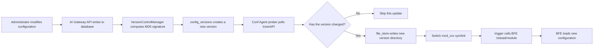

# Chapter 25: Configuration Hot Reload and Upgrade

## Chapter Goals

By the end of this chapter, readers will be able to:

- Understand the complete chain through which a configuration is delivered from the AI Gateway API management plane to the BFE data plane and takes effect;
- Understand how Conf Agent (configuration agent) polls the InnerAPI, compares versions, and persists configurations;
- Understand how BFE hot reload is triggered and how the monitoring port works;
- Know how to check the currently active configuration version;
- Perform a version rollback when the configuration is abnormal;
- Understand the precautions when upgrading components such as AI Gateway API, Dashboard, and Conf Agent.

---

## The Complete Configuration Delivery Flow

Rainway AI Gateway adopts an architecture of **control plane generation, data plane pull**. After an administrator modifies a configuration in the Dashboard or via the OpenAPI, the configuration is not pushed to BFE immediately. Instead, it is first persisted to the database by AI Gateway API, and then periodically pulled by Conf Agent, which is deployed alongside BFE, to trigger a hot reload. The complete flow is as follows:



Description of each step:

1. **Configuration write**: The administrator modifies resource configurations such as Provider, Cluster, API-Key, and rate limit policies through the Dashboard or OpenAPI, and AI Gateway API writes the changes to MySQL/SQLite.
2. **Configuration export and version control**: When Conf Agent requests the InnerAPI, AI Gateway API calls `VersionControlManager.ExportConfig` to generate the configuration and computes an MD5 signature after zeroing the version number field. If the signature matches the latest record in the `config_versions` table, it returns `Data: null`; otherwise, it generates a new timestamp-based version number and returns the full configuration. See `ai-gateway-api/design-docs/sys-design/details/InnerAPI配置导出与版本控制.md` for details.
3. **Conf Agent pull**: The `prober` in Conf Agent accesses the InnerAPI at the configured interval and compares the local version number with the remote version number.
4. **Local persistence**: When a version change is detected, `file_store` writes the new configuration to a directory named after the version number and atomically switches the `mod_{name}` symlink to point to the new directory.
5. **BFE hot reload**: `trigger` calls the `/reload/{module}` interface on the BFE monitoring port, and BFE re-reads the configuration files pointed to by the symlink, completing the hot reload.

This pull-based design means the control plane does not need to know the number of data plane nodes, and BFE can continue forwarding traffic with its locally cached configuration even when the control plane is temporarily unreachable.

---

## Conf Agent Polling and Version Comparison

Conf Agent is a key component in the configuration delivery chain; its architecture and responsibilities are described in `conf-agent/AGENTS.md`. Each configuration topic corresponds to one `Reloader`, and each `Reloader` contains three submodules:

- **prober** (`conf_reload/prober/`): responsible for polling the InnerAPI of AI Gateway API;
- **file_store** (`conf_reload/file_store/`): responsible for writing configurations to version directories and managing symlinks;
- **trigger** (`conf_reload/trigger/`): responsible for calling the BFE monitoring port to trigger a reload.

### Polling Configuration

Conf Agent's configuration file `conf/conf-agent.toml` defines the polling interval, the BFE configuration directory, the monitoring port, and the mapping of each `Reloader`. Key configuration items are as follows:

```toml
[Basic]
BFECluster              = "bfe-cluster-01"
BFEConfDir              = "/home/work/bfe/conf"
BFEMonitorPort          = 8421
BFEReloadTimeoutMs      = 1500
ReloadIntervalMs        = 5000
ConfServer              = "http://127.0.0.1:8183"
ConfTaskHeaders         = {"Authorization" = "Token {Token}"}
ConfTaskTimeoutMs       = 1500
```

`ReloadIntervalMs` determines the prober's polling cycle, with a default of 5000 milliseconds. Each `Reloader` sends a GET request to the corresponding InnerAPI at this interval, carrying the locally cached version number:

```http
GET /inner-api/v1/configs/mod-api-key?version=20260101120000 HTTP/1.1
Authorization: Token <token>
```

### Version Comparison

After receiving the request, AI Gateway API looks up the latest signature and version number for that topic in the `config_versions` table. If the requested `version` matches the latest version, it returns:

```json
{
  "ErrNum": 200,
  "ErrMsg": "success",
  "Data": null
}
```

After receiving an empty response, Conf Agent skips the write and hot reload. If the version has changed, the response contains the full configuration data with the new `version`, and Conf Agent enters the persistence and trigger flow.

### Local Version Directories and Symlinks

`file_store` allocates an independent directory for the new version's configuration (the directory name usually contains the version number). After the write completes, it atomically modifies the `mod_{name}` symlink to point to that directory. For example, the symlink corresponding to the `mod_ai_token_auth` topic is `mod_ai_token_auth`, and BFE always reads files such as `token_rule.data` through this symlink. This mechanism prevents BFE from reading half-written files and also preserves several historical version directories, making rollback easy.

---

## BFE Hot Reload Trigger Mechanism

At startup, BFE listens on a monitoring port (default 8421) to receive administrative requests, including the configuration hot reload interface `/reload/{module}`. After `file_store` completes the symlink switch, the `trigger` module of Conf Agent constructs the following request:

```bash
curl -X POST http://127.0.0.1:8421/reload/mod_ai_token_auth
```

Different configuration topics correspond to different BFE reload interfaces. Typical mappings are as follows:

| Configuration Topic | Conf Agent Reloader | BFE Hot Reload Interface |
|----------|---------------------|----------------|
| `route_rule` | `server_data_conf` | `/reload/server_data_conf` |
| `cluster_table` / `gslb.<cluster>` | `cluster_conf` | `/reload/gslb_data_conf` |
| `certificate` | `tls_conf` | `/reload/tls_conf` |
| `mod_api_key_rule` | `mod_ai_token_auth` | `/reload/mod_ai_token_auth` |
| `mod_body_process` | `mod_body_process` | `/reload/mod_body_process` |
| `mod_ai_rate_limit` | `mod_ai_rate_limit` | `/reload/mod_ai_rate_limit` |
| `ai_route` | `mod_ai_route` | `/reload/mod_ai_route` |
| `ai_cache_rule` | `mod_ai_cache` | `/reload/mod_ai_cache` |
| `traffic_mirror_rule` | `mod_traffic_mirror` | `/reload/mod_traffic_mirror` |
| `intent_config` | `mod_ai_intent` | `/reload/mod_ai_intent` |
| `ai_context_rule` | `mod_ai_context` | `/reload/mod_ai_context` |

These mappings are explicitly configured via the `BFEReloadAPI` field in the `[Reloaders.xxx]` section of `conf-agent/conf/conf-agent.toml`:

```toml
[Reloaders.mod_ai_token_auth]
BFEReloadAPI    = "/reload/mod_ai_token_auth"
ReloadFile      = "token_rule.data"
CopyFiles       = ["token_rule.data", "mod_ai_token_auth.conf"]
[[Reloaders.mod_ai_token_auth.NormalFileTasks]]
ConfAPI         = "/inner-api/v1/configs/mod-api-key"
ConfFileName    = "token_rule.data"
```

After receiving the reload request, BFE re-reads the configuration file of the corresponding module and updates the rule table in memory. Since the reload process does not involve restarting the process, existing connections are not interrupted.

### tls_conf Versioned Hot Reload and Client CA/CRL Relocation

Conf Agent distributes TLS configuration using a "versioned directory + symbolic link" approach: it writes the new configuration (including complete copies of the `client_ca` and `client_crl` directories, with directory entries copied recursively while preserving the relative directory structure) into a versioned directory `tls_conf_<version>`, then first calls `GET /reload/tls_conf?path=tls_conf_<version>` so that BFE performs a full load validation of this self-contained configuration unit **before** the symbolic link is switched. Only after BFE returns success does Conf Agent switch the `tls_conf` symlink and clean up expired versions.

`TLSConfReload` relocates every dependency of the versioned directory (`server_cert_conf` / `tls_rule_conf` and the client CA/CRL base directories) into the directory given by `path` together: if the client CA/CRL base directories were still read from the activated directory `<confRoot>/tls_conf/client_ca|crl`, a change involving a client CA that exists only in the version directory but not in the activated one would fail the reload at the `ClientCALoad` stage with "CA file not found". Conf Agent would therefore be unable to complete the switch, and subsequent reloads would fail again for the same reason. The relocation is thus a necessary condition for the self-contained validation of the version directory.

The relocation logic (see `TLSConfReload` / `tlsConfLoad` in `bfe/bfe_server/bfe_confdata_load.go`):

- When `ClientCABaseDir` / `ClientCRLBaseDir` are located under `<confRoot>/tls_conf`, they are relocated into the versioned directory together with `path`, consistent with how the cert / tls_rule files are handled (reusing `joinPath`, which keeps only the last path segment);
- Custom absolute paths outside `tls_conf` (such as an independently mounted `/mnt/ca`) do not match the prefix check and keep being read from the configured absolute path;
- Calls to `/reload/tls_conf` without `path`, as well as the BFE startup load path, are not relocated into the versioned directory, and the `ClientCALoad` / `ClientCRLLoad` validation logic is consistent — a reload still fails correctly when the version directory lacks a referenced copy.

---

## How to Check the Currently Active Configuration Version

In operations, it is often necessary to confirm which version of the configuration BFE has currently loaded. There are three ways to check:

### 1. Check the Conf Agent Log

After each successful write of a new version and hot reload trigger, Conf Agent prints a log, whose path is specified in the `[Logger]` section of `conf-agent.toml`. The log usually contains the version number, module name, and reload result.

### 2. Check the Symlink Target

Directly check the version directory that each module's symlink in the BFE configuration directory points to:

```bash
ls -l /home/work/bfe/conf/mod_ai_token_auth
# Example output:
# mod_ai_token_auth -> mod_ai_token_auth_20260102120000
```

The timestamp in the symlink target directory name is the currently active version.

### 3. Check the version Field in the Configuration File

Most exported configuration files contain a `version` field at the JSON root node, which can be read directly:

```bash
cat /home/work/bfe/conf/mod_ai_token_auth_20260102120000/token_rule.data | head -c 200
```

The output should contain `"version": "20260102120000"`.

### 4. Recognizing a Stuck Reload Loop

Conf Agent increments a consecutive-failure counter on every failed reload. When the store (`StoreFile2TmpDir`, writing the version directory / switching the symlink) or trigger (`TriggerBFEReload`, calling the BFE `/reload`) stage of the same Reloader keeps failing, a summary ERROR `reload keeps failing` is emitted every 10 consecutive failures, carrying the stage, the consecutive failure count, and the version, and stating "symlink not switched, bfe still runs old config" — that is, the symlink was not switched and BFE still runs the old configuration. Seeing this log means the reload loop is stuck; locate the cause by the stage field:

- `stage=StoreFile2TmpDir`: check disk space and write permissions on the BFE configuration directory, and for leftover half-finished directories without the `.conf-agent-version` marker;
- `stage=TriggerBFEReload`: check that the BFE monitor port (default 8421) is reachable, and look at the BFE-side reload validation errors (such as TLS configuration association check failures).

Once the offending stage is fixed, a single successful reload logs `reload recovered` and resets the counter.

---

## Version Rollback

When a new configuration causes abnormal BFE behavior, you can quickly roll back to the previous version. Since Conf Agent retains several historical version directories (the number is controlled by `VersionKeepCount`; by default the most recent few versions are kept), the rollback does not need to pull from the control plane again.

### Manual Rollback Steps

1. Identify the historical version directory to roll back to, e.g. `mod_ai_token_auth_20260101120000`.
2. Stop Conf Agent or temporarily increase the polling interval to prevent it from immediately switching the symlink back to the new version.
3. Manually modify the symlink to point to the target version directory:

```bash
cd /home/work/bfe/conf
ln -sfn mod_ai_token_auth_20260101120000 mod_ai_token_auth
```

4. Call the BFE monitoring port to reload that module:

```bash
curl -X POST http://127.0.0.1:8421/reload/mod_ai_token_auth
```

5. After verifying that the service has recovered, fix the configuration in the Dashboard and publish it again.

### Rollback Precautions

- Rollback only affects the local configuration of the data plane and does not write back to the database. If the control plane configuration itself is wrong, it still needs to be fixed in the Dashboard.
- When rolling back basic modules such as `server_data_conf`, `cluster_conf`, and `tls_conf`, confirm the compatibility between the versions of each module to avoid inconsistency between the routing and backend instance table versions.
- In production, it is recommended to verify on a small set of nodes before switching all nodes; see the canary release suggestions in the next section.

---

## Upgrade Precautions

AI Gateway involves multiple components, including the control plane (AI Gateway API), Dashboard, Conf Agent, BFE, and MySQL. Upgrades must be performed in the correct order, with attention to database migration and configuration compatibility. The following uses the v0.0.2 upgrade path from `ai-gateway-api/docs/zh_cn/upgrade.md` as an example.

### Database Migration

Upgrading AI Gateway API is often accompanied by database schema changes. Before upgrading, back up the database, and then execute the DDL according to the upgrade documentation. For example, v0.0.2 requires the following adjustments to the `users` table:

```sql
ALTER TABLE users ADD COLUMN `type` tinyint(1) NOT NULL DEFAULT '0' AFTER name;
ALTER TABLE users ADD COLUMN `scopes` varchar(2048) NOT NULL DEFAULT '' AFTER `type`;

UPDATE users SET type = 0, scopes = 'System' WHERE roles = 'admin';
UPDATE users SET type = 1, scopes = 'Support' WHERE roles = 'inner';

ALTER TABLE users CHANGE COLUMN `session_key` `ticket` varchar(20) NOT NULL DEFAULT '';
ALTER TABLE users CHANGE COLUMN `session_key_created_at` `ticket_created_at` datetime NOT NULL DEFAULT '0000-01-01 00:00:00';

ALTER TABLE users DROP COLUMN `roles`;

ALTER TABLE users DROP INDEX name_uni;
ALTER TABLE users ADD UNIQUE KEY `name_uni` (`name`, `type`);
```

Likewise, when upgrading to v0.0.10, existing databases need the following columns added to the Entity and Provider tables:

```sql
ALTER TABLE entities ADD COLUMN description VARCHAR(255) NOT NULL DEFAULT '';
ALTER TABLE providers ADD COLUMN protocol_paths JSON;
```

When upgrading to v0.0.11, the control-plane database needs 7 new tables (AI cache rules, semantic cache global settings, context compression rules and global settings, intent configuration, traffic mirror rules, and K8s instance pools), plus instance-supply-related columns added to the `providers` table:

```sql
-- Control-plane database (see ai-gateway-api/db_ddl.sql for the full definitions)
CREATE TABLE `k8s_pools` (
  `id` BIGINT AUTO_INCREMENT PRIMARY KEY,
  `name` VARCHAR(255) NOT NULL,
  `instances` JSON NOT NULL,
  `created_at` DATETIME NOT NULL DEFAULT CURRENT_TIMESTAMP,
  `updated_at` DATETIME NOT NULL DEFAULT CURRENT_TIMESTAMP ON UPDATE CURRENT_TIMESTAMP,
  UNIQUE KEY `uk_name` (`name`)
) ENGINE=InnoDB DEFAULT CHARSET=utf8mb4 COMMENT='K8s instance pool table';

CREATE TABLE `ai_cache_rules` (
  `id` BIGINT AUTO_INCREMENT PRIMARY KEY,
  `name` VARCHAR(128) NOT NULL,
  `cond` TEXT NOT NULL,
  `cache_key_strategy` VARCHAR(32) NOT NULL DEFAULT 'lastQuestion',
  `cache_ttl` INT NOT NULL DEFAULT 0,
  `max_body_bytes` BIGINT NOT NULL DEFAULT 1048576,
  `max_value_bytes` BIGINT NOT NULL DEFAULT 1048576,
  `enable_semantic_cache` TINYINT(1) NOT NULL DEFAULT 0,
  `created_at` DATETIME NOT NULL DEFAULT CURRENT_TIMESTAMP,
  `updated_at` DATETIME NOT NULL DEFAULT CURRENT_TIMESTAMP ON UPDATE CURRENT_TIMESTAMP,
  UNIQUE KEY `uk_name` (`name`)
) ENGINE=InnoDB DEFAULT CHARSET=utf8mb4 COMMENT='AI cache rule table';

CREATE TABLE `ai_cache_semantic_settings` (
  `id` BIGINT AUTO_INCREMENT PRIMARY KEY,
  `top_k` INT NOT NULL DEFAULT 1,
  `threshold` DOUBLE NOT NULL DEFAULT 0.15,
  `threshold_relation` VARCHAR(8) NOT NULL DEFAULT 'lt',
  `created_at` DATETIME NOT NULL DEFAULT CURRENT_TIMESTAMP,
  `updated_at` DATETIME NOT NULL ON UPDATE CURRENT_TIMESTAMP
) ENGINE=InnoDB DEFAULT CHARSET=utf8mb4 COMMENT='AI cache semantic global settings table (single row)';

CREATE TABLE `ai_context_rules` (
  `id` BIGINT AUTO_INCREMENT PRIMARY KEY,
  `cond` VARCHAR(1024) NOT NULL,
  `mode` VARCHAR(16) NOT NULL,
  `max_context_tokens` INT NOT NULL DEFAULT 0,
  `reserve_tokens` INT NOT NULL DEFAULT 0,
  `created_at` DATETIME NOT NULL DEFAULT CURRENT_TIMESTAMP,
  `updated_at` DATETIME NOT NULL DEFAULT CURRENT_TIMESTAMP ON UPDATE CURRENT_TIMESTAMP
) ENGINE=InnoDB DEFAULT CHARSET=utf8mb4 COMMENT='AI context compression rule table';

CREATE TABLE `ai_context_settings` (
  `id` BIGINT AUTO_INCREMENT PRIMARY KEY,
  `trigger_ratio` DOUBLE NOT NULL DEFAULT 0.7,
  `keep_latest_images` INT NOT NULL DEFAULT 2,
  `tool_result_max_chars` INT NOT NULL DEFAULT 2000,
  `thinking_policy` VARCHAR(32) NOT NULL DEFAULT 'trim-all-but-last',
  `chars_per_token` INT NOT NULL DEFAULT 4,
  `image_token_estimate` INT NOT NULL DEFAULT 1200,
  `rewrite_strength` VARCHAR(8) NOT NULL DEFAULT 'lite',
  `rewrite_protected_survival_rate` DOUBLE NOT NULL DEFAULT 0.95,
  `created_at` DATETIME NOT NULL DEFAULT CURRENT_TIMESTAMP,
  `updated_at` DATETIME NOT NULL DEFAULT CURRENT_TIMESTAMP ON UPDATE CURRENT_TIMESTAMP
) ENGINE=InnoDB DEFAULT CHARSET=utf8mb4 COMMENT='AI context compression global settings table (single row)';

CREATE TABLE `traffic_mirror_rules` (
  `id` BIGINT AUTO_INCREMENT PRIMARY KEY,
  `name` VARCHAR(128) NOT NULL,
  `cond` TEXT,
  `mirror_cluster` VARCHAR(128) NOT NULL,
  `percentage` INT NOT NULL DEFAULT 100,
  `remove_headers` TEXT,
  `set_headers` TEXT,
  `body_rewrites` TEXT,
  `path_rewrite` VARCHAR(1024),
  `created_at` DATETIME NOT NULL DEFAULT CURRENT_TIMESTAMP,
  `updated_at` DATETIME NOT NULL DEFAULT CURRENT_TIMESTAMP ON UPDATE CURRENT_TIMESTAMP,
  UNIQUE KEY `uk_name` (`name`)
) ENGINE=InnoDB DEFAULT CHARSET=utf8mb4 COMMENT='Traffic mirror rule table';

CREATE TABLE `intent_config` (
  `id` BIGINT NOT NULL AUTO_INCREMENT,
  `version` VARCHAR(32) NOT NULL,
  `min_confidence` DECIMAL(4,3) NOT NULL DEFAULT 0.600,
  `questions` TEXT NOT NULL,
  `created_at` DATETIME NOT NULL DEFAULT CURRENT_TIMESTAMP,
  `updated_at` DATETIME NOT NULL DEFAULT CURRENT_TIMESTAMP ON UPDATE CURRENT_TIMESTAMP,
  PRIMARY KEY (`id`)
) ENGINE=InnoDB DEFAULT CHARSET=utf8mb4 COMMENT='AI intent configuration table (single-row overwrite storage)';

ALTER TABLE providers
  ADD COLUMN `instance_source` VARCHAR(32) NOT NULL DEFAULT 'instance_pool' AFTER `instance_pool`,
  ADD COLUMN `k8s_pool_name` VARCHAR(255) NULL AFTER `instance_source`,
  ADD COLUMN `k8s_instance_pool` JSON NULL AFTER `k8s_pool_name`;

-- Existing databases that created ai_cache_rules in the first phase (without the semantic cache column) add the phase-2 column
ALTER TABLE ai_cache_rules
  ADD COLUMN `enable_semantic_cache` TINYINT(1) NOT NULL DEFAULT 0 AFTER `max_value_bytes`;
```

The reporting database (MySQL form) needs 10 columns added to the detail table `bfe_ai_request_log` and 3 columns added to the aggregate table `bfe_ai_metrics_1m` (cache-hit, traffic-mirror, and intent-related fields); ready-made statements are available at the top of `ai-gateway-api/db_ddl_report_mysql.sql`:

```sql
ALTER TABLE bfe_ai_request_log
  ADD COLUMN ai_cache_status VARCHAR(16) NOT NULL DEFAULT '' AFTER ai_auth_hit_quota_plans,
  ADD COLUMN mirror_hit TINYINT NOT NULL DEFAULT 0 AFTER ai_cache_status,
  ADD COLUMN mirror_cluster VARCHAR(128) NOT NULL DEFAULT '' AFTER mirror_hit,
  ADD COLUMN ai_intent_question VARCHAR(64) NOT NULL DEFAULT '' AFTER mirror_cluster,
  ADD COLUMN ai_intent_answer VARCHAR(64) NOT NULL DEFAULT '' AFTER ai_intent_question,
  ADD COLUMN ai_intent_confidence DOUBLE DEFAULT NULL AFTER ai_intent_answer,
  ADD COLUMN ai_intent_source VARCHAR(32) NOT NULL DEFAULT '' AFTER ai_intent_confidence,
  ADD COLUMN ai_intent_latency_us BIGINT DEFAULT NULL AFTER ai_intent_source,
  ADD COLUMN ai_intent_cache_hit TINYINT DEFAULT NULL AFTER ai_intent_latency_us,
  ADD COLUMN ai_intent_questions_version VARCHAR(32) NOT NULL DEFAULT '' AFTER ai_intent_cache_hit;

ALTER TABLE bfe_ai_metrics_1m
  ADD COLUMN ai_cache_status VARCHAR(16) NOT NULL DEFAULT '' AFTER ai_auth_reject_quota_plans_slot5,
  ADD COLUMN mirror_hit TINYINT NOT NULL DEFAULT 0 AFTER ai_cache_status,
  ADD COLUMN ai_intent_answer VARCHAR(64) NOT NULL DEFAULT '' AFTER mirror_hit;
```

For upgrades from v0.0.10.x to v0.0.11, a ready-made incremental script is available: `database/db_ddl_upgrade_to_0.0.11.sql` (archived in the `database/` directory and shipped with the release package). It covers the schema differences between the two versions (such as `clusters.epp_runtime`, the enlarged `api_keys.api_key` column with the `api_key_hash` lookup-hash column, and `model_prices.batch_discount`; `epp_assignments` no longer has the `primary_instance_id` column, as EPP assignment granularity converges to instance groups, with a rollback `ADD COLUMN` attached). The `api_key_hash` column must be backfilled by the application (HMAC-SHA256, which SQL cannot compute) before the unique key is switched following the manual steps at the end of the script.

Before upgrading, be sure to:

- Make a full backup of the production database;
- Verify the DDL and data migration scripts in a test environment first;
- Confirm that the starting version listed in the upgrade documentation includes your current version.

### Configuration Compatibility

A new version may introduce new configuration fields or change the authentication header format. For example, in v0.0.2, the Conf Agent request header changed from `Session {Token}` to `Token {Token}`:

```toml
# Old version
ConfTaskHeaders = {"Authorization" = "Session {Token}"}

# v0.0.2 and later
ConfTaskHeaders = {"Authorization" = "Token {Token}"}
```

After upgrading, check the following:

- Whether `ConfTaskHeaders` and `ExtraFileTaskHeaders` in `conf-agent.toml` are consistent with the authentication method of AI Gateway API;
- Whether the `Reloader` for newly added modules is configured correctly;
- Whether BFE supports the hot reload interface for the new modules.
- When upgrading to v0.0.11, whether `conf-agent.toml` already contains the four Reloaders `mod_ai_cache`, `mod_traffic_mirror`, `mod_ai_intent`, and `mod_ai_context` (the default configuration file of Conf Agent v0.0.8 already includes them; deployments reusing an old configuration file must compare and fill them in manually); otherwise the configurations of the corresponding modules will not be delivered.

### BFE Upgrade and the [AIKeyAffinity] Section

AI Key session affinity (Key Affinity, i.e. session→key binding and key penalty state) is part of BFE's core forwarding logic. Its Redis client is owned by bfe_server (`initAIKeyAffinityRedis` in `bfe_server/bfe_server.go`), and the configuration entry is the `[AIKeyAffinity]` section of `bfe.conf` (definition in `bfe_config/bfe_conf/conf_ai_key_affinity.go`); it does not depend on any module's Redis configuration. The full key set of this section is as follows:

| Key | Meaning | Default |
|----|------|--------|
| `Disabled` | Whether to disable AI Key session affinity | `true` |
| `ServiceConf` | Redis bns name or weighted bns list, resolved via `name_conf.data` | None (required when enabled) |
| `MaxIdle` | Maximum idle connections in the pool (must be > 0) | `10` |
| `MaxActive` | Maximum active connections in the pool (0 means unlimited) | `20` |
| `ConnectTimeoutMs` / `ReadTimeoutMs` / `WriteTimeoutMs` | Connect and read/write timeouts, in milliseconds (must be > 0) | `1000` |
| `Password` | Redis password; can be ignored when unset | None |

When `Disabled` is `true` (the default), no client is created: even if a cluster configures `SessionAffinity=true`, session affinity does not take effect, and BFE reports no error — it is silently disabled (fail-open). A client creation failure likewise only outputs a WARN log and keeps the client nil (fail-open), and does not block startup.

**Upgrade pitfall**: when upgrading from v1.8.8, if an existing deployment has Key Affinity enabled (cluster configuration `SessionAffinity=true`), you must add the `[AIKeyAffinity]` section to `bfe.conf` before upgrading (at least setting `Disabled=false` and `ServiceConf`); otherwise session affinity is silently disabled after the upgrade: no error, no alarm, and all session→key bindings and key penalty states become invalid. Reference configuration:

```toml
[AIKeyAffinity]
Disabled         = false
ServiceConf      = "redis_bns"
MaxIdle          = 10
MaxActive        = 20
ConnectTimeoutMs = 1000
ReadTimeoutMs    = 1000
WriteTimeoutMs   = 1000
#Password         = ""
```

### Component Version Compatibility

According to `upgrade.md`, the v0.0.2 upgrade requires:

- AI Gateway API upgraded to v0.0.2;
- Dashboard upgraded to v0.0.2;
- Conf Agent kept at v0.0.1 or a newer version.

Taking the upgrade to v0.0.11 as another example, the matching requirements are:

- AI Gateway API upgraded to v0.0.11;
- Dashboard upgraded to v0.0.11;
- Conf Agent upgraded to v0.0.8, with confirmation that the four Reloaders `mod_ai_cache`, `mod_traffic_mirror`, `mod_ai_intent`, and `mod_ai_context` are configured;
- BFE upgraded to v1.8.9, and evaluate as described in the previous section whether `bfe.conf` needs the `[AIKeyAffinity]` section added;
- ai-gateway-epp and the frontend released in lockstep with AI Gateway API (the EPP-related components are mutually incompatible; a mixed deployment results in all-no-match EPP matching with an explicit alert).

### Upgrading to v0.9.0 (BFE v1.9.0 + API v0.1.0)

Target component combination: BFE v1.9.0, AI Gateway API v0.1.0, Dashboard v0.1.0, Log Reader v1.6.0, ai-gateway-observability v0.1.0, and bfe-access-pb v0.3.18; conf-agent v0.0.8, ai-gateway-epp v0.3.0, and ai-gateway-controller v1.1.0 can be kept as-is (no Reloader changes are needed for conf-agent).

**Pre-upgrade checks (BFE v1.9.0 TLS stack migration — both are mandatory)**:

1. If `mod_header` rule files (`header_rule.data` and other `mod_header` rules) reference `%tls_ja3_raw` / `%tls_ja3_hash`, they will be **rejected as a whole file** after the upgrade — delete or rewrite the references first; session-log consumers (text `ses_tls_client_random` / `ses_tls_server_random`, pb3 `HandshakeTime`) must adjust to the fields disappearing;
2. For multi-instance deployments that ever enabled the Redis `[SessionCache]`: session resumption degrades to in-process session tickets and the handshake rate may rise — validate with load tests against the production topology. Also note that `HttpsBasic.MaxTlsVersion` now defaults to `VersionTLS13` (was `VersionTLS12`) and `MinTlsVersion` to `VersionTLS10` (was `VersionSSL30`), and `CipherSuites` line order no longer affects negotiation priority (pure whitelist); deployments without explicit settings may negotiate TLS 1.3 after upgrading.

**Database changes**:

- Control Plane database: no new tables or columns; the `providers.k8s_instance_pool` column definition has been removed from the DDL — **that column never shipped with v0.0.11**, so only databases that added the preview version need the manual step `ALTER TABLE providers DROP COLUMN k8s_instance_pool;`;
- Reporting database: `bfe_ai_request_log` grows from 99 to **101 columns**. For the MySQL form, take the two `ALTER TABLE ... ADD COLUMN ... AFTER ai_intent_questions_version` statements from the header of `db_ddl_report_mysql.sql`; for the Doris / StarRocks / ClickHouse forms, run the scripts under `sqls/upgrade/2026-10-30-issue-1479-price-miss-columns/` in ai-gateway-observability (for Doris, **add the columns before rebuilding** the unique-key table; ClickHouse Kafka engine tables cannot be ALTERed and the ingest pipeline must be rebuilt per the HOWTO; StarRocks is a plain `ADD COLUMN`). Note the Doris/StarRocks target columns must be `BOOLEAN` / `VARCHAR(32)` — a TINYINT target silently writes JSON booleans as NULL.

**Upgrade order (every step is mandatory)**: bfe-access-pb → BFE → AI Gateway API (may go first) + reporting-database DDL → Log Reader → observability schemas on the three backends → Dashboard. Consequences of reversing the order: log-reader fails writing 101 columns or the new columns stay NULL when the reporting database has not been altered; the three field groups (price-miss action, reasoning-content completion, penalty TTLs) all follow "BFE first, Control Plane second" — a reversed release shows "configurable in the console, not yet effective in the Data Plane".

The recommended upgrade order is:

1. Back up the database;
2. Execute the database migration scripts;
3. Replace the AI Gateway API executable;
4. Upgrade the Dashboard;
5. Upgrade Conf Agent as needed and check its configuration;
6. Observe the Conf Agent logs and BFE monitoring metrics to confirm that configurations are synchronizing normally.

### EPP Components Must Be Released in Lockstep

The EPP (endpoint pool) related components — ai-gateway-epp, ai-gateway-api (including the database schema upgrade), and the frontend — must be released in lockstep at the same version; old and new versions are mutually incompatible. During a mixed deployment, EPP matching returns all no-match and raises an explicit alert about the version mismatch, avoiding a silent degradation to plain routing.

### Hard Ordering Constraint: Upgrade BFE Before Enabling Encrypted Exports

Once the Control Plane supports encrypted configuration exports with enc$v1$ (`[Security].EncryptExports`), older BFE versions cannot parse the encrypted configuration. Therefore, all BFE instances must be fully upgraded first, and only after the Data Plane is confirmed ready should encrypted configuration export be enabled on the Control Plane; reversing the order causes unupgraded BFE instances to fail when pulling configurations.

### User Password Upgrade

For the user password storage upgrade (plaintext → bcrypt hash), the code must be upgraded first — never rewrite the data first: existing plaintext passwords are migrated lazily, being re-hashed and persisted on the first successful login. Bulk-rewriting password data ahead of the code upgrade would leave the old code unable to verify passwords and lock users out.

---

## Complete Operation Example

The following demonstrates the complete operation from modifying an API-Key quota in the Dashboard, through BFE hot reload taking effect, to a rollback.

### Scenario

An administrator adjusts the daily Token quota of `team-a` from 1 million to 2 million.

### Step 1: Modify the Quota in the Dashboard

After saving, AI Gateway API writes the new quota to the database, but it has not yet been delivered to BFE.

### Step 2: Wait for Conf Agent Polling

Within about 5 seconds, the `mod_ai_token_auth` Reloader of Conf Agent will detect the version change of the `mod-api-key` topic:

```bash
# Conf Agent log example (path depends on actual configuration)
tail -f /home/work/conf-agent/log/conf_agent.log
# [2026-01-02 12:00:05] [INFO] [prober.go:xxx] mod_ai_token_auth version changed: 20260101120000 -> 20260102120000
# [2026-01-02 12:00:05] [INFO] [file_store.go:xxx] write mod_ai_token_auth_20260102120000
# [2026-01-02 12:00:05] [INFO] [trigger.go:xxx] reload mod_ai_token_auth success
```

### Step 3: Check the Currently Active Version

```bash
ls -l /home/work/bfe/conf/mod_ai_token_auth
# mod_ai_token_auth -> mod_ai_token_auth_20260102120000

curl -X POST http://127.0.0.1:8421/reload/mod_ai_token_auth
# {"code":0,"message":"reload success"}
```

### Step 4: Verify the Quota Takes Effect

Send a test request carrying the API-Key of `team-a` and confirm that the limit has changed to 2 million.

### Step 5: Roll Back (If Needed)

If the business behaves abnormally after the quota adjustment, roll back quickly:

```bash
cd /home/work/bfe/conf
ln -sfn mod_ai_token_auth_20260101120000 mod_ai_token_auth
curl -X POST http://127.0.0.1:8421/reload/mod_ai_token_auth
ls -l mod_ai_token_auth
# mod_ai_token_auth -> mod_ai_token_auth_20260101120000
```

---

## Chapter Summary

- Rainway AI Gateway adopts a configuration synchronization model of control plane generation and data plane pull: administrator changes are first written to the database, and Conf Agent then pulls them from the InnerAPI periodically and triggers a BFE hot reload.
- `VersionControlManager` implements incremental synchronization based on MD5 signatures and the `config_versions` table; when the configuration has not changed, it returns `Data: null`, avoiding meaningless configuration delivery.
- Each `Reloader` of Conf Agent consists of three parts — prober, file_store, and trigger — responsible for pulling, persistence, and triggering the BFE hot reload, respectively.
- BFE completes hot reload through the `/reload/{module}` interface on the monitoring port, and each module has an independent hot reload path; `TLSConfReload` relocates the client CA/CRL base directories into the `?path=` versioned directory so that the self-contained version-directory validation can pass.
- The active version can be checked via the Conf Agent log, the symlink target, or the `version` field in the configuration file; the summary ERROR `reload keeps failing` (with the stage field) emitted every 10 consecutive reload failures is the signal for recognizing a stuck reload loop.
- Version rollback can use the historical version directories retained by Conf Agent: manually switch the symlink and reload, without restarting BFE.
- When upgrading, perform database migration, AI Gateway API replacement, Dashboard upgrade, and Conf Agent configuration checks in order, and pay attention to the compatibility of authentication headers, database DDL, and configuration fields (such as the `[AIKeyAffinity]` section of BFE `bfe.conf` and the `Reloader`s of new Conf Agent modules).
- The v0.0.10.x → v0.0.11 upgrade ships a ready-made incremental script `database/db_ddl_upgrade_to_0.0.11.sql` (including dropping `primary_instance_id` from `epp_assignments` and adding the `api_key_hash` column to `api_keys`); the EPP-related components (ai-gateway-epp, ai-gateway-api, schema, frontend) must be released in lockstep at the same version, and a mixed deployment produces all-no-match EPP matching with an explicit alert.
- Hard ordering constraints: upgrade all BFE instances before enabling encrypted configuration export enc$v1$ (`[Security].EncryptExports`) on the Control Plane; for the user password upgrade, upgrade the code first and never rewrite the data first — existing plaintext passwords are re-hashed lazily on the first successful login.

---

## References

- `ai-gateway-api/docs/zh_cn/upgrade.md`
- `ai-gateway-api/database/db_ddl_upgrade_to_0.0.11.sql`: incremental upgrade script for the Control Plane database from v0.0.10 to v0.0.11
- `ai-gateway-api/db_ddl.sql`
- `ai-gateway-api/db_ddl_report_mysql.sql`
- `conf-agent/AGENTS.md`
- `ai-gateway-api/design-docs/sys-design/details/InnerAPI配置导出与版本控制.md`
- `ai-gateway-api/design-docs/api-define/InnerAPI接口定义/00-overview.md`
- `bfe/docs/zh_cn/sys_design/tls_conf_reload_path.md`
- [Chapter 14: Configuration Export and Version Control Design](../design/chapter14-config-export-and-version-control.md)
