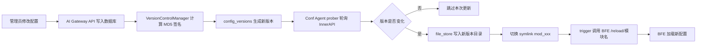

# 第二十五章 配置热加载与升级

## 本章目标

通过本章，读者将掌握：

- 一条配置从 AI Gateway API 管理面下发到 BFE 数据面生效的完整链路；
- Conf Agent（配置代理）如何轮询 InnerAPI、比对版本并持久化配置；
- BFE 热加载的触发方式与监控端口机制；
- 如何查看当前生效的配置版本；
- 配置异常时的版本回滚操作；
- AI Gateway API、Dashboard、Conf Agent 等组件升级时的注意事项。

---

## 配置生效的完整流程

壬远AI网关采用**控制面生成、数据面拉取**的架构。管理员在 Dashboard 或通过 OpenAPI 修改配置后，配置不会立即推送到 BFE，而是先由 AI Gateway API 持久化到数据库，再由部署在 BFE 侧的 Conf Agent 定期拉取并触发热加载。完整流程如下：



各环节说明：

1. **配置写入**：管理员通过 Dashboard 或 OpenAPI 修改 Provider、Cluster、API-Key、限流策略等资源配置，AI Gateway API 将变更写入 MySQL/SQLite。
2. **配置导出与版本控制**：当 Conf Agent 请求 InnerAPI 时，AI Gateway API 调用 `VersionControlManager.ExportConfig` 生成配置，并将版本号字段置零后计算 MD5 签名。若签名与 `config_versions` 表中最新记录相同，则返回 `Data: null`；否则生成新的时间戳版本号并返回全量配置。详见 `ai-gateway-api/design-docs/sys-design/details/InnerAPI配置导出与版本控制.md`。
3. **Conf Agent 拉取**：Conf Agent 中的 `prober` 按配置周期访问 InnerAPI，比较本地版本号与远程版本号。
4. **本地持久化**：当检测到版本变化时，`file_store` 将新配置写入以版本号命名的目录，并原子切换 `mod_{name}` 软链接指向新目录。
5. **BFE 热加载**：`trigger` 调用 BFE 监控端口的 `/reload/{module}` 接口，BFE 重新读取软链接指向的配置文件，完成热加载。

这种拉取式设计使控制面无需感知数据面节点数量，BFE 在控制面短暂不可达时仍可继续使用本地缓存配置转发流量。

---

## Conf Agent 轮询与版本比对

Conf Agent 是配置下发链路的关键组件，其架构与职责见 `conf-agent/AGENTS.md`。每个配置主题对应一个 `Reloader`，每个 `Reloader` 包含三个子模块：

- **prober**（`conf_reload/prober/`）：负责轮询 AI Gateway API 的 InnerAPI；
- **file_store**（`conf_reload/file_store/`）：负责将配置写入版本目录并管理软链接；
- **trigger**（`conf_reload/trigger/`）：负责调用 BFE 监控端口触发重载。

### 轮询配置

Conf Agent 的配置文件 `conf/conf-agent.toml` 中定义了轮询间隔、BFE 配置目录、监控端口以及各 `Reloader` 的映射关系。关键配置项如下：

```toml
[Basic]
BFECluster              = "bfe-cluster-01"
BFEConfDir              = "/home/work/bfe/conf"
BFEMonitorPort          = 8421
BFEReloadTimeoutMs      = 1500
ReloadIntervalMs        = 5000
ConfServer              = "http://127.0.0.1:8183"
ConfTaskHeaders         = {"Authorization" = "Token {Token}"}
ConfTaskTimeoutMs       = 1500
```

`ReloadIntervalMs` 决定 prober 的轮询周期，默认 5000 毫秒。每个 `Reloader` 会按此周期向对应的 InnerAPI 发起 GET 请求，并携带本地缓存的版本号：

```http
GET /inner-api/v1/configs/mod-api-key?version=20260101120000 HTTP/1.1
Authorization: Token <token>
```

### 版本比对

AI Gateway API 收到请求后，会在 `config_versions` 表中查找该主题的最新签名与版本号。若请求的 `version` 与最新版本一致，则返回：

```json
{
  "ErrNum": 200,
  "ErrMsg": "success",
  "Data": null
}
```

Conf Agent 收到空响应后跳过写入与热加载。若版本已变化，则返回包含新 `version` 的全量配置数据，Conf Agent 进入持久化与触发流程。

### 本地版本目录与软链接

`file_store` 为新版本配置分配独立目录（目录名通常包含版本号），写入完成后再原子地修改 `mod_{name}` 软链接指向该目录。例如 `mod_ai_token_auth` 主题对应的软链接为 `mod_ai_token_auth`，BFE 始终通过该软链接读取 `token_rule.data` 等文件。这种机制避免了 BFE 读取到半截文件，也保留了若干历史版本目录，便于回滚。

---

## BFE 热加载触发机制

BFE 在启动时会监听一个监控端口（默认 8421），用于接收管理类请求，其中就包括配置热加载接口 `/reload/{module}`。Conf Agent 的 `trigger` 模块在 `file_store` 完成软链接切换后，会构造如下请求：

```bash
curl -X POST http://127.0.0.1:8421/reload/mod_ai_token_auth
```

不同配置主题对应不同的 BFE 重载接口，典型映射如下：

| 配置主题 | Conf Agent Reloader | BFE 热加载接口 |
|----------|---------------------|----------------|
| `route_rule` | `server_data_conf` | `/reload/server_data_conf` |
| `cluster_table` / `gslb.<cluster>` | `cluster_conf` | `/reload/gslb_data_conf` |
| `certificate` | `tls_conf` | `/reload/tls_conf` |
| `mod_api_key_rule` | `mod_ai_token_auth` | `/reload/mod_ai_token_auth` |
| `mod_body_process` | `mod_body_process` | `/reload/mod_body_process` |
| `mod_ai_rate_limit` | `mod_ai_rate_limit` | `/reload/mod_ai_rate_limit` |
| `ai_route` | `mod_ai_route` | `/reload/mod_ai_route` |
| `ai_cache_rule` | `mod_ai_cache` | `/reload/mod_ai_cache` |
| `traffic_mirror_rule` | `mod_traffic_mirror` | `/reload/mod_traffic_mirror` |
| `intent_config` | `mod_ai_intent` | `/reload/mod_ai_intent` |
| `ai_context_rule` | `mod_ai_context` | `/reload/mod_ai_context` |

这些映射在 `conf-agent/conf/conf-agent.toml` 的 `[Reloaders.xxx]` 段中通过 `BFEReloadAPI` 字段显式配置：

```toml
[Reloaders.mod_ai_token_auth]
BFEReloadAPI    = "/reload/mod_ai_token_auth"
ReloadFile      = "token_rule.data"
CopyFiles       = ["token_rule.data", "mod_ai_token_auth.conf"]
[[Reloaders.mod_ai_token_auth.NormalFileTasks]]
ConfAPI         = "/inner-api/v1/configs/mod-api-key"
ConfFileName    = "token_rule.data"
```

BFE 收到重载请求后，会重新读取对应模块的配置文件并更新内存中的规则表。由于重载过程不涉及进程重启，因此不会中断现有连接。

### tls_conf 版本化热加载与 client CA/CRL 重定位

Conf Agent 下发 TLS 配置采用"版本目录 + 符号链接"方式：它将新版本配置（含 `client_ca`、`client_crl` 等目录的完整副本，目录项递归复制并保持相对目录结构）写入版本目录 `tls_conf_<version>`，然后先调用 `GET /reload/tls_conf?path=tls_conf_<version>`，让 BFE 在符号链接切换**之前**对版本目录这份自包含配置做一次完整加载校验；仅当 BFE 返回成功后，Conf Agent 才切换 `tls_conf` 软链接并清理过期版本。

`TLSConfReload` 会把版本目录中的全部依赖（`server_cert_conf` / `tls_rule_conf` 以及 client CA/CRL 基目录）都随 `path` 一起重定位到版本目录：client CA/CRL 基目录如果仍从已激活目录 `<confRoot>/tls_conf/client_ca|crl` 读取，当变更涉及"仅存在于版本目录、激活目录中不存在"的 client CA 时，reload 会在 `ClientCALoad` 阶段报"找不到 CA 文件"，Conf Agent 因此无法完成本次切换，后续 reload 也会以同样原因失败。因此重定位是版本目录自包含校验的必要条件。

重定位逻辑（`bfe/bfe_server/bfe_confdata_load.go` 中的 `TLSConfReload` / `tlsConfLoad`）：

- 当 `ClientCABaseDir` / `ClientCRLBaseDir` 位于 `<confRoot>/tls_conf` 之下时，随 `path` 一起重定位到版本目录，与 cert / tls_rule 文件的处理方式一致（复用 `joinPath` 取末段拼接）；
- 配置为 `tls_conf` 之外的自定义绝对路径（如独立挂载的 `/mnt/ca`）时不命中前缀判断，保持从配置的绝对路径读取；
- 不带 `path` 的 `/reload/tls_conf` 调用以及 BFE 启动加载路径不从版本目录重定位，`ClientCALoad` / `ClientCRLLoad` 校验逻辑一致——版本目录副本缺失时 reload 仍会正确报错。

---

## 如何查看当前生效配置版本

运维中经常需要确认 BFE 当前加载的是哪一版配置。可通过以下三种方式查看：

### 1. 查看 Conf Agent 日志

Conf Agent 在每次成功写入新版本并触发热加载后都会打印日志，路径由 `conf-agent.toml` 中的 `[Logger]` 段指定。日志中通常包含版本号、模块名与重载结果。

### 2. 查看软链接指向

直接查看 BFE 配置目录中各模块软链接指向的版本目录：

```bash
ls -l /home/work/bfe/conf/mod_ai_token_auth
# 输出示例：
# mod_ai_token_auth -> mod_ai_token_auth_20260102120000
```

软链接目标目录名中的时间戳即为当前生效版本。

### 3. 查看配置文件中的 version 字段

多数导出配置文件的 JSON 根节点包含 `version` 字段，可直接读取：

```bash
cat /home/work/bfe/conf/mod_ai_token_auth_20260102120000/token_rule.data | head -c 200
```

输出中应包含 `"version": "20260102120000"` 字样。

### 4. 识别 reload 循环卡死

Conf Agent 对每一次失败的 reload 都会累计连续失败计数；当同一 Reloader 的 store（`StoreFile2TmpDir`，写版本目录/软链切换）或 trigger（`TriggerBFEReload`，调用 BFE `/reload`）阶段持续失败时，每累计 10 次会输出一条 `reload keeps failing` 汇总 ERROR，包含 stage、连续失败次数与版本号，并指明"symlink not switched, bfe still runs old config"——即软链接未切换、BFE 仍在运行旧配置。看到该日志说明 reload 循环已卡死，应按 stage 字段定位：

- `stage=StoreFile2TmpDir`：检查 BFE 配置目录的磁盘空间与写权限、是否残留未带 `.conf-agent-version` 标记的半成品目录；
- `stage=TriggerBFEReload`：检查 BFE 监控端口（默认 8421）是否可达，以及 BFE 侧 reload 校验报错（如 TLS 配置关联检查失败）。

对应阶段修复后，reload 成功一次即会输出 `reload recovered` 并重置计数。

---

## 版本回滚操作

当新配置导致 BFE 行为异常时，可快速回滚到上一版本。由于 Conf Agent 保留了若干历史版本目录（数量由 `VersionKeepCount` 控制，默认通常保留最近几个版本），回滚无需重新从控制面拉取。

### 手动回滚步骤

1. 确认要回滚到的历史版本目录，例如 `mod_ai_token_auth_20260101120000`。
2. 停止 Conf Agent 或临时调大轮询间隔，避免它立即将软链接再次切回新版本。
3. 手动修改软链接指向目标版本目录：

```bash
cd /home/work/bfe/conf
ln -sfn mod_ai_token_auth_20260101120000 mod_ai_token_auth
```

4. 调用 BFE 监控端口重新加载该模块：

```bash
curl -X POST http://127.0.0.1:8421/reload/mod_ai_token_auth
```

5. 验证业务恢复后，在 Dashboard 修正配置并重新发布。

### 回滚注意事项

- 回滚仅影响数据面本地配置，不会回写数据库。若控制面配置本身有误，仍需在 Dashboard 中修正。
- 对 `server_data_conf`、`cluster_conf`、`tls_conf` 等基础模块回滚时，需确认各模块版本之间的兼容性，避免路由与后端实例表版本不一致。
- 生产环境建议先在小范围节点验证再全量切换，详见下一节灰度发布建议。

---

## 升级注意事项

AI Gateway 涉及控制面（AI Gateway API）、Dashboard、Conf Agent、BFE 以及 MySQL 等多个组件。升级时需按正确顺序执行，并关注数据库迁移与配置兼容性。以下以 `ai-gateway-api/docs/zh_cn/upgrade.md` 中 v0.0.2 的升级路径为例说明。

### 数据库迁移

AI Gateway API 升级时常伴随数据库表结构变更。升级前应备份数据库，然后按升级文档执行 DDL。例如 v0.0.2 需要对 `users` 表做以下调整：

```sql
ALTER TABLE users ADD COLUMN `type` tinyint(1) NOT NULL DEFAULT '0' AFTER name;
ALTER TABLE users ADD COLUMN `scopes` varchar(2048) NOT NULL DEFAULT '' AFTER `type`;

UPDATE users SET type = 0, scopes = 'System' WHERE roles = 'admin';
UPDATE users SET type = 1, scopes = 'Support' WHERE roles = 'inner';

ALTER TABLE users CHANGE COLUMN `session_key` `ticket` varchar(20) NOT NULL DEFAULT '';
ALTER TABLE users CHANGE COLUMN `session_key_created_at` `ticket_created_at` datetime NOT NULL DEFAULT '0000-01-01 00:00:00';

ALTER TABLE users DROP COLUMN `roles`;

ALTER TABLE users DROP INDEX name_uni;
ALTER TABLE users ADD UNIQUE KEY `name_uni` (`name`, `type`);
```

再如升级到 v0.0.10 时，存量库需要对 Entity 与 Provider 表补充以下列：

```sql
ALTER TABLE entities ADD COLUMN description VARCHAR(255) NOT NULL DEFAULT '';
ALTER TABLE providers ADD COLUMN protocol_paths JSON;
```

升级到 v0.0.11 时，控制面库需要新建 7 张表（AI 缓存规则、语义缓存全局设置、上下文压缩规则与全局设置、意图配置、流量镜像规则、K8s 实例池），并为 `providers` 表补充实例供给相关列：

```sql
-- 控制面库（完整定义以 ai-gateway-api/db_ddl.sql 为准）
CREATE TABLE `k8s_pools` (
  `id` BIGINT AUTO_INCREMENT PRIMARY KEY,
  `name` VARCHAR(255) NOT NULL,
  `instances` JSON NOT NULL,
  `created_at` DATETIME NOT NULL DEFAULT CURRENT_TIMESTAMP,
  `updated_at` DATETIME NOT NULL DEFAULT CURRENT_TIMESTAMP ON UPDATE CURRENT_TIMESTAMP,
  UNIQUE KEY `uk_name` (`name`)
) ENGINE=InnoDB DEFAULT CHARSET=utf8mb4 COMMENT='K8s 实例池表';

CREATE TABLE `ai_cache_rules` (
  `id` BIGINT AUTO_INCREMENT PRIMARY KEY,
  `name` VARCHAR(128) NOT NULL,
  `cond` TEXT NOT NULL,
  `cache_key_strategy` VARCHAR(32) NOT NULL DEFAULT 'lastQuestion',
  `cache_ttl` INT NOT NULL DEFAULT 0,
  `max_body_bytes` BIGINT NOT NULL DEFAULT 1048576,
  `max_value_bytes` BIGINT NOT NULL DEFAULT 1048576,
  `enable_semantic_cache` TINYINT(1) NOT NULL DEFAULT 0,
  `created_at` DATETIME NOT NULL DEFAULT CURRENT_TIMESTAMP,
  `updated_at` DATETIME NOT NULL DEFAULT CURRENT_TIMESTAMP ON UPDATE CURRENT_TIMESTAMP,
  UNIQUE KEY `uk_name` (`name`)
) ENGINE=InnoDB DEFAULT CHARSET=utf8mb4 COMMENT='AI缓存规则表';

CREATE TABLE `ai_cache_semantic_settings` (
  `id` BIGINT AUTO_INCREMENT PRIMARY KEY,
  `top_k` INT NOT NULL DEFAULT 1,
  `threshold` DOUBLE NOT NULL DEFAULT 0.15,
  `threshold_relation` VARCHAR(8) NOT NULL DEFAULT 'lt',
  `created_at` DATETIME NOT NULL DEFAULT CURRENT_TIMESTAMP,
  `updated_at` DATETIME NOT NULL ON UPDATE CURRENT_TIMESTAMP
) ENGINE=InnoDB DEFAULT CHARSET=utf8mb4 COMMENT='AI缓存语义全局设置表（单行）';

CREATE TABLE `ai_context_rules` (
  `id` BIGINT AUTO_INCREMENT PRIMARY KEY,
  `cond` VARCHAR(1024) NOT NULL,
  `mode` VARCHAR(16) NOT NULL,
  `max_context_tokens` INT NOT NULL DEFAULT 0,
  `reserve_tokens` INT NOT NULL DEFAULT 0,
  `created_at` DATETIME NOT NULL DEFAULT CURRENT_TIMESTAMP,
  `updated_at` DATETIME NOT NULL DEFAULT CURRENT_TIMESTAMP ON UPDATE CURRENT_TIMESTAMP
) ENGINE=InnoDB DEFAULT CHARSET=utf8mb4 COMMENT='AI上下文压缩规则表';

CREATE TABLE `ai_context_settings` (
  `id` BIGINT AUTO_INCREMENT PRIMARY KEY,
  `trigger_ratio` DOUBLE NOT NULL DEFAULT 0.7,
  `keep_latest_images` INT NOT NULL DEFAULT 2,
  `tool_result_max_chars` INT NOT NULL DEFAULT 2000,
  `thinking_policy` VARCHAR(32) NOT NULL DEFAULT 'trim-all-but-last',
  `chars_per_token` INT NOT NULL DEFAULT 4,
  `image_token_estimate` INT NOT NULL DEFAULT 1200,
  `rewrite_strength` VARCHAR(8) NOT NULL DEFAULT 'lite',
  `rewrite_protected_survival_rate` DOUBLE NOT NULL DEFAULT 0.95,
  `created_at` DATETIME NOT NULL DEFAULT CURRENT_TIMESTAMP,
  `updated_at` DATETIME NOT NULL DEFAULT CURRENT_TIMESTAMP ON UPDATE CURRENT_TIMESTAMP
) ENGINE=InnoDB DEFAULT CHARSET=utf8mb4 COMMENT='AI上下文压缩全局设置表（单行）';

CREATE TABLE `traffic_mirror_rules` (
  `id` BIGINT AUTO_INCREMENT PRIMARY KEY,
  `name` VARCHAR(128) NOT NULL,
  `cond` TEXT,
  `mirror_cluster` VARCHAR(128) NOT NULL,
  `percentage` INT NOT NULL DEFAULT 100,
  `remove_headers` TEXT,
  `set_headers` TEXT,
  `body_rewrites` TEXT,
  `path_rewrite` VARCHAR(1024),
  `created_at` DATETIME NOT NULL DEFAULT CURRENT_TIMESTAMP,
  `updated_at` DATETIME NOT NULL DEFAULT CURRENT_TIMESTAMP ON UPDATE CURRENT_TIMESTAMP,
  UNIQUE KEY `uk_name` (`name`)
) ENGINE=InnoDB DEFAULT CHARSET=utf8mb4 COMMENT='流量镜像规则表';

CREATE TABLE `intent_config` (
  `id` BIGINT NOT NULL AUTO_INCREMENT,
  `version` VARCHAR(32) NOT NULL,
  `min_confidence` DECIMAL(4,3) NOT NULL DEFAULT 0.600,
  `questions` TEXT NOT NULL,
  `created_at` DATETIME NOT NULL DEFAULT CURRENT_TIMESTAMP,
  `updated_at` DATETIME NOT NULL DEFAULT CURRENT_TIMESTAMP ON UPDATE CURRENT_TIMESTAMP,
  PRIMARY KEY (`id`)
) ENGINE=InnoDB DEFAULT CHARSET=utf8mb4 COMMENT='AI意图配置表（单行覆盖式存储）';

ALTER TABLE providers
  ADD COLUMN `instance_source` VARCHAR(32) NOT NULL DEFAULT 'instance_pool' AFTER `instance_pool`,
  ADD COLUMN `k8s_pool_name` VARCHAR(255) NULL AFTER `instance_source`,
  ADD COLUMN `k8s_instance_pool` JSON NULL AFTER `k8s_pool_name`;

-- 已在一期建过 ai_cache_rules（无语义缓存列）的存量库补加二期列
ALTER TABLE ai_cache_rules
  ADD COLUMN `enable_semantic_cache` TINYINT(1) NOT NULL DEFAULT 0 AFTER `max_value_bytes`;
```

报表库（MySQL 形态）需要为明细表 `bfe_ai_request_log` 补充 10 列、为聚合表 `bfe_ai_metrics_1m` 补充 3 列（缓存命中、流量镜像、意图相关字段），现成语句见 `ai-gateway-api/db_ddl_report_mysql.sql` 文件头：

```sql
ALTER TABLE bfe_ai_request_log
  ADD COLUMN ai_cache_status VARCHAR(16) NOT NULL DEFAULT '' AFTER ai_auth_hit_quota_plans,
  ADD COLUMN mirror_hit TINYINT NOT NULL DEFAULT 0 AFTER ai_cache_status,
  ADD COLUMN mirror_cluster VARCHAR(128) NOT NULL DEFAULT '' AFTER mirror_hit,
  ADD COLUMN ai_intent_question VARCHAR(64) NOT NULL DEFAULT '' AFTER mirror_cluster,
  ADD COLUMN ai_intent_answer VARCHAR(64) NOT NULL DEFAULT '' AFTER ai_intent_question,
  ADD COLUMN ai_intent_confidence DOUBLE DEFAULT NULL AFTER ai_intent_answer,
  ADD COLUMN ai_intent_source VARCHAR(32) NOT NULL DEFAULT '' AFTER ai_intent_confidence,
  ADD COLUMN ai_intent_latency_us BIGINT DEFAULT NULL AFTER ai_intent_source,
  ADD COLUMN ai_intent_cache_hit TINYINT DEFAULT NULL AFTER ai_intent_latency_us,
  ADD COLUMN ai_intent_questions_version VARCHAR(32) NOT NULL DEFAULT '' AFTER ai_intent_cache_hit;

ALTER TABLE bfe_ai_metrics_1m
  ADD COLUMN ai_cache_status VARCHAR(16) NOT NULL DEFAULT '' AFTER ai_auth_reject_quota_plans_slot5,
  ADD COLUMN mirror_hit TINYINT NOT NULL DEFAULT 0 AFTER ai_cache_status,
  ADD COLUMN ai_intent_answer VARCHAR(64) NOT NULL DEFAULT '' AFTER mirror_hit;
```

自 v0.0.10.x 升级至 v0.0.11 可直接使用仓库内置的增量脚本 `database/db_ddl_upgrade_to_0.0.11.sql`（归档于 `database/` 目录，随发布包下发）：覆盖两版之间的表结构差异（如 `clusters.epp_runtime`、`api_keys.api_key` 扩容与 `api_key_hash` 查询哈希列、`model_prices.batch_discount`；`epp_assignments` 去掉 `primary_instance_id`，EPP 分配粒度收敛为实例组，脚本附回滚 `ADD COLUMN`）。其中 `api_key_hash` 需应用侧回填（HMAC-SHA256，SQL 无法计算）后，再按脚本末尾的手动步骤切换唯一键。

升级前务必：

- 对生产库做完整备份；
- 在测试环境先验证 DDL 与数据迁移脚本；
- 确认升级文档中列出的起始版本是否包含当前版本。

### 配置兼容性

新版本可能引入新的配置字段或变更鉴权头格式。例如 v0.0.2 中，Conf Agent 请求头从 `Session {Token}` 调整为 `Token {Token}`：

```toml
# 旧版本
ConfTaskHeaders = {"Authorization" = "Session {Token}"}

# v0.0.2 及以后
ConfTaskHeaders = {"Authorization" = "Token {Token}"}
```

升级后应检查：

- `conf-agent.toml` 中的 `ConfTaskHeaders`、`ExtraFileTaskHeaders` 是否与 AI Gateway API 的鉴权方式一致；
- 新增模块的 `Reloader` 是否已正确配置；
- BFE 是否支持新模块的热加载接口。
- 升级到 v0.0.11 时，`conf-agent.toml` 是否已包含 `mod_ai_cache`、`mod_traffic_mirror`、`mod_ai_intent`、`mod_ai_context` 四个 Reloader（Conf Agent v0.0.8 的默认配置文件已带，沿用旧配置文件的部署需人工比对补齐），否则对应模块的配置不会下发。

### BFE 升级与 [AIKeyAffinity] 段

AI Key 会话保持（Key Affinity，即 session→key 绑定与 key 惩罚状态）属于 BFE 核心转发逻辑，其 Redis 客户端由 bfe_server 自持（`bfe_server/bfe_server.go` 中的 `initAIKeyAffinityRedis`），配置入口是 `bfe.conf` 的 `[AIKeyAffinity]` 段（定义见 `bfe_config/bfe_conf/conf_ai_key_affinity.go`），不依赖任何模块的 Redis 配置。该段的键全集如下：

| 键 | 含义 | 缺省值 |
|----|------|--------|
| `Disabled` | 是否关闭 AI Key 会话保持 | `true` |
| `ServiceConf` | Redis bns 名或加权 bns 列表，经 `name_conf.data` 解析 | 无（启用时必填） |
| `MaxIdle` | 连接池最大空闲连接数（须 >0） | `10` |
| `MaxActive` | 连接池最大活动连接数（0 表示不限） | `20` |
| `ConnectTimeoutMs` / `ReadTimeoutMs` / `WriteTimeoutMs` | 连接与读写超时，毫秒（须 >0） | `1000` |
| `Password` | Redis 密码，未设置可忽略 | 无 |

`Disabled` 为 `true`（缺省）时不创建客户端：即使 cluster 配置了 `SessionAffinity=true`，会话保持也不生效，且 BFE 不报错——fail-open 静默关闭。客户端创建失败同样只输出 WARN 日志并保持 nil（fail-open），不会阻断启动。

**升级陷阱**：从 v1.8.8 升级时，若存量部署已启用 Key Affinity（cluster 配置 `SessionAffinity=true`），必须在升级前于 `bfe.conf` 补充 `[AIKeyAffinity]` 段（至少设置 `Disabled=false` 与 `ServiceConf`），否则升级后会话保持被静默关闭：无报错、无告警，session→key 绑定与 key 惩罚状态全部失效。参考配置：

```toml
[AIKeyAffinity]
Disabled         = false
ServiceConf      = "redis_bns"
MaxIdle          = 10
MaxActive        = 20
ConnectTimeoutMs = 1000
ReadTimeoutMs    = 1000
WriteTimeoutMs   = 1000
#Password         = ""
```

### 组件版本配套

根据 `upgrade.md`，v0.0.2 升级需要：

- AI Gateway API 升级为 v0.0.2；
- Dashboard 升级为 v0.0.2；
- Conf Agent 保持 v0.0.1 或更新版本。

再以升级到 v0.0.11 为例，配套要求为：

- AI Gateway API 升级为 v0.0.11；
- Dashboard 升级为 v0.0.11；
- Conf Agent 升级为 v0.0.8，并确认 `mod_ai_cache`、`mod_traffic_mirror`、`mod_ai_intent`、`mod_ai_context` 四个 Reloader 已配置；
- BFE 升级为 v1.8.9，并按上一节说明评估 `bfe.conf` 是否需要补充 `[AIKeyAffinity]` 段；
- ai-gateway-epp 与前端随 AI Gateway API 同版本同步发布（EPP 相关组件互不兼容，混部将全 no-match 并显式告警）。

### 升级到 v0.9.0（BFE v1.9.0 + API v0.1.0）

目标组件组合为：BFE v1.9.0、AI Gateway API v0.1.0、Dashboard v0.1.0、Log Reader v1.6.0、ai-gateway-observability v0.1.0、bfe-access-pb v0.3.18；conf-agent v0.0.8、ai-gateway-epp v0.3.0、ai-gateway-controller v1.1.0 可继续使用（conf-agent 无需调整 Reloader）。

**升级前检查（BFE v1.9.0 TLS 栈迁移，两项必做）**：

1. `mod_header` 规则文件（`header_rule.data` 及其它 `mod_header` 规则）若引用 `%tls_ja3_raw` / `%tls_ja3_hash`，升级后会**整文件拒载**——须先删除或改写；会话日志消费方（文本 `ses_tls_client_random` / `ses_tls_server_random`、pb3 `HandshakeTime`）按字段消失调整；
2. 曾启用 Redis `[SessionCache]` 的多实例部署：会话恢复退化为进程内 session ticket，握手率可能上升，须按现网拓扑压测确认。同时注意 `HttpsBasic.MaxTlsVersion` 默认 `VersionTLS12` → `VersionTLS13`、`MinTlsVersion` 默认 `VersionSSL30` → `VersionTLS10`，`CipherSuites` 行序不再影响协商优先级（纯白名单），未显式配置的部署升级后客户端可能协商到 TLS 1.3。

**数据库变更**：

- 控制面库：无新增表/列；`providers.k8s_instance_pool` 列定义已从 DDL 移除——**该列从未随 v0.0.11 发布**，只有加过预览版的库需要手工执行 `ALTER TABLE providers DROP COLUMN k8s_instance_pool;`；
- 报表库：`bfe_ai_request_log` 99 → **101 列**。MySQL 形态在 `db_ddl_report_mysql.sql` 头部取两条 `ALTER TABLE ... ADD COLUMN ... AFTER ai_intent_questions_version` 语句；Doris / StarRocks / ClickHouse 形态按 `ai-gateway-observability` 的 `sqls/upgrade/2026-10-30-issue-1479-price-miss-columns/` 脚本执行（Doris 须**先加列、再重建**唯一键表；ClickHouse 的 Kafka 引擎表不能 ALTER，须按 HOWTO 重建导入链路；StarRocks 为纯 `ADD COLUMN`）。注意 Doris/StarRocks 目标列必须是 `BOOLEAN` / `VARCHAR(32)`，TINYINT 会把 JSON 布尔静默写成 NULL。

**升级顺序（缺一不可）**：bfe-access-pb → BFE → AI Gateway API（可先行）+ 报表库 DDL → Log Reader → observability 三后端 schema → Dashboard。顺序颠倒的后果：报表库未加列时 log-reader 写 101 列失败或新列恒 NULL；缺价动作、推理内容补齐、惩罚时长三组字段均为"bfe 先行、控制面后跟"，反序发布会出现"控制台已可配、数据面未生效"。

建议的升级顺序为：

1. 备份数据库；
2. 执行数据库迁移脚本；
3. 替换 AI Gateway API 可执行程序；
4. 升级 Dashboard；
5. 按需升级 Conf Agent 并检查配置；
6. 观察 Conf Agent 日志与 BFE 监控指标，确认配置正常同步。

### EPP 组件同版本同步发布

EPP（端点池）相关组件——ai-gateway-epp、ai-gateway-api（含数据库 schema 升级）与前端——必须同版本同步发布，新旧版本互不兼容。混部期间 EPP 匹配会全部 no-match，并以显式告警提示版本不齐，避免在不知情下降级为普通路由。

### 上线顺序硬约束：先升级 BFE，再开启加密导出

控制面导出配置支持 enc$v1$ 加密（`[Security].EncryptExports`）后，旧版本 BFE 无法解析加密配置。因此必须先全量升级 BFE、确认数据面全部就绪，再开启控制面导出配置加密；顺序颠倒会使未升级的 BFE 拉取配置失败。

### 用户口令升级

用户口令存储升级（明文 → bcrypt 哈希）必须先升级代码、禁止先刷数据：存量明文口令采用懒迁移策略，用户首次登录成功时即按需重哈希并落库。提前批量改写口令数据会导致旧代码无法校验、用户无法登录。

---

## 完整操作示例

以下演示从 Dashboard 修改 API-Key 配额到 BFE 热加载生效，再到回滚的完整操作。

### 场景

管理员将 `team-a` 的日 Token 配额从 100 万调整为 200 万。

### 步骤 1：在 Dashboard 修改配额

保存后，AI Gateway API 将新配额写入数据库，但尚未下发到 BFE。

### 步骤 2：等待 Conf Agent 轮询

约 5 秒内，Conf Agent 的 `mod_ai_token_auth` Reloader 会检测到 `mod-api-key` 主题版本变化：

```bash
# Conf Agent 日志示例（路径以实际配置为准）
tail -f /home/work/conf-agent/log/conf_agent.log
# [2026-01-02 12:00:05] [INFO] [prober.go:xxx] mod_ai_token_auth version changed: 20260101120000 -> 20260102120000
# [2026-01-02 12:00:05] [INFO] [file_store.go:xxx] write mod_ai_token_auth_20260102120000
# [2026-01-02 12:00:05] [INFO] [trigger.go:xxx] reload mod_ai_token_auth success
```

### 步骤 3：查看当前生效版本

```bash
ls -l /home/work/bfe/conf/mod_ai_token_auth
# mod_ai_token_auth -> mod_ai_token_auth_20260102120000

curl -X POST http://127.0.0.1:8421/reload/mod_ai_token_auth
# {"code":0,"message":"reload success"}
```

### 步骤 4：验证配额生效

通过测试请求携带 `team-a` 的 API-Key 发起调用，确认限额已变为 200 万。

### 步骤 5：回滚（如需要）

若发现配额调整后业务异常，可快速回滚：

```bash
cd /home/work/bfe/conf
ln -sfn mod_ai_token_auth_20260101120000 mod_ai_token_auth
curl -X POST http://127.0.0.1:8421/reload/mod_ai_token_auth
ls -l mod_ai_token_auth
# mod_ai_token_auth -> mod_ai_token_auth_20260101120000
```

---

## 本章小结

- 壬远AI网关采用控制面生成、数据面拉取的配置同步模式：管理员变更先写入数据库，Conf Agent 再按周期从 InnerAPI 拉取并触发 BFE 热加载。
- `VersionControlManager` 基于 MD5 签名与 `config_versions` 表实现增量同步；配置未变化时返回 `Data: null`，避免无意义的配置下发。
- Conf Agent 的每个 `Reloader` 由 prober、file_store、trigger 三部分组成，分别负责拉取、持久化与触发 BFE 热加载。
- BFE 通过监控端口的 `/reload/{module}` 接口完成热加载，各模块对应独立的热加载路径；`TLSConfReload` 会把 client CA/CRL 基目录随 `?path=` 版本目录重定位，保证版本目录自包含校验可通过。
- 生效版本可通过 Conf Agent 日志、软链接指向或配置文件中的 `version` 字段查看；连续 reload 失败时每 10 次输出的 `reload keeps failing` 汇总 ERROR（含 stage 字段）是识别 reload 循环卡死的信号。
- 版本回滚可利用 Conf Agent 保留的历史版本目录手动切换软链接并重新加载，无需重启 BFE。
- 升级时需按顺序执行数据库迁移、AI Gateway API 替换、Dashboard 升级与 Conf Agent 配置检查，并注意鉴权头、数据库 DDL 与配置字段（如 BFE `bfe.conf` 的 `[AIKeyAffinity]` 段、Conf Agent 新模块的 `Reloader`）的兼容性。
- v0.0.10.x → v0.0.11 有现成的增量升级脚本 `database/db_ddl_upgrade_to_0.0.11.sql`（含 `epp_assignments` 删列、`api_keys` 增 `api_key_hash` 列等）；EPP 相关组件（ai-gateway-epp、ai-gateway-api、schema、前端）必须同版本同步发布，混部全 no-match 并显式告警。
- 上线顺序硬约束：先全量升级 BFE，再开启控制面导出配置 enc$v1$ 加密（`[Security].EncryptExports`）；用户口令升级先升代码、禁止先刷数据，存量明文首次登录成功即懒迁移重哈希。

---

## 参考文档

- `ai-gateway-api/docs/zh_cn/upgrade.md`
- `ai-gateway-api/database/db_ddl_upgrade_to_0.0.11.sql`：v0.0.10 → v0.0.11 控制面库增量升级脚本
- `ai-gateway-api/db_ddl.sql`
- `ai-gateway-api/db_ddl_report_mysql.sql`
- `conf-agent/AGENTS.md`
- `ai-gateway-api/design-docs/sys-design/details/InnerAPI配置导出与版本控制.md`
- `ai-gateway-api/design-docs/api-define/InnerAPI接口定义/00-overview.md`
- `bfe/docs/zh_cn/sys_design/tls_conf_reload_path.md`
- [第十四章 配置导出与版本控制设计](../design/chapter14-config-export-and-version-control.md)
